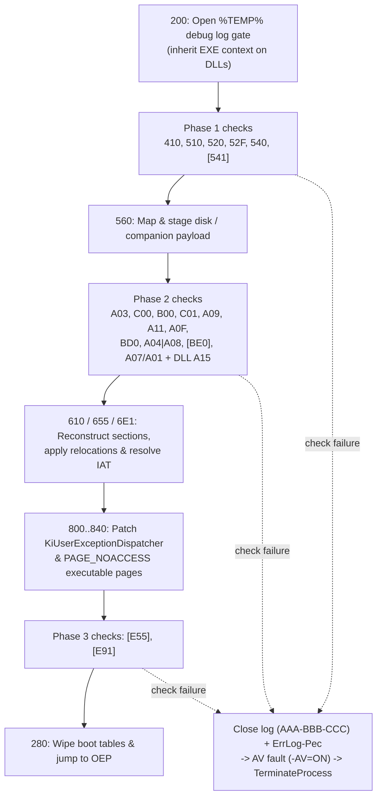

# Design

Arare encodes standard Windows PE inputs into the four structural layout families documented in [CrackProof for Windows internals](https://app.gitbook.com/s/PuKTEy2soDgSB3qfWACy/) (`pe32`, `pe64-classic`, `pe64-modern`, and `legacy-dll`) and embeds its own MIT-licensed native and managed runtime loaders.

## Workspace architecture

| Component | Responsibility | License |
| --- | --- | --- |
| `arare-pe` | Checked PE32/PE32+ parser and file-offset / RVA mapper | MIT |
| `arare-codec` | Rolling XOR/rotation ciphers, AES-CBC schedules, bytecode VM stubs, Huffman/LZ | MIT |
| `arare-runtime`, `runtime/src`, `runtime/arch` | Embedded C/ASM native reconstruction, check helpers, and page-fault dispatcher | MIT |
| `runtime/managed` | Embedded C# before-JIT module initializer and memory adapters | MIT |
| `arare-engine` | Profile encoders, placeholder trimming, loader synthesis, managed orchestration | AGPL-3.0-only |
| `tools/managed` | Standalone ECMA-335 metadata rewriter and IL wrapper generator | AGPL-3.0-only |
| `arare-cli` / `gui` | CLI commands, atomic output writes, and WPF batch front-end | AGPL-3.0-only |
| `verification/senbei-oracle` | Isolated test crate linking unchanged Senbei 1.3.1 outside the workspace | AGPL-3.0-only |

`arare_engine::protect(input: &[u8], options: &Options) -> Result<Artifact, Error>` drives packing. `Options` configures nine fields: `profile`, `seed`, `compression`, `storage`, `checks`, `page_encrypt`, `scribble`, `errlog`, and `antidebug_av`.

## Store-once encoding and section trimming

Stages are encoded in reverse dependency order so checksums and derived stage keys feed earlier headers without private Arare-only trailers:

* **Placeholder raw trimming (`trim_placeholder_raw`):** original application sections are compressed once into `.arpay` rather than duplicated in full on disk. Physical `SizeOfRawData` on original sections is trimmed down to the file-aligned prefix needed for unencrypted disk overlays (`export` directory, `CLR` header and `COR20` metadata/resource streams, `TLS` directory/template, loader `preserved_ranges`, and x64 companion-TLS jump patches). Sections carrying nonzero initialized bytes past `VirtualSize` remain untrimmed while zero alignment tails are dropped.
* **Single-copy PE resources:** PE resources (`DataDirectory[2]`) are tracked in `Startup.resources` for relocation and companion-TLS overlap checks while staying out of `LoaderPatch.preserved_ranges`, so resources are stored once inside `.arpay` and restored with the payload.
* **Import recovery:** `copy_imports` recovers by-name hint/name entries whether thunks store bare RVAs or full virtual addresses (`ImageBase + RVA`).

## Runtime execution flow

Native outputs embed two manually mapped helper DLLs (environment checks and page protection, mirroring the commercial `HtpecIt` / `HtdpStub2` split with zeroed MZ/PE headers and no PEB module-list entry); managed outputs carry both x86 and x64 helper pairs and select at startup:

* **Stage `410` debugger checks and AV response:** native `410` checks `IsDebuggerPresent`, `PEB.BeingDebugged`, `NtGlobalFlag`, hardware debug registers (`DR0`..`DR3`, `DR7`), and kernel-backed `NtQueryInformationProcess` (`ProcessDebugPort`, `ProcessDebugFlags`, `ProcessDebugObjectHandle`). On native EXEs (`--antidebug-av=on` by default), `ar_reject` raises `EXCEPTION_ACCESS_VIOLATION` and faults on null before `TerminateProcess` (managed modules call `TerminateProcess` directly).
* **Host markers (`A11` / `A15`):** `A15` is logged on native DLLs as a pure sequencer marker with no check body when `host-process` is enabled. `A11` checks for cooperative Arare host sections (`.arldr` or `.armclr`) plus an optional runtime stamp rather than commercial `peC` / `KeRnEl32.dLl` markers.
* **On-fault page decryption and stage `280` cleanup:** Arare generates per-build page-cipher bytecode and schedules, installs one shared process-wide `KiUserExceptionDispatcher` hook across compatible modules, and erases spent import maps, helper blobs, and boot descriptors before jumping to OEP at `280`.

## Experimental kernel provider and remaining commercial gaps

`kernel/` contains an independently written experimental driver project excluded from Cargo builds and `arare protect`. Remaining differences from commercial CrackProof builds include exact conditions for checks only partially observed in samples, host-directory admission, unmapped `E`-series check objects, periodic post-boot module re-scanning, a verified commercial default-check matrix, and standalone Windows 10 test runs.
