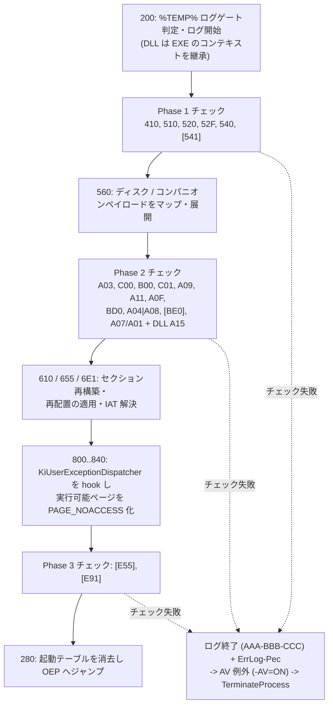

# 設計

Arare は標準的な Windows PE 入力を [CrackProof for Windows の内部構造](https://app.gitbook.com/s/DDUo0VKfH9uzyTcguGIx/)で解説されている4種類の構造レイアウト系統（`pe32`、`pe64-classic`、`pe64-modern`、`legacy-dll`）へ符号化し、MIT ライセンスの独自ネイティブ／マネージドランタイムローダーを組み込みます。

## ワークスペース構成

| コンポーネント | 役割 | ライセンス |
| --- | --- | --- |
| `arare-pe` | 境界検査付き PE32/PE32+ パーサーおよびファイルオフセット／RVA マッパー | MIT |
| `arare-codec` | ローリング XOR／ローテーション暗号、AES-CBC スケジュール、バイトコード VM スタブ、Huffman/LZ | MIT |
| `arare-runtime`, `runtime/src`, `runtime/arch` | 組み込み C/ASM ネイティブ再構築処理、環境チェックヘルパー、オンデマンドページ復号ハンドラー | MIT |
| `runtime/managed` | 組み込み C# の JIT 前モジュール初期化子およびメモリアダプター | MIT |
| `arare-engine` | プロファイルエンコーダー、プレースホルダー切り詰め、ローダー合成、マネージド統合制御 | AGPL-3.0-only |
| `tools/managed` | 独立した ECMA-335 メタデータ書き換えツールおよび IL ラッパー生成器 | AGPL-3.0-only |
| `arare-cli` / `gui` | CLI コマンド、アトミックな出力書き込み、WPF バッチフロントエンド | AGPL-3.0-only |
| `verification/senbei-oracle` | ワークスペース外で無改変の Senbei 1.3.1 をリンクする分離テストクレート | AGPL-3.0-only |

パック処理は `arare_engine::protect(input: &[u8], options: &Options) -> Result<Artifact, Error>` が駆動します。`Options` は `profile`、`seed`、`compression`、`storage`、`checks`、`page_encrypt`、`scribble`、`errlog`、`antidebug_av` の9フィールドで構成されます。

## 単一格納エンコーディングとセクション切り詰め

Arare 専用の独自トレーラーを持たずにチェックサムや派生ステージ鍵を前段のヘッダーへ反映できるよう、各ステージは依存関係の逆順に符号化されます。

* **プレースホルダー生データの切り詰め（`trim_placeholder_raw`）:** 元のアプリケーションセクションは `.arpay` 内に1回だけ圧縮格納され、ディスク上に平文のまま二重保持されることはありません。元セクションの物理 `SizeOfRawData` は、ディスク上に平文で残す必要があるデータを含むファイルアライメント済み先頭領域（エクスポートディレクトリ、`CLR` ヘッダーと `COR20` メタデータ／リソースストリーム、`TLS` ディレクトリ／テンプレート、ローダーの `preserved_ranges`、x64 コンパニオン TLS ジャンプパッチ）まで切り詰められます。`VirtualSize` を超えて非ゼロの初期化バイトを持つセクションは切り詰めず、ゼロ埋めのアライメント末尾のみを除去します。
* **PE リソースの単一保持:** PE リソース（`DataDirectory[2]`）は再配置およびコンパニオン TLS 重複検査のために `Startup.resources` で追跡されますが、`LoaderPatch.preserved_ranges` からは除外されるため、`.arpay` 内に1度だけ格納されてペイロードとともに復元されます。
* **インポート復元:** `copy_imports` は、サンクが素の RVA を保持している場合でも仮想アドレス（`ImageBase + RVA`）を保持している場合でも、名前指定インポートの hint/name エントリを復元します。

## ランタイムの実行フロー

ネイティブ出力には手動マップされる2つのヘルパー DLL（商用の `HtpecIt` / `HtdpStub2` 分離構造に対応する環境チェック用・ページ保護用モジュールで、MZ/PE ヘッダーはゼロ消去され PEB モジュールリストにも登録されません）が組み込まれます。マネージド出力は x86 と x64 の両方のヘルパーペアを保持し、起動時に実行アーキテクチャに応じて選択します。

* **ステージ `410` のデバッガー検査と AV 応答:** ネイティブの `410` は `IsDebuggerPresent`、`PEB.BeingDebugged`、`NtGlobalFlag`、ハードウェアデバッグレジスター（`DR0`..`DR3`、`DR7`）、およびカーネル照会を伴う `NtQueryInformationProcess`（`ProcessDebugPort`、`ProcessDebugFlags`、`ProcessDebugObjectHandle`）を検査します。ネイティブ EXE（既定で `--antidebug-av=on`）では、`ar_reject` が `TerminateProcess` の前に `EXCEPTION_ACCESS_VIOLATION` を発生させ、さらに null アドレスへのアクセス違反を起こします（マネージドモジュールは直接 `TerminateProcess` を呼び出します）。
* **ホストマーカー（`A11` / `A15`）:** `A15` は `host-process` 有効時のネイティブ DLL において、検査本体を持たない純粋なシーケンサーマーカーとしてログ記録されます。`A11` は商用版の `peC` / `KeRnEl32.dLl` マーカーではなく、協調動作する Arare のホストセクション（`.arldr` または `.armclr`）および任意の実行時スタンプを検査します。
* **オンデマンドページ復号とステージ `280` のクリーンアップ:** Arare はビルドごとにページ暗号のバイトコードと鍵スケジュールを生成し、互換モジュール間で共有されるプロセス単位の `KiUserExceptionDispatcher` hook を1つ設置します。その後、ステージ `280` で OEP へジャンプする前に、使用済みのインポートマップ、ヘルパーデータ、起動記述子をメモリから消去します。

## 実験的カーネルプロバイダーと商用版との残存差分

`kernel/` には独自に実装された実験的なドライバープロジェクトが含まれていますが、Cargo ビルドおよび `arare protect` からは除外されています。商用の CrackProof ビルドとの主な残存差分として、サンプル上で一部のみ観測されているチェックの厳密な発火条件、ホストディレクトリによる許可判定、未解明の `E` 系チェック項目、起動完了後の定期的なモジュール再走査、商用版の既定チェック構成の網羅的な確認、および Windows 10 実機単体でのテスト実行が挙げられます。
