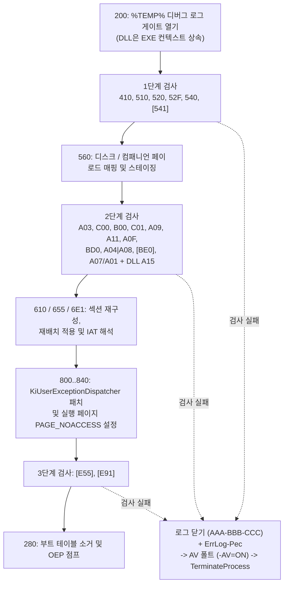

# 설계

Arare는 표준 Windows PE 입력을 [CrackProof Windows 내부 구조](https://app.gitbook.com/s/FlY9nVrA6FxLQBrkLIc2/)에 문서화된 4가지 구조 레이아웃 계열(`pe32`, `pe64-classic`, `pe64-modern`, `legacy-dll`)로 인코딩하며, 자체 구현한 MIT 라이선스 네이티브 및 관리형 런타임 로더를 내장합니다.

## 워크스페이스 아키텍처

| 구성 요소 | 역할 | 라이선스 |
| --- | --- | --- |
| `arare-pe` | 범위 검사를 수행하는 PE32/PE32+ 파서 및 파일 오프셋 / RVA 매퍼 | MIT |
| `arare-codec` | 롤링 XOR/회전 암호, AES-CBC 키 스케줄, 바이트코드 VM 스텁, Huffman/LZ 압축 | MIT |
| `arare-runtime`, `runtime/src`, `runtime/arch` | 내장용 C/ASM 네이티브 섹션 재구성기, 환경 검사 헬퍼 및 온디맨드 페이지 복호화 예외 핸들러 | MIT |
| `runtime/managed` | JIT 이전에 실행되는 내장 C# 모듈 초기화기 및 메모리 어댑터 | MIT |
| `arare-engine` | 프로필 인코더, 자리표시자 트리밍, 로더 합성 및 관리형 패킹 오케스트레이션 | AGPL-3.0-only |
| `tools/managed` | 독립 실행형 ECMA-335 메타데이터 재작성기 및 IL 래퍼 생성기 | AGPL-3.0-only |
| `arare-cli` / `gui` | CLI 명령어, 원자적 출력 파일 기록 및 WPF 배치 프런트엔드 | AGPL-3.0-only |
| `verification/senbei-oracle` | 워크스페이스 외부에서 수정하지 않은 Senbei 1.3.1을 링크해 검증하는 격리 테스트 크레이트 | AGPL-3.0-only |

패킹 작업은 `arare_engine::protect(input: &[u8], options: &Options) -> Result<Artifact, Error>` 함수가 수행합니다. `Options` 구조체는 `profile`, `seed`, `compression`, `storage`, `checks`, `page_encrypt`, `scribble`, `errlog`, `antidebug_av`의 9개 필드로 구성됩니다.

## 단일 저장 인코딩 및 섹션 트리밍

별도의 비공개 Arare 전용 트레일러를 두지 않고도 체크섬과 파생 단계 키를 앞선 헤더에 기록할 수 있도록 각 단계는 의존성 역순으로 인코딩됩니다.

* **자리표시자 원시 데이터 트리밍 (`trim_placeholder_raw`):** 원본 애플리케이션 섹션은 디스크에 중복으로 전체 복사본을 남기지 않고 `.arpay` 안에 한 번만 압축 저장됩니다. 원본 섹션의 물리 `SizeOfRawData`는 평문 디스크 오버레이에 꼭 필요한 파일 정렬 접두 구간(`export` 디렉터리, `CLR` 헤더 및 `COR20` 메타데이터/리소스 스트림, `TLS` 디렉터리/템플릿, 로더 `preserved_ranges`, x64 컴패니언 TLS 점프 패치)까지만 남기고 잘라냅니다. `VirtualSize` 너머에 0이 아닌 초기화된 바이트가 있는 섹션은 잘라내지 않고 유지하며, 0으로 채워진 정렬 패딩 꼬리만 제거합니다.
* **PE 리소스 단일 저장:** PE 리소스(`DataDirectory[2]`)는 재배치 및 컴패니언 TLS 영역 겹침 검사를 위해 `Startup.resources`에서 추적하되 `LoaderPatch.preserved_ranges`에서는 제외하므로, `.arpay` 내부에 한 번만 저장된 뒤 페이로드 복원 시 함께 복구됩니다.
* **임포트 복구:** `copy_imports`는 썽크(thunk)가 순수 RVA를 담고 있든 전체 가상 주소(`ImageBase + RVA`)를 담고 있든 관계없이 이름 기반 hint/name 엔트리를 복구합니다.

## 런타임 실행 흐름

네이티브 출력에는 수동 매핑되는 헬퍼 DLL 2개(환경 검사용 및 페이지 보호용으로 상용 `HtpecIt` / `HtdpStub2` 분할 구조를 재현하며, MZ/PE 헤더를 0으로 지우고 PEB 모듈 목록에 등록하지 않음)가 내장됩니다. 관리형 출력에는 x86 및 x64 헬퍼 쌍이 모두 포함되며 시작 시 프로세스 비트 수에 맞춰 선택됩니다.

* **`410` 단계 디버거 검사 및 AV 응답:** 네이티브 `410` 단계는 `IsDebuggerPresent`, `PEB.BeingDebugged`, `NtGlobalFlag`, 하드웨어 디버그 레지스터(`DR0`..`DR3`, `DR7`), 커널 기반 `NtQueryInformationProcess`(`ProcessDebugPort`, `ProcessDebugFlags`, `ProcessDebugObjectHandle`)를 검사합니다. 네이티브 EXE(기본값 `--antidebug-av=on`)에서는 `ar_reject`가 `EXCEPTION_ACCESS_VIOLATION`을 발생시키고 널 포인터 폴트를 일으킨 뒤 `TerminateProcess`를 호출합니다(관리형 모듈은 곧바로 `TerminateProcess` 호출).
* **호스트 마커 (`A11` / `A15`):** `A15`는 `host-process`가 활성화된 네이티브 DLL에서 실제 검사 본문 없이 기록되는 순수 시퀀서 마커입니다. `A11`은 상용 빌드의 `peC` / `KeRnEl32.dLl` 마커 대신 협력형 Arare 호스트 섹션(`.arldr` 또는 `.armclr`)과 선택적 런타임 스탬프를 확인합니다.
* **온디맨드 페이지 복호화 및 `280` 단계 정리:** Arare는 빌드마다 고유한 페이지 암호 바이트코드와 키 스케줄을 생성하고, 호환 모듈 간에 프로세스 전역으로 공유되는 단일 `KiUserExceptionDispatcher` hook을 설치하며, `280` 단계에서 OEP로 점프하기 직전에 사용이 끝난 임포트 맵, 헬퍼 데이터, 부트 디스크립터를 메모리에서 소거합니다.

## 실험용 커널 프로바이더 및 상용 빌드와의 차이

`kernel/` 디렉터리에는 독자적으로 작성한 실험용 드라이버 프로젝트가 있으며 Cargo 빌드와 `arare protect`에서는 제외되어 있습니다. 상용 CrackProof 빌드와 남아 있는 차이점으로는 샘플에서 일부만 관찰된 검사의 세부 발동 조건, 호스트 디렉터리 허용 규칙, 아직 매핑되지 않은 `E` 계열 검사 객체, 로더 초기화 완료 후 주기적 모듈 재스캔, 상용 기본 검사 매트릭스의 완전한 대조 검증, Windows 10 단독 환경 테스트가 있습니다.
