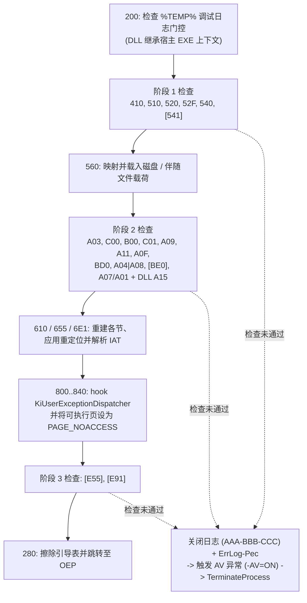

# 架构设计

Arare 将标准 Windows PE 输入编码为 [CrackProof Windows 内部机制](https://app.gitbook.com/s/fEb9nKPvKsjkPAHMUbOt/) 中记录的四种结构布局族（`pe32`、`pe64-classic`、`pe64-modern` 与 `legacy-dll`），并嵌入自行实现的 MIT 许可原生与托管运行时加载器。

## 工作区架构

| 组件 | 职责 | 许可证 |
| --- | --- | --- |
| `arare-pe` | 带边界检查的 PE32/PE32+ 解析器及文件偏移 / RVA 换算 | MIT |
| `arare-codec` | 滚动异或与循环移位密码、AES-CBC 轮密钥编排、字节码 VM 存根、Huffman/LZ | MIT |
| `arare-runtime`, `runtime/src`, `runtime/arch` | 内嵌 C/ASM 原生映像重建、环境检查辅助模块与页异常分发器 | MIT |
| `runtime/managed` | 内嵌 C# JIT 前模块初始化器与内存适配器 | MIT |
| `arare-engine` | 布局编码器、占位节裁剪、加载器合成与托管加壳编排 | AGPL-3.0-only |
| `tools/managed` | 独立的 ECMA-335 元数据重写器与 IL 包装器生成工具 | AGPL-3.0-only |
| `arare-cli` / `gui` | CLI 命令、原子输出写入及 WPF 批处理桌面前端 | AGPL-3.0-only |
| `verification/senbei-oracle` | 在工作区外链接未修改版 Senbei 1.3.1 的隔离验证测试 crate | AGPL-3.0-only |

加壳主流程由 `arare_engine::protect(input: &[u8], options: &Options) -> Result<Artifact, Error>` 驱动。`Options` 包含九个配置项：`profile`、`seed`、`compression`、`storage`、`checks`、`page_encrypt`、`scribble`、`errlog` 与 `antidebug_av`。

## 单副本编码与原始节裁剪

各阶段按依赖关系逆序编码，使后序阶段的校验和与派生密钥直接写入前序头部，无需附加任何 Arare 私有的尾部数据：

* **原始占位节裁剪（`trim_placeholder_raw`）：** 原应用程序各节只压缩一份存入 `.arpay`，不会在磁盘上重复保留完整明文副本。原始节头中的物理 `SizeOfRawData` 会裁剪至磁盘明文保留区所需的文件对齐前缀（涵盖导出目录、`CLR` 头与 `COR20` 元数据/资源流、`TLS` 目录与模板、加载器 `preserved_ranges`，以及 x64 伴随模式 TLS 跳转补丁）。在 `VirtualSize` 之后仍带有非零初始化字节的节保持原样不裁剪，纯零填充对齐尾部则会直接截去。
* **单副本 PE 资源：** PE 资源目录（`DataDirectory[2]`）记录在 `Startup.resources` 中用于重定位与伴随模式 TLS 重叠检查，但不列入 `LoaderPatch.preserved_ranges`；因此资源仅在 `.arpay` 中保存一份，随载荷一并还原。
* **导入表恢复：** 无论原始 thunk 中存放的是裸 RVA 还是完整虚拟地址（`ImageBase + RVA`），`copy_imports` 都能正确还原按名称导入的 hint/name 条目。

## 运行时执行流程

原生输出内嵌两个手动映射的辅助 DLL（分别负责环境检查与页面保护，对应商业版 `HtpecIt` / `HtdpStub2` 的职责拆分，且抹除了 MZ/PE 头、不注册到 PEB 模块链表）；托管输出同时携带 x86 与 x64 两套辅助 DLL，在进程启动时按当前位宽选择加载：

* **阶段 `410` 调试器检查与 AV 异常响应：** 原生 `410` 依次检查 `IsDebuggerPresent`、`PEB.BeingDebugged`、`NtGlobalFlag`、硬件调试寄存器（`DR0`..`DR3`、`DR7`），以及 `NtQueryInformationProcess`（`ProcessDebugPort`、`ProcessDebugFlags`、`ProcessDebugObjectHandle`）。在原生 EXE 上（默认 `--antidebug-av=on`），`ar_reject` 会在调用 `TerminateProcess` 前先触发 `EXCEPTION_ACCESS_VIOLATION` 并向空指针写入（托管模块则直接调用 `TerminateProcess`）。
* **宿主标记（`A11` / `A15`）：** 开启 `host-process` 的原生 DLL 会将 `A15` 作为纯流程顺序标记写入日志，其本身不执行额外检查逻辑。`A11` 检查协作式 Arare 宿主节（`.arldr` 或 `.armclr`）及可选的运行时标记，而非商业版的 `peC` 节名或 `KeRnEl32.dLl` 特征。
* **页异常按需解密与阶段 `280` 清理：** Arare 为每次构建生成独立的页加密字节码与密钥表，在进程内所有兼容模块间共享同一个 `KiUserExceptionDispatcher` hook，并在 `280` 跳转至 OEP 前抹除已用完的导入映射、辅助模块镜像与引导描述符。

## 实验性内核组件与商业版已知差异

`kernel/` 目录下包含一个独立编写的实验性驱动项目，默认不参与 Cargo 构建，也不会接入 `arare protect`。当前实现与商业版 CrackProof 的剩余差异包括：样本中仅部分观测到的检查项精确触发条件、宿主目录准入规则、尚未还原的 `E` 系列检查对象、启动完成后的周期性模块重扫、经完整核实的商业版默认检查矩阵，以及独立的 Windows 10 实机测试验证。
