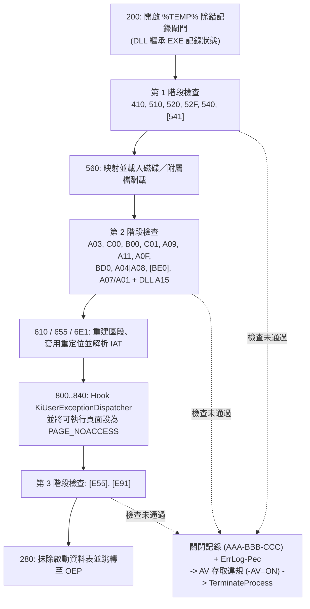

# 架構設計

Arare 會將標準 Windows PE 輸入編碼為 [CrackProof for Windows 內部機制](https://app.gitbook.com/s/sFi4W2Zr1UBoxZd5YI3A/) 所記錄的四種結構版面家族（`pe32`、`pe64-classic`、`pe64-modern` 與 `legacy-dll`），並嵌入自行實作且採用 MIT 授權的原生與 Managed 執行階段載入器。

## Workspace 架構

| 元件 | 職責 | 授權條款 |
| --- | --- | --- |
| `arare-pe` | 具邊界檢查的 PE32/PE32+ 解析器與檔案偏移／RVA 映射器 | MIT |
| `arare-codec` | 滾動式 XOR／旋轉加密、AES-CBC 金鑰排程、bytecode VM stub、Huffman/LZ | MIT |
| `arare-runtime`, `runtime/src`, `runtime/arch` | 內嵌 C/ASM 原生重建、環境檢查輔助模組與頁面存取例外分派器 | MIT |
| `runtime/managed` | 內嵌 C# JIT 前模組初始化器與記憶體轉接層 | MIT |
| `arare-engine` | 版面設定檔編碼器、區段前置裁剪、載入器合成與 Managed 流程協調 | AGPL-3.0-only |
| `tools/managed` | 獨立的 ECMA-335 中繼資料改寫器與 IL 包裝層產生器 | AGPL-3.0-only |
| `arare-cli` / `gui` | CLI 命令、原子檔案寫入與 WPF 批次前端 | AGPL-3.0-only |
| `verification/senbei-oracle` | 在 workspace 外連結未修改之 Senbei 1.3.1 的隔離測試 crate | AGPL-3.0-only |

封裝流程由 `arare_engine::protect(input: &[u8], options: &Options) -> Result<Artifact, Error>` 驅動。`Options` 包含九個設定欄位：`profile`、`seed`、`compression`、`storage`、`checks`、`page_encrypt`、`scribble`、`errlog` 與 `antidebug_av`。

## 單份儲存編碼與區段裁剪

各階段會依相依順序反向編碼，使計算出的總和檢查碼與衍生階段金鑰能直接填入前段標頭，無須附加 Arare 私有的尾端區塊：

* **原始區段實體裁剪（`trim_placeholder_raw`）：** 原始應用程式區段只會壓縮儲存一份於 `.arpay` 內，不會在磁碟上重複保留完整原始資料。原始區段的實體 `SizeOfRawData` 會裁剪至未加密磁碟覆寫所需的檔案對齊前綴（包含 `export` 目錄、`CLR` 標頭與 `COR20` 中繼資料／資源資料流、`TLS` 目錄／範本、載入器 `preserved_ranges`，以及 x64 附屬檔 TLS 跳轉修補區）。在 `VirtualSize` 之後仍帶有非零初始化位元組的區段會維持原狀不裁剪，僅捨棄尾端的零填補對齊位元組。
* **單份 PE 資源儲存：** PE 資源（`DataDirectory[2]`）會記錄於 `Startup.resources` 以供重定位與附屬檔 TLS 重疊檢查使用，但不會列入 `LoaderPatch.preserved_ranges`，因此資源只會在 `.arpay` 中儲存一份並隨酬載一併還原。
* **匯入表還原：** 無論 thunk 內儲存的是純 RVA 或完整虛擬位址（`ImageBase + RVA`），`copy_imports` 皆能還原依名稱匯入的 hint/name 項目。

## 執行階段啟動流程

原生輸出檔內嵌兩個手動映射的輔助 DLL（分別負責環境檢查與頁面保護，對應商業版 `HtpecIt` / `HtdpStub2` 的職責拆分，且抹除 MZ/PE 標頭、不登錄於 PEB 模組清單）；Managed 輸出檔則同時攜帶 x86 與 x64 兩組輔助 DLL，並於啟動時依行程架構擇一載入：

* **階段 `410` 除錯器檢查與 AV 處置：** 原生 `410` 會檢查 `IsDebuggerPresent`、`PEB.BeingDebugged`、`NtGlobalFlag`、硬體除錯暫存器（`DR0`..`DR3`、`DR7`），以及查詢核心狀態的 `NtQueryInformationProcess`（`ProcessDebugPort`、`ProcessDebugFlags`、`ProcessDebugObjectHandle`）。在原生 EXE 上（預設 `--antidebug-av=on`），`ar_reject` 會在呼叫 `TerminateProcess` 前先引發 `EXCEPTION_ACCESS_VIOLATION` 並寫入空指標位址（Managed 模組則直接呼叫 `TerminateProcess`）。
* **宿主標記（`A11` / `A15`）：** 啟用 `host-process` 時，原生 DLL 會將 `A15` 記錄為純流程標記而不執行額外檢查邏輯。`A11` 則檢查協作式 Arare 宿主區段（`.arldr` 或 `.armclr`）與選用的執行期戳記，而非商業版的 `peC` / `KeRnEl32.dLl` 標記。
* **存取違規觸發的頁面解密與階段 `280` 清理：** Arare 會在每次封裝時產生專屬的頁面加密 bytecode 與排程表，在同行程相容模組間共用單一 `KiUserExceptionDispatcher` hook，並在階段 `280` 跳轉至 OEP 前抹除已用畢的匯入映射表、輔助 DLL 區塊與啟動描述元。

## 實驗性核心驅動元件與商業版剩餘差異

`kernel/` 目錄包含獨立撰寫的實驗性驅動程式專案，未納入 Cargo 建置與 `arare protect` 流程。目前與商業版 CrackProof 的剩餘差異包括：樣本中僅部分觀測到的檢查觸發細部條件、宿主目錄白名單判定、尚未對應的 `E` 系列檢查物件、啟動後的週期性模組重新掃描、經完整核對的商業版預設檢查矩陣，以及獨立的 Windows 10 實機測試。
