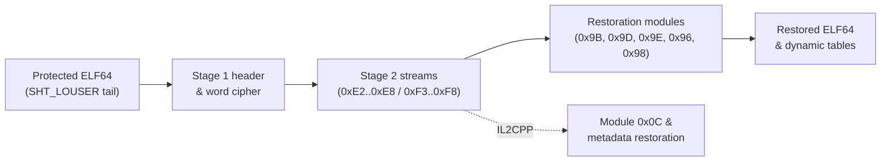

# CrackProof for Android SO internals

This section documents the Android native-library protection format used by CrackProof on little-endian ELF64 AArch64 shared objects. CrackProof hollows out the loadable code and data ranges, appends a single `SHT_LOUSER` private payload section, and reconstructs the image at load time through a two-stage loader and nested module streams.

## Sections

<table data-view="cards"><thead><tr><th width="48"></th><th></th><th></th><th data-hidden data-card-target data-type="content-ref"></th></tr></thead><tbody><tr><td><i class="fa-folder-tree"></i></td><td><strong>File format</strong></td><td>ELF recognition, the private <code>SHT_LOUSER</code> section, Stage 1 parameters, and Stage 2 record streams.</td><td><a href="file-format/file-format.md">File format</a></td></tr><tr><td><i class="fa-shuffle"></i></td><td><strong>Data transforms</strong></td><td>GF(2³²) word mixing, stream and record ciphers, module <code>0x9B</code> keys, <code>0x9D</code> containers, and Huffman/LZ compression.</td><td><a href="data-transforms/data-transforms.md">Data transforms</a></td></tr><tr><td><i class="fa-puzzle-piece"></i></td><td><strong>Restoration</strong></td><td>Static module extraction, dynamic-symbol and relocation table recovery, and clean ELF reconstruction.</td><td><a href="restoration/restoration.md">Restoration</a></td></tr><tr><td><i class="fa-play"></i></td><td><strong>Runtime</strong></td><td>Stage 1 self-discovery, the Stage 2 module table and nested interpreters, environment probes, and module catalog.</td><td><a href="runtime/runtime.md">Runtime</a></td></tr><tr><td><i class="fa-database"></i></td><td><strong>Metadata</strong></td><td>IL2CPP metadata versions 24.1, 29, 31, and 39, five-round RID permutations, and storage layouts.</td><td><a href="metadata/metadata.md">Metadata</a></td></tr><tr><td><i class="fa-compass"></i></td><td><strong>Analysis</strong></td><td>Fail-closed validation checklist and observed format constants across Android build families.</td><td><a href="analysis/analysis.md">Analysis</a></td></tr></tbody></table>

## Relationship to the Windows format

Android libraries share the 3-byte Huffman/LZ token encoding and the byte-reversed AES-256 decryption key schedule with [CrackProof for Windows internals](https://app.gitbook.com/s/PuKTEy2soDgSB3qfWACy/). The GF(2³²) word ciphers, nested `0xE2`..`0xE8` record streams, auxiliary ELF relocation containers, and usermode-only environment checks are specific to Android.
