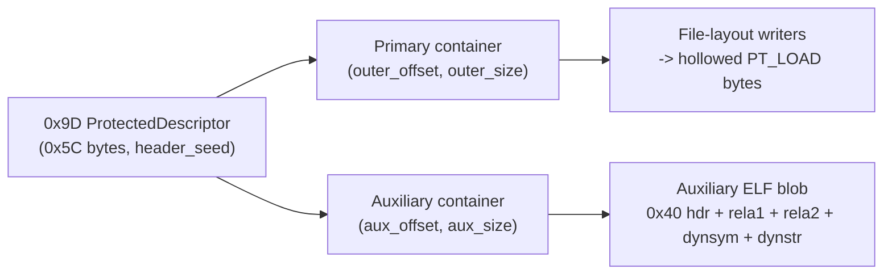

# Container transforms

Module `0x9D` begins with a `0x5C`-byte [protected descriptor](word-and-record.md) decrypted with `header_seed` from [module `0x9B`](module-config.md). That descriptor bounds two complete containers inside `0x9D`, both decoded with `container_seed` and the recovered AES-256 key from `0x9B`:



## Container header

The header seed `s` is derived from `seed = container_seed` by squaring and XOR-shifting (`17` and `11`):

```text
s = (seed * seed) & MASK32
s = ((s >> 17) ^ (s << 11)) & MASK32
```

The first 12 bytes (`w0`, `w1`, `w2`) decode with unsigned 32-bit arithmetic and `gf = gf32_mul_fixed`:

| Word | Formula (all ops mod 2³²) | Decoded meaning |
| --- | --- | --- |
| `w0` | `gf(w0) + s * 0xF87B337C + (0xA21DFB3A << (s & 7))` | Total decoded container output size (`0` means empty) |
| `w1` | `gf(w1) ^ (s + 0xBD19C63C + (0x416E2AF2 >> (s & 0xD)))` | Low byte `w1 & 0xFF` = `segment_count` (`> 0`); second byte `(w1 >> 8) & 0xFF == 1` sets `header.skip_aes` |
| `w2` | `gf(w2) + (0x643A3A3B << (s & 0xB)) - (s ^ 0x3B2BF538)` | `tree_size` in bytes (`<= 0x1B00`) |

**Huffman table (`+0x0C`, length `tree_size`):** every 4-byte-aligned dword in the table buffer is first replaced with `gf(dword)` (any 1 to 3 trailing bytes are left as-is before the byte pass), then adjusted byte-by-byte for `i in 0..tree_size`:

```text
k20  = ((s + 0xF1CB5B81) * s) & MASK32
k21  = (k20 - s * 0x23B32203) & MASK32
adj  = ((gf((k20 << (i & 0x1B)) & MASK32) - (k21 >> (i & 0x17))) & MASK32) >> (i & 0x1F)
b[i] = (b[i] + adj) & 0xFF
```

**Segment table (4-byte-aligned end of the Huffman table, `segment_count` pairs of `{offset, size}` dwords):** at `byte_offset = index * 4` from the start of the segment table:

```text
t     = ((s + 0xB31F451C) * s) & MASK32
k22   = (t << 3) & MASK32
s2    = (t - s * 0x822FE82D) & MASK32
plain = (gf(cipher ^ k22) + (s2 >> ((byte_offset & 7) + 5))) & MASK32
```


`s2` subtracts `s * 0x822FE82D` from the unshifted product `t`, not from `k22`. Using `k22` corrupts every segment offset and size.


Every `{offset, size}` segment range must fit inside the container buffer.

## Segment cipher and AES layer

For each segment, the rolling word cipher runs over 4-byte little-endian chunks (`i = 0, 1, ...`) starting from `state = container_seed`, `left = 0xE34EAC63`, and `right = 0x07B48238`:

```text
left  = ((state + 0x72F6FCBE + ((left + 0x4F8B1BCA) * left)) & MASK32) >> ((i * i) & 0x0F)
right = (((state - 0x71B6A98D + ((right - 0x1605A81C) * right)) & MASK32) << (i & 7)) & MASK32
state = left ^ right

v = (word[i] + (0xB43B9BAF * (i & 0x0D))) & MASK32
v = v ^ ((0xAF57F7FB * (i & 3)) & MASK32)
word[i] = ((v - state) & MASK32) ^ state
```

Next, unless `config.skip_aes || header.skip_aes` is true, AES-256-CBC decryption runs in place over 16-byte blocks with a zero IV using the key recovered from [Module configuration](module-config.md).

## Writer records and target coverage

Each decrypted segment starts with a 16-byte writer header `{u32 base, u32 count, u32 table_offset, u32 src_base}` followed at `table_offset` by `count` 16-byte records `{u32 dst, u32 out_len, u32 src_len, u32 pad}` reading source slices sequentially from `src_base`:

* When `out_len == src_len`, the slice is copied verbatim to `base + dst`.
* Otherwise, the slice is expanded with [Huffman and LZ compression](compression.md) using the container's decoded Huffman table and must consume all `src_len` bytes while producing `out_len` bytes.

For the primary `0x9D` container, writer destinations target virtual address ranges across the ELF's `PT_LOAD` segments: writes within `0..p_filesz` map to the corresponding file offsets, while writes into the `.bss` tail (`p_filesz..p_memsz`) advance in-memory coverage without extending file size.

## Auxiliary ELF relocation container

The second container at `(aux_offset, aux_size)` decodes to a standalone dynamic-linking blob rather than `PT_LOAD` virtual-address writes:

| Region | Layout | Contents |
| --- | --- | --- |
| Header (`0x00..0x40`) | 16 × `u32` | `words[4..12]` = `dynstr_offset`, `dynstr_size`, `dynsym_offset`, `dynsym_count`, `relocation1_offset` (`0x40`), `relocation1_count`, `relocation2_offset`, `relocation2_count`; `words[14] == 0xB7` (`EM_AARCH64`); `words[1, 3, 12, 13, 15] == 0` |
| `relocation1` | `Elf64_Rela[relocation1_count]` + 16B zero align | `.rela.dyn` entries (`0x403` = `R_AARCH64_RELATIVE`, `0x101` = `R_AARCH64_ABS64`, `0x401` = `R_AARCH64_GLOB_DAT`) |
| `relocation2` | `Elf64_Rela[relocation2_count]` + 16B zero align | `.rela.plt` entries (`0x402` = `R_AARCH64_JUMP_SLOT`) |
| Auxiliary `.dynsym` | `Elf64_Sym[dynsym_count]` | 24-byte null symbol at index `0`, followed by stripped external symbols |
| Auxiliary `.dynstr` | `u8[dynstr_size]` | NUL-terminated names for the auxiliary symbol table |

Each `0x18`-byte relocation entry is a standard `Elf64_Rela` `{u64 r_offset, u64 r_info, i64 r_addend}` whose upper 32 bits (`r_info >> 32`) store an auxiliary symbol index (permuted per row when module `0x96` is present). How these tables merge back into `.dynsym`, `.dynstr`, `.rela.dyn`, and `.rela.plt` is covered in [Dynamic linking](../restoration/dynamic-linking.md).
