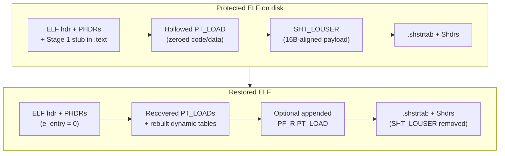

# Protected ELF

## Required ELF shape

A protected binary is a little-endian ELF64 shared object targeting AArch64 (`EM_AARCH64 = 183`, `e_phentsize = 0x38`, `e_shentsize = 0x40`). Section names are resolved from `.shstrtab`, which must be a valid UTF-8 `SHT_STRTAB` within file bounds.

| Section | Requirement | Purpose |
| --- | --- | --- |
| `.dynsym` and `.dynstr` | Required | Dynamic symbol records and symbol name strings |
| `.gnu.hash` and/or `.hash` | At least one | Symbol hash lookup table (GNU hash, SysV hash, or both) |
| `.gnu.version` | Required | Per-symbol version indices |
| `.gnu.version_r` | Required | Required symbol version definitions |
| `.dynamic`, `.rela.dyn`, `.rela.plt` | Once each (restoration) | Dynamic tags, data relocations, and PLT relocations |
| `SHT_LOUSER` (`0x80000000`) | Exactly one, final section | Encrypted Stage 1 and Stage 2 protection payload |

Files with zero or multiple `SHT_LOUSER` sections, out-of-bounds section ranges, or another architecture or endianness are rejected before decryption runs. The `SHT_LOUSER` section is always the final entry in the section header table and starts at the 16-byte-aligned end of the file-backed `PT_LOAD` range (with zero padding in any alignment gap).

Inside `.init_array`, one `R_AARCH64_RELATIVE` entry points to the `0x84`-byte Stage 1 bootstrap wrapper in the intact `.text` head (saving `X1`..`X30` with 15 `STP` instructions, passing `SP` in `X0`, calling the bootstrap body, restoring registers, and returning). Other `.init_array` entries are either unsuppressed constructors kept in linker order, `RET`-only (`0xD65F03C0`) placeholders, or hollowed addresses that only become valid after restoration and constructor recovery via module `0x98`.

## Visible headers and companion files

The protected file retains parseable ELF headers, program headers, section headers, and `.dynamic` entries, though several dynamic tables are truncated or stripped of hidden symbols and relocations. Identifying a protected binary requires matching this ELF layout alongside the checks in [Stage 1 header](stage1.md) and [Stage 2 streams](stage2-streams.md), rather than relying on the presence of `SHT_LOUSER` alone.

Protected APKs frequently include two auxiliary files alongside the target `.so`:

* `lib__XXXX__.so` (where `XXXX` is a short build stamp): a standalone copy of the Stage 1/2 protector stub.
* `assets/<id>/data1.dat` (roughly 180 KiB of high-entropy data): a small configuration table listing protected library names and per-library settings.

Both are runtime wrapper artifacts unused by the restored library.
