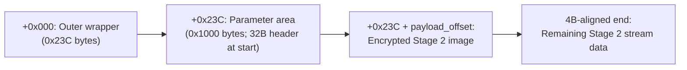

# Stage 1 header

The `SHT_LOUSER` section contains four regions in sequence:



Observed builds use an outer wrapper size (`outer_size`) of `0x23C` bytes (572 bytes), followed by a `0x1000`-byte parameter block whose first 32 bytes hold the encrypted eight-dword Stage 1 header. Two Stage 1 word-cipher constants `C` occur across observed families: `0xBF20165D` and `0xBF189BDD`.

Runtime discovery of this section is covered in [Stage 1 bootstrap](../runtime/stage1-bootstrap.md), and the surrounding cipher family is documented in [Word, stream, and record ciphers](../data-transforms/word-and-record.md).

## Header fields

Decrypting the first 32 bytes at `section_offset + outer_size` yields eight little-endian `u32` fields:

| Offset | Field | Meaning | Validation rule |
| --- | --- | --- | --- |
| `+0x00` | `key` | Per-file Stage 1 header key | Restored into word 0 after decrypting words `1..7` |
| `+0x04` | `reserved` | Unused field | `== 0` |
| `+0x08` | `payload_offset` | Stage 2 start relative to the parameter header (`section_offset + outer_size`) | `>= 0x20` and `payload_offset + payload_size <= section_size - outer_size` |
| `+0x0C` | `payload_size` | Encrypted Stage 2 byte length | `> 0` and 4-byte aligned (`payload_size % 4 == 0`) |
| `+0x10` | `payload_key` | Word-cipher key used by Stage 1 to decrypt the Stage 2 image | Passed to the Stage 1 word cipher over `payload_size` bytes |
| `+0x14` | `entry_offset` | Entry offset inside the decrypted Stage 2 image | `< payload_size` |
| `+0x18` | `protect_size` | `mprotect` length inside the decrypted Stage 2 image | `<= payload_size` |
| `+0x1C` | `size_copy` | Duplicate of `payload_size` | `== payload_size` |


`payload_offset` is measured from the start of the 32-byte parameter header (`section_offset + outer_size`), not from the beginning of the ELF file. The file offset of the encrypted Stage 2 image is `section_offset + outer_size + payload_offset`.


For word index `i` (`0..7`), decryption uses unsigned 32-bit wraparound:

```text
plain[i] = ((cipher[i] + (i + 3) * key) ^ (C * (i + 1))) & 0xFFFFFFFF
```

Word `0` supplies `key` (`key = cipher[0] ^ C` before write-back, with `plain[0] = key` stored after words `1..7` are decoded). Stage 1 then decrypts the Stage 2 image at `section_offset + outer_size + payload_offset` using the same word cipher with `payload_key` and constant `C`. The Stage 2 root record stream (`0xE2`) starts inside `SHT_LOUSER` immediately after the 4-byte-aligned end of the Stage 2 image.

## Header validation

Candidate combinations of `(outer_size, C)` are accepted only when all eight header invariants hold and the resulting Stage 2 image plus trailing stream fit inside `SHT_LOUSER`. Any truncated section, non-zero `reserved` word, mismatched `size_copy`, unaligned `payload_size`, or out-of-range `entry_offset` / `protect_size` rejects the candidate before Stage 2 parsing begins.
