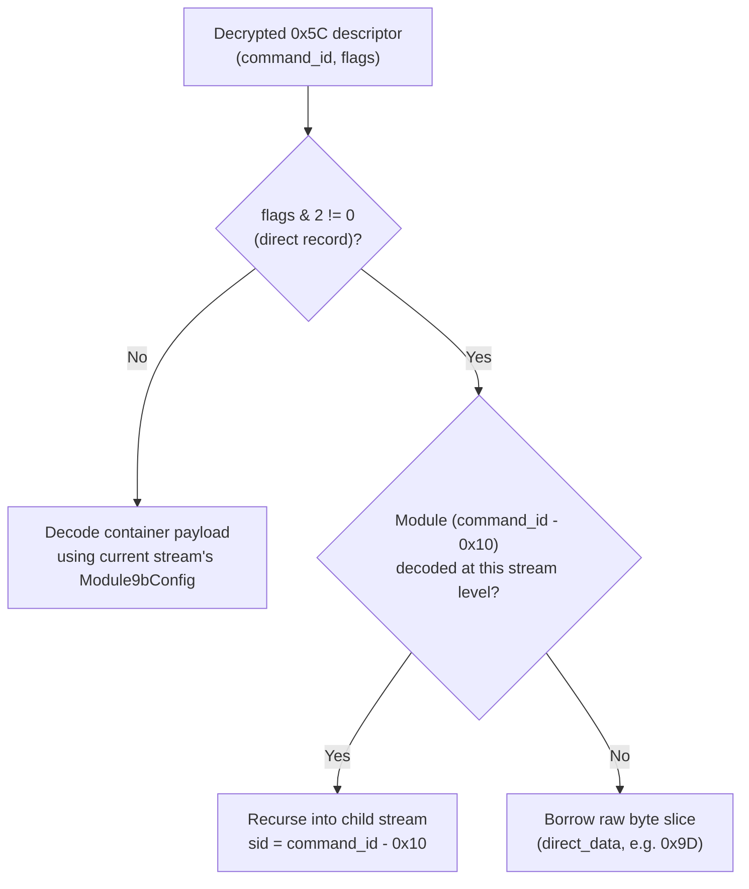

# Stage 2 streams

Stage 2 starts with root stream identifier `0xE2`. Each stream begins with an encrypted 8-byte header (`cipher0`, `cipher1`), followed immediately at `+0x08` by a contiguous array of `N` `0x5C`-byte record descriptors (`dw0` from the decrypted stream header gives the count, capped at 256). Record payloads begin after the entire descriptor table (`8 + N * 0x5C`), so descriptor parsing stops where `8 + (index + 1) * 0x5C` reaches the earliest non-zero `image_offset` or `metadata_offset`.

## Record dispatch

Each descriptor carries `command_id`, `flags`, `image_offset` / `image_size`, `metadata_offset` / `metadata_size`, `id_copy` (`== command_id`), `entry_offset` (`+0x1C`), and `init_offset` (`+0x20`). How `image_size` and `metadata_size` are interpreted depends on `DIRECT_FLAG` (`0x2`):

* **Container records (`flags & 2 == 0`):** `image_offset` and `metadata_offset` point to compressed/encrypted containers inside the current stream, while `image_size` and `metadata_size` specify the expected **decoded output sizes** (compressed payloads in the stream are smaller, so `offset < stream.len()` is checked before decoding and exact decoded size is checked after expansion). Every container at stream level `S` is decoded using stream `S`'s own interpreter [configuration](../data-transforms/module-config.md): the embedded Stage 2 decoder config at root `0xE2`, and `Module9bConfig` parsed from interpreter module `S` at nested levels `0xE3`..`0xE8`.
* **Direct records (`flags & 2 != 0`):** `image_offset` and `image_size` slice raw bytes directly from the containing stream (`image_offset + image_size <= stream.len()`). When a module with identifier `command_id - 0x10` was decoded at the same stream level (observed pairs `0xF3` -> `0xE3` through `0xF8` -> `0xE8`), that slice is parsed recursively as child stream `command_id - 0x10`. Otherwise (as with module `0x9D`), the slice is kept as raw module data.

Flag `0x100` skips runtime `init` and `entry` callbacks for that record. During static extraction, child streams are deduplicated by `(stream_id, sha256)` so repeated references are not decoded twice, and duplicate records for the same module ID are accepted only when their SHA-256 digests match.

The runtime module table and callback sequence are documented in [Stage 2 interpreter](../runtime/stage2-interpreter.md).

## Structural bounds

Image payloads and protector module metadata (`metadata_offset` / `metadata_size`, which hold module load, relocation, and import metadata rather than IL2CPP assets) stay separate throughout extraction. Any truncated descriptor table, `id_copy` mismatch, out-of-range slice, container decode failure, or conflicting module digest aborts stream extraction.
