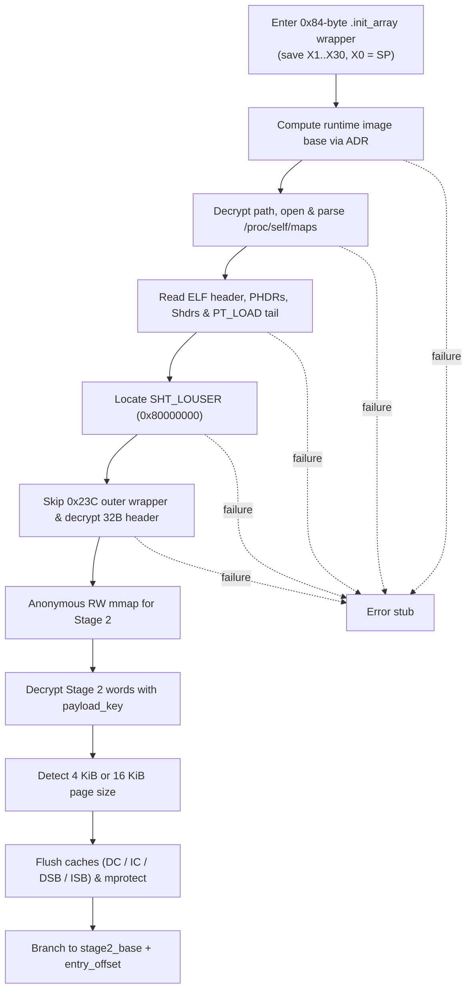

# Stage 1 bootstrap

One `.init_array` entry points to a `0x84`-byte register-saving wrapper in the intact `.text` head (15 `STP` instructions saving `X1`..`X30`, `MOV X0, SP`, `BL` into the bootstrap body, 15 `LDP` restores, and `RET`). The bootstrap locates its own file via `/proc/self/maps`, reads `SHT_LOUSER`, decrypts Stage 2 into anonymous memory, and jumps to its entry point.

## Locating `SHT_LOUSER`

Stage 1 obtains its own PC with `ADR`, subtracts its link-time offset to get the loaded library's base address, decrypts `"/proc/self/maps"` into a stack buffer, opens it, and immediately wipes the path buffer. After finding the backing file path for its load base, it reads the ELF header, program headers, and section headers (`Elf64_Shdr` stride `0x40`) to locate `sh_type == 0x80000000` (`SHT_LOUSER`) after the last `PT_LOAD` segment.

Skipping the `0x23C`-byte outer wrapper reaches the `0x1000`-byte parameter area whose first 32 bytes decode under the family word constant `C` (`0xBF20165D` or `0xBF189BDD`; see [Stage 1 header](../file-format/stage1.md)).

## Stage 2 mapping and register handoff

Stage 1 allocates an anonymous writable region of `payload_size` bytes, copies and decrypts the Stage 2 image with `payload_key`, detects 4 KiB vs 16 KiB system pages, flushes data and instruction caches (`DC` / `IC` / `DSB` / `ISB`), applies `mprotect` over `protect_size`, and branches to `stage2_base + entry_offset` with eight arguments:

| Register | Value |
| --- | --- |
| `X0` | Loader context pointer |
| `X1` | Protected library's runtime image base |
| `X2` | Decrypted Stage 2 base address |
| `X3` | Decrypted Stage 2 byte size (`payload_size`) |
| `X4` | Remaining `SHT_LOUSER` stream base (4-byte-aligned end of Stage 2) |
| `X5` | Remaining `SHT_LOUSER` stream size |
| `X6` | File-tail mapping base |
| `X7` | File-tail mapping size |

Stage 2 immediately records `(X2, X3)` as module `0xE2` and `(X6, X7)` as module `0xD0`.
