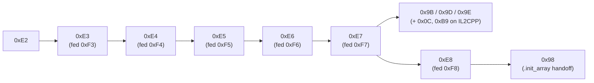

# Stage 2 interpreter

Stage 2 (`0xE2`) allocates a 256-slot module table, registers itself (`0xE2`) and the `SHT_LOUSER` tail mapping (`0xD0`), and walks the root record stream in `(X4, X5)`. Each interpreter level loads worker modules, decodes the next interpreter module `0xE(n+1)`, slices direct stream `0xF(n+1)`, and hands `0xF(n+1)` to `0xE(n+1)`:

## Module table (`0x1800` bytes)

Stage 2 maps `0x1800` bytes of anonymous RW memory holding 256 entries of `0x18` (24) bytes each:

| Offset | Size | Field |
| --- | --- | --- |
| `+0x00` | 4 | `command_id` |
| `+0x04` | 4 | State flags |
| `+0x08` | 8 | Mapped base pointer |
| `+0x10` | 4 | Mapped size |
| `+0x14` | 4 | Reserved |

Slot registration starts with `0xE2` (`X2`, `X3`) and `0xD0` (`X6`, `X7`), followed by each record's `command_id` as streams execute.

## `0x5C` record descriptor layout

After the 8-byte stream header (`dw0` = descriptor count, `G` = descriptor seed; see [Word, stream, and record ciphers](../data-transforms/word-and-record.md)), descriptors occupy `8 + N * 0x5C` bytes up to the first payload offset. Each 23-dword (`0x5C`-byte) descriptor has the binary layout:

| Offset | Dword | Field | Role |
| --- | --- | --- | --- |
| `+0x00` | `words[0]` | `command_id` | Module or stream-slice identifier (`0x00`..`0xFF`) |
| `+0x04` | `words[1]` | `flags` | `0x2` = direct slice; `0x100` = skip `init` and `entry` callbacks |
| `+0x08` | `words[2]` | `image_offset` | Payload offset inside the current stream |
| `+0x0C` | `words[3]` | `image_size` | Decoded container size (`flags & 2 == 0`) or raw slice length (`flags & 2 != 0`) |
| `+0x10` | `words[4]` | `metadata_offset` | Protector module load/reloc/import metadata offset (`0` if none) |
| `+0x14` | `words[5]` | `metadata_size` | Decoded or raw module-metadata size |
| `+0x18` | `words[6]` | `id_copy` | Must equal `command_id` |
| `+0x1C` | `words[7]` | `entry_offset` | Module entry callback offset relative to mapped base |
| `+0x20` | `words[8]` | `init_offset` | Module init callback offset relative to mapped base |
| `+0x24..+0x5C` | `words[9..22]` | Trailing words | Reserved / module-specific parameters |

For each descriptor, the interpreter prepares the payload (unpacking a container with its own `Module9bConfig` when `flags & 2 == 0`, or pointing directly to the stream slice when `flags & 2 != 0`), applies any module relocations and imports from the record's `metadata` blob, registers the slot, and calls `init_offset` followed by `entry_offset` unless `flags & 0x100` is set.

## Layering differences

Interpreter `0xE7` loads the core ELF restoration modules (`0x9B`, `0x9D`, `0x9E`). On Unity IL2CPP builds, `0xE7` also loads module `0x0C` (the `mmap` hook for `global-metadata.dat`) alongside a populated `0xB9` data record; non-IL2CPP native libraries omit `0x0C` and either omit `0xB9` or carry an empty `0xB9` record. Interpreter `0xE8` then loads module `0x98`, which invokes the target library's `.init_array` constructors once image restoration finishes.
