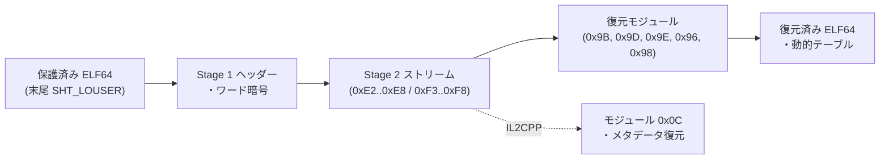

# CrackProof for Android SO の内部構造

本セクションでは、リトルエンディアンの ELF64 AArch64 共有ライブラリに対して CrackProof が適用する Android ネイティブライブラリ保護フォーマットを解説します。CrackProof はロード対象のコード領域とデータ領域をファイル末尾に追加した単一の `SHT_LOUSER` 専用セクションへ退避して元の領域をゼロ埋めし、ロード時に 2 段階のローダーと入れ子構造のモジュールストリームでイメージを再構築します。

## 構成

<table data-view="cards"><thead><tr><th width="48"></th><th></th><th></th><th data-hidden data-card-target data-type="content-ref"></th></tr></thead><tbody><tr><td><i class="fa-folder-tree"></i></td><td><strong>ファイル形式</strong></td><td>ELF の識別条件、<code>SHT_LOUSER</code> 専用セクション、Stage 1 パラメーター、および Stage 2 レコードストリーム。</td><td><a href="file-format/file-format.md">ファイル形式</a></td></tr><tr><td><i class="fa-shuffle"></i></td><td><strong>データ変換</strong></td><td>GF(2³²) ワード攪拌、ストリーム暗号・レコード暗号、モジュール <code>0x9B</code> の鍵構造、<code>0x9D</code> コンテナー、および Huffman/LZ 圧縮。</td><td><a href="data-transforms/data-transforms.md">データ変換</a></td></tr><tr><td><i class="fa-puzzle-piece"></i></td><td><strong>復元</strong></td><td>モジュール群の静的抽出、動的シンボルテーブルおよび再配置テーブルの復元、正常な ELF イメージの再構築。</td><td><a href="restoration/restoration.md">復元</a></td></tr><tr><td><i class="fa-play"></i></td><td><strong>ランタイム</strong></td><td>Stage 1 の自己位置特定、Stage 2 モジュールテーブルと入れ子インタープリター、実行環境プローブ、およびモジュール一覧。</td><td><a href="runtime/runtime.md">ランタイム</a></td></tr><tr><td><i class="fa-database"></i></td><td><strong>メタデータ</strong></td><td>IL2CPP メタデータ（バージョン 24.1、29、31、39）、5 ラウンドの RID 置換、および格納レイアウト。</td><td><a href="metadata/metadata.md">メタデータ</a></td></tr><tr><td><i class="fa-compass"></i></td><td><strong>解析</strong></td><td>フェイルクローズな検証チェックリストと、Android ビルド系統間で観測されたフォーマット定数。</td><td><a href="analysis/analysis.md">解析</a></td></tr></tbody></table>

## Windows 版フォーマットとの関係

Android 版では、3 バイト単位の Huffman/LZ トークン符号化と、ワード単位でバイト反転された AES-256 復号ラウンド鍵スケジュールが [CrackProof for Windows の内部構造](https://app.gitbook.com/s/XSPACE_WINDOWS_JA/)と共通しています。一方、GF(2³²) ワード暗号、入れ子構造の `0xE2`..`0xE8` レコードストリーム、補助 ELF コンテナーによる再配置情報の保持、およびユーザーモードで完結する環境チェックは Android 版固有の仕組みです。
