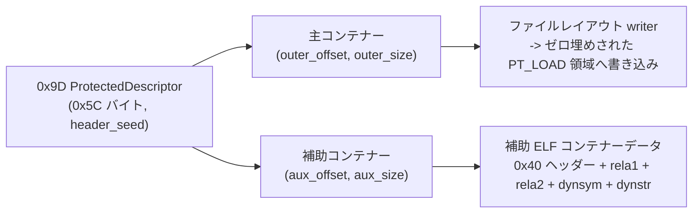

# コンテナー変換

モジュール `0x9D` の先頭には、[モジュール `0x9B`](module-config.md) の `header_seed` で復号される `0x5C` バイトの[保護記述子](word-and-record.md)があります。この記述子は `0x9D` 内の 2 つの独立したコンテナー領域を定義しており、どちらも `0x9B` から取得した `container_seed` と復元済み AES-256 鍵を用いてデコードされます。



## コンテナーヘッダー

ヘッダーシード `s` は、`seed = container_seed` を 2 乗した後にビットシフトと XOR（`17` および `11`）を適用して導出します。

```text
s = (seed * seed) & MASK32
s = ((s >> 17) ^ (s << 11)) & MASK32
```

先頭 12 バイト（`w0`、`w1`、`w2`）は、符号なし 32 ビット演算と `gf = gf32_mul_fixed` を用いて次のように復号します。

| ワード | 計算式（演算はすべて mod 2³²） | 復号後の意味 |
| --- | --- | --- |
| `w0` | `gf(w0) + s * 0xF87B337C + (0xA21DFB3A << (s & 7))` | デコード後のコンテナー総出力サイズ（`0` は空を表す） |
| `w1` | `gf(w1) ^ (s + 0xBD19C63C + (0x416E2AF2 >> (s & 0xD)))` | 下位バイト `w1 & 0xFF` = `segment_count`（`> 0`）。第 2 バイト `(w1 >> 8) & 0xFF == 1` のとき `header.skip_aes` が有効 |
| `w2` | `gf(w2) + (0x643A3A3B << (s & 0xB)) - (s ^ 0x3B2BF538)` | バイト単位の `tree_size`（`<= 0x1B00`） |

**Huffman テーブル（`+0x0C`、長さ `tree_size`）:** テーブルバッファー内の 4 バイト境界に揃った各 32 ビットワードをまず `gf(dword)` に置き換え（末尾に 1 から 3 バイトの端数がある場合は後続のバイト単位処理までそのまま残します）、続いて `i in 0..tree_size` の各バイトを順に補正します。

```text
k20  = ((s + 0xF1CB5B81) * s) & MASK32
k21  = (k20 - s * 0x23B32203) & MASK32
adj  = ((gf((k20 << (i & 0x1B)) & MASK32) - (k21 >> (i & 0x17))) & MASK32) >> (i & 0x1F)
b[i] = (b[i] + adj) & 0xFF
```

**セグメントテーブル（Huffman テーブル終端の 4 バイト境界切り上げ位置、`{offset, size}` の 32 ビットワード対 × `segment_count` 個）:** セグメントテーブル先頭からの `byte_offset = index * 4` に対して次式で復号します。

```text
t     = ((s + 0xB31F451C) * s) & MASK32
k22   = (t << 3) & MASK32
s2    = (t - s * 0x822FE82D) & MASK32
plain = (gf(cipher ^ k22) + (s2 >> ((byte_offset & 7) + 5))) & MASK32
```


`s2` はシフト済みの `k22` ではなく、シフト前の積 `t` から `s * 0x822FE82D` を減算します。誤って `k22` を使うと、すべてのセグメントのオフセットとサイズが破損します。


すべての `{offset, size}` セグメント範囲は、コンテナーバッファー内に収まっていなければなりません。

## セグメント暗号と AES 層

各セグメントに対し、`state = container_seed`、`left = 0xE34EAC63`、`right = 0x07B48238` を初期状態として、4 バイトのリトルエンディアンワード単位（`i = 0, 1, ...`）でローリングワード暗号を適用します。

```text
left  = ((state + 0x72F6FCBE + ((left + 0x4F8B1BCA) * left)) & MASK32) >> ((i * i) & 0x0F)
right = (((state - 0x71B6A98D + ((right - 0x1605A81C) * right)) & MASK32) << (i & 7)) & MASK32
state = left ^ right

v = (word[i] + (0xB43B9BAF * (i & 0x0D))) & MASK32
v = v ^ ((0xAF57F7FB * (i & 3)) & MASK32)
word[i] = ((v - state) & MASK32) ^ state
```

続いて、`config.skip_aes || header.skip_aes` が真でない限り、[モジュール設定](module-config.md)で復元した鍵とゼロ IV を用いて、16 バイトブロック単位でインプレースの AES-256-CBC 復号を実行します。

## Writer レコードと書き込み範囲

復号後の各セグメントは 16 バイトの writer ヘッダー `{u32 base, u32 count, u32 table_offset, u32 src_base}` から始まり、`table_offset` の位置に `count` 個の 16 バイトレコード `{u32 dst, u32 out_len, u32 src_len, u32 pad}` が並びます。入力スライスは `src_base` から順番に読み進められます。

* `out_len == src_len` の場合、スライスはそのまま `base + dst` へコピーされます。
* それ以外の場合、コンテナーから復号した Huffman テーブルを使って [Huffman / LZ 圧縮](compression.md)を展開します。このとき `src_len` バイトすべてを消費し、ちょうど `out_len` バイトを出力しなければなりません。

`0x9D` の主コンテナーでは、writer の書き込み先は ELF の各 `PT_LOAD` セグメントにわたる仮想アドレス範囲を指します。`0..p_filesz` の範囲への書き込みは対応するファイルオフセットへ反映され、`.bss` 末尾領域（`p_filesz..p_memsz`）への書き込みはファイルサイズを拡張せず、メモリ上の書き込み範囲のみを進めます。

## 補助 ELF コンテナー

`(aux_offset, aux_size)` にある第 2 コンテナーをデコードすると、`PT_LOAD` 仮想アドレスへの書き込みデータではなく、動的リンク情報をまとめた独立のデータブロック（補助 ELF コンテナー）が得られます。

| 領域 | レイアウト | 内容 |
| --- | --- | --- |
| ヘッダー（`0x00..0x40`） | 16 × `u32` | `words[4..12]` = `dynstr_offset`、`dynstr_size`、`dynsym_offset`、`dynsym_count`、`relocation1_offset`（`0x40`）、`relocation1_count`、`relocation2_offset`、`relocation2_count`。`words[14] == 0xB7`（`EM_AARCH64`）、`words[1, 3, 12, 13, 15] == 0` |
| `relocation1` | `Elf64_Rela[relocation1_count]` + 16B ゼロパディング | `.rela.dyn` エントリ（`0x403` = `R_AARCH64_RELATIVE`、`0x101` = `R_AARCH64_ABS64`、`0x401` = `R_AARCH64_GLOB_DAT`） |
| `relocation2` | `Elf64_Rela[relocation2_count]` + 16B ゼロパディング | `.rela.plt` エントリ（`0x402` = `R_AARCH64_JUMP_SLOT`） |
| 補助 `.dynsym` | `Elf64_Sym[dynsym_count]` | インデックス `0` の 24 バイト NULL シンボルに続き、本体から除去された外部シンボル群を格納 |
| 補助 `.dynstr` | `u8[dynstr_size]` | 補助動的シンボルテーブル用の NUL 終端シンボル名文字列 |

`0x18` バイトの各再配置エントリは標準の `Elf64_Rela` `{u64 r_offset, u64 r_info, i64 r_addend}` であり、上位 32 ビット（`r_info >> 32`）に補助シンボルインデックスが格納されています（モジュール `0x96` が存在する場合はエントリごとに置換されています）。これらの再配置テーブルおよび動的シンボルテーブルを本体の `.dynsym`、`.dynstr`、`.rela.dyn`、`.rela.plt` へ統合する手順については、[動的リンク](../restoration/dynamic-linking.md)を参照してください。
