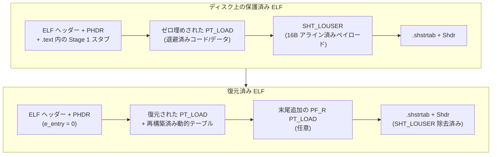

# 保護済み ELF

## 必須の ELF 構造

保護対象のバイナリは、AArch64 向けのリトルエンディアン ELF64 共有ライブラリです（`EM_AARCH64 = 183`、`e_phentsize = 0x38`、`e_shentsize = 0x40`）。各セクション名は `.shstrtab` から解決され、`.shstrtab` はファイル範囲内に収まる有効な UTF-8 の `SHT_STRTAB` でなければなりません。

| セクション | 要件 | 役割 |
| --- | --- | --- |
| `.dynsym` および `.dynstr` | 必須 | 動的シンボルテーブルのレコードとシンボル名文字列 |
| `.gnu.hash` または `.hash` | いずれか 1 つ以上 | シンボル検索用ハッシュテーブル（GNU hash、SysV hash、または両方） |
| `.gnu.version` | 必須 | シンボルごとのバージョンインデックス |
| `.gnu.version_r` | 必須 | 要求されるシンボルバージョン定義 |
| `.dynamic`、`.rela.dyn`、`.rela.plt` | 各 1 つ（復元時） | 動的タグ、データ再配置テーブル、および PLT 再配置テーブル |
| `SHT_LOUSER`（`0x80000000`） | 末尾に 1 つのみ | 暗号化された Stage 1 および Stage 2 の保護ペイロードを格納する専用セクション |

`SHT_LOUSER` 専用セクションが存在しないファイルや複数存在するファイル、セクション範囲がファイル外を指すファイル、あるいは別アーキテクチャや別エンディアンのファイルは、復号処理に入る前に棄却されます。`SHT_LOUSER` セクションは常にセクションヘッダーテーブルの最終エントリに配置され、ファイル上に実体を持つ `PT_LOAD` 領域の終端を 16 バイト境界へ切り上げた位置から始まります（アラインメントの隙間はゼロパディングされます）。

`.init_array` 内の `R_AARCH64_RELATIVE` エントリのうち 1 つは、先頭部分が残された `.text` 内の `0x84` バイトの Stage 1 ブートストラップラッパーを指します（15 個の `STP` 命令で `X1`..`X30` を退避し、`SP` を `X0` に渡してブートストラップ本体を呼び出した後、レジスタを復帰してリターンします）。残りの `.init_array` エントリは、無効化されずにリンカー順のまま残されたコンストラクター、`RET` 命令のみ（`0xD65F03C0`）のプレースホルダー、またはイメージ復元とモジュール `0x98` によるコンストラクター復元を経て初めて有効になるゼロ埋め領域内のアドレスのいずれかです。

## 残存ヘッダーと APK 内の付随ファイル

保護済みファイルには解析可能な ELF ヘッダー、プログラムヘッダーテーブル、セクションヘッダーテーブル、および `.dynamic` エントリが残っていますが、一部の動的テーブルは切り詰められているか、非公開シンボルや再配置エントリが除去されています。そのため、保護済みバイナリの判定では `SHT_LOUSER` の有無だけを見るのではなく、この ELF レイアウトに加えて [Stage 1 ヘッダー](stage1.md)および [Stage 2 ストリーム](stage2-streams.md)の検証条件を併せて確認する必要があります。

保護された APK には、対象の `.so` と並んで次の 2 つの補助ファイルが同梱されていることがよくあります。

* `lib__XXXX__.so`（`XXXX` は短いビルドスタンプ）: Stage 1/2 プロテクタースタブの単体コピー。
* `assets/<id>/data1.dat`（約 180 KiB の高エントロピーデータ）: 保護対象ライブラリ名とライブラリごとの設定を格納した小規模な設定テーブル。

いずれも実行時ラッパー側の付随ファイルであり、復元後の共有ライブラリからは参照されません。
