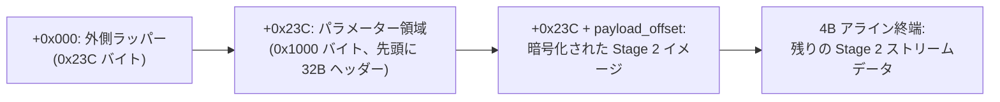

# Stage 1 ヘッダー

`SHT_LOUSER` 専用セクションの内部には、次の 4 つの領域が順番に並んでいます。



観測されたビルドでは、外側ラッパーのサイズ（`outer_size`）はいずれも `0x23C` バイト（572 バイト）であり、その直後に `0x1000` バイトのパラメーター領域が続きます。このパラメーター領域の先頭 32 バイトに、暗号化された 8 個の 32 ビットワードからなる Stage 1 ヘッダーが格納されています。Stage 1 ワード暗号の定数 `C` には、ビルド系統に応じて `0xBF20165D` と `0xBF189BDD` の 2 種類が確認されています。

実行時にこのセクションを特定する手順は [Stage 1 ブートストラップ](../runtime/stage1-bootstrap.md)、関連する暗号プリミティブは[ワード・ストリーム・レコード暗号](../data-transforms/word-and-record.md)で解説します。

## ヘッダーフィールド

`section_offset + outer_size` から始まる先頭 32 バイトを復号すると、リトルエンディアンの `u32` フィールド 8 個が得られます。

| オフセット | フィールド | 意味 | 検証条件 |
| --- | --- | --- | --- |
| `+0x00` | `key` | ファイルごとの Stage 1 ヘッダー鍵 | ワード `1..7` の復号後にワード 0 へ書き戻される |
| `+0x04` | `reserved` | 未使用フィールド | `== 0` |
| `+0x08` | `payload_offset` | パラメーターヘッダー（`section_offset + outer_size`）からの Stage 2 開始相対オフセット | `>= 0x20` かつ `payload_offset + payload_size <= section_size - outer_size` |
| `+0x0C` | `payload_size` | 暗号化された Stage 2 のバイト長 | `> 0` かつ 4 バイト境界（`payload_size % 4 == 0`） |
| `+0x10` | `payload_key` | Stage 1 が Stage 2 イメージの復号に使用するワード暗号鍵 | `payload_size` バイト分の Stage 1 ワード復号で使用される |
| `+0x14` | `entry_offset` | 復号後の Stage 2 イメージ内エントリオフセット | `< payload_size` |
| `+0x18` | `protect_size` | 復号後の Stage 2 イメージ内で `mprotect` を適用する長さ | `<= payload_size` |
| `+0x1C` | `size_copy` | `payload_size` の複製値 | `== payload_size` |


`payload_offset` の基準位置は ELF ファイル先頭ではなく、32 バイトのパラメーターヘッダー先頭（`section_offset + outer_size`）です。暗号化された Stage 2 イメージのファイルオフセットは `section_offset + outer_size + payload_offset` になります。


ワードインデックス `i`（`0..7`）に対する復号は、符号なし 32 ビットのラップアラウンド演算で行われます。

```text
plain[i] = ((cipher[i] + (i + 3) * key) ^ (C * (i + 1))) & 0xFFFFFFFF
```

ワード `0` から `key` を求め（書き戻し前の `key = cipher[0] ^ C`）、ワード `1..7` を復号した後に `plain[0] = key` を格納します。続いて Stage 1 は、同じワード暗号に `payload_key` と定数 `C` を与えて `section_offset + outer_size + payload_offset` にある Stage 2 イメージを復号します。Stage 2 のルートレコードストリーム（`0xE2`）は、`SHT_LOUSER` 内で Stage 2 イメージ終端を 4 バイト境界に揃えた直後から始まります。

## ヘッダーの検証

`(outer_size, C)` の候補組は、8 個のヘッダー不変条件をすべて満たし、かつ Stage 2 イメージと後続ストリームが `SHT_LOUSER` の範囲内に収まる場合にのみ受理されます。セクションの切り詰め、非ゼロの `reserved`、`size_copy` の不一致、4 バイト境界でない `payload_size`、または範囲外の `entry_offset` / `protect_size` が検出された場合、Stage 2 の解析に進む前にその候補は棄却されます。
