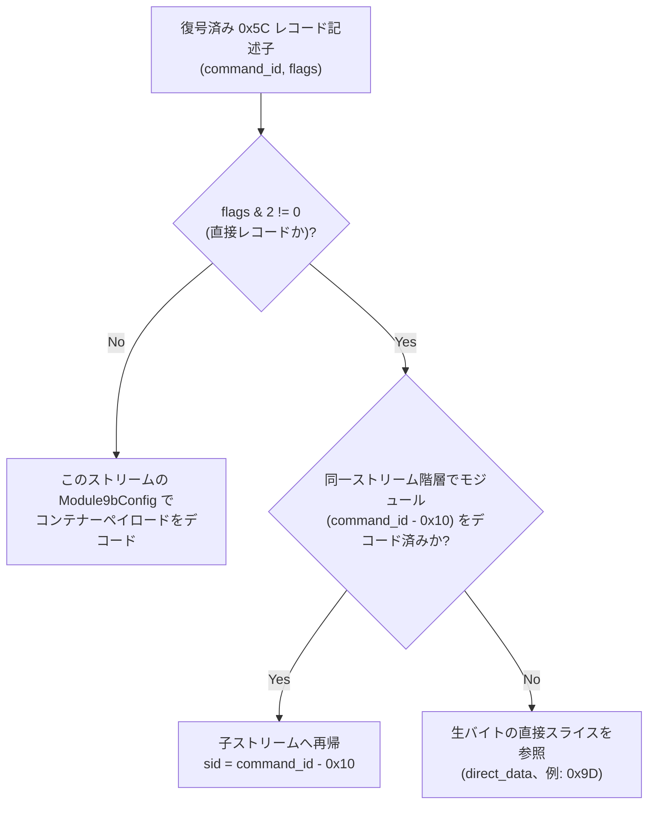

# Stage 2 ストリーム

Stage 2 はルートストリーム識別子 `0xE2` から始まります。各ストリームの先頭には暗号化された 8 バイトのヘッダー（`cipher0`、`cipher1`）があり、直後の `+0x08` から `0x5C` バイトのレコード記述子が `N` 個連続して並びます（復号後のストリームヘッダーの `dw0` がレコード数を表し、上限は 256 です）。各レコードのペイロードは記述子テーブル全体（`8 + N * 0x5C`）の後ろに配置されるため、`8 + (index + 1) * 0x5C` が非ゼロの最小 `image_offset` または `metadata_offset` に達した時点で記述子の読み取りは終了します。

## レコードのディスパッチ

各レコード記述子は `command_id`、`flags`、`image_offset` / `image_size`、`metadata_offset` / `metadata_size`、`id_copy`（`== command_id`）、`entry_offset`（`+0x1C`）、および `init_offset`（`+0x20`）を保持します。`image_size` と `metadata_size` の意味は `DIRECT_FLAG`（`0x2`）の有無によって切り替わります。

* **コンテナーレコード（`flags & 2 == 0`）:** `image_offset` と `metadata_offset` は現在のストリーム内にある圧縮・暗号化済みコンテナーを指し、`image_size` と `metadata_size` は**展開後に期待される出力サイズ**を表します（ストリーム上の圧縮データはこれより小さいため、デコード前に `offset < stream.len()` を確認し、展開後にデコード結果のサイズが一致することを検証します）。ストリーム階層 `S` にある各コンテナーは、ストリーム `S` 自身のインタープリター[モジュール設定](../data-transforms/module-config.md)を使ってデコードされます。具体的には、ルート `0xE2` では Stage 2 イメージに埋め込まれたデコーダー設定、入れ子階層 `0xE3`..`0xE8` ではインタープリターモジュール `S` から抽出した `Module9bConfig` が用いられます。
* **直接レコード（`flags & 2 != 0`）:** `image_offset` と `image_size` は現在のストリーム内にある生バイト列の範囲を直接指定します（`image_offset + image_size <= stream.len()`）。同一ストリーム階層で識別子 `command_id - 0x10` のモジュールがデコード済みである場合（観測例では `0xF3` -> `0xE3` から `0xF8` -> `0xE8` までの組）、そのスライスは子ストリーム `command_id - 0x10` として再帰的に解析されます。該当するモジュールが存在しない場合（モジュール `0x9D` など）、スライスは生のモジュールデータとしてそのまま保持されます。

フラグ `0x100` が立っているレコードでは、実行時の `init` および `entry` コールバックがスキップされます。静的抽出では、子ストリームを `(stream_id, sha256)` で重複排除して同一ストリームの再デコードを防ぎ、同一モジュール ID の重複レコードは SHA-256 ダイジェストが一致する場合にのみ受理します。

実行時のモジュールテーブルとコールバック順序については、[Stage 2 インタープリター](../runtime/stage2-interpreter.md)を参照してください。

## 構造境界の検証

イメージペイロードとプロテクターモジュール用のメタデータ（`metadata_offset` / `metadata_size`。IL2CPP アセットではなく、モジュールのロード・再配置・インポート情報を保持します）は、抽出処理全体を通じて個別に管理されます。記述子テーブルの切り詰め、`id_copy` の不一致、範囲外のスライス、コンテナーのデコード失敗、または同一モジュール間でのダイジェスト競合が 1 つでも発生した場合、ストリーム抽出は中断されます。
