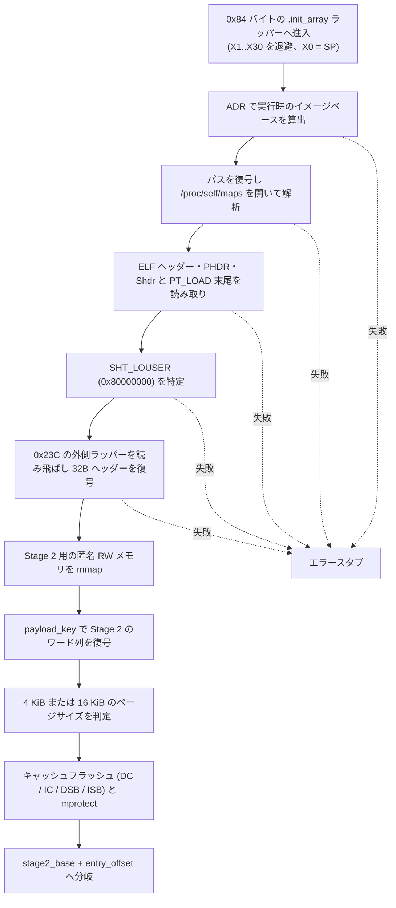

# Stage 1 ブートストラップ

`.init_array` の 1 エントリは、元のまま残された `.text` 先頭領域にある `0x84` バイトのレジスタ退避ラッパーを指しています（15 個の `STP` 命令で `X1`..`X30` を退避し、`MOV X0, SP` に続いてブートストラップ本体へ `BL` し、15 個の `LDP` で復帰して `RET` します）。ブートストラップは `/proc/self/maps` から自身のファイルパスを特定して `SHT_LOUSER` を読み取り、Stage 2 を匿名メモリへ復号してエントリポイントへジャンプします。

## `SHT_LOUSER` の特定

Stage 1 は `ADR` 命令で自身の PC を取得し、リンク時のオフセットを減算してロード済み共有ライブラリのベースアドレスを求めます。続いてスタックバッファ上に `"/proc/self/maps"` を復号してファイルを開き、直ちにパスバッファを消去します。ロードベースに対応する実体ファイルのパスを見つけたら、ELF ヘッダー、プログラムヘッダーテーブル、およびセクションヘッダーテーブル（`Elf64_Shdr` ストライド `0x40`）を読み取り、最後の `PT_LOAD` セグメント直後にある `sh_type == 0x80000000`（`SHT_LOUSER`）の専用セクションを特定します。

先頭 `0x23C` バイトの外側ラッパーを読み飛ばした先にある `0x1000` バイトのパラメーター領域から、先頭 32 バイトをビルド系統ごとのワード定数 `C`（`0xBF20165D` または `0xBF189BDD`。[Stage 1 ヘッダー](../file-format/stage1.md)を参照）で復号します。

## Stage 2 のマッピングとレジスタ引き渡し

Stage 1 は `payload_size` バイトの書き込み可能な匿名メモリ領域を確保し、`payload_key` を用いて Stage 2 イメージをコピー・復号します。システムのページサイズ（4 KiB または 16 KiB）を判定したあと、データキャッシュと命令キャッシュをフラッシュ（`DC` / `IC` / `DSB` / `ISB`）し、`protect_size` の範囲に `mprotect` を適用して、以下の 8 引数をレジスタにセットした状態で `stage2_base + entry_offset` へ分岐します。

| レジスタ | 値 |
| --- | --- |
| `X0` | ローダーコンテキストのポインター |
| `X1` | 保護対象ライブラリの実行時イメージベース |
| `X2` | 復号済み Stage 2 のベースアドレス |
| `X3` | 復号済み Stage 2 のバイトサイズ（`payload_size`） |
| `X4` | 残りの `SHT_LOUSER` ストリームのベース（Stage 2 終端を 4 バイト境界に切り上げた位置） |
| `X5` | 残りの `SHT_LOUSER` ストリームのサイズ |
| `X6` | ファイル末尾マッピングのベース |
| `X7` | ファイル末尾マッピングのサイズ |

Stage 2 は開始直後に `(X2, X3)` をモジュール `0xE2`、`(X6, X7)` をモジュール `0xD0` として登録します。
