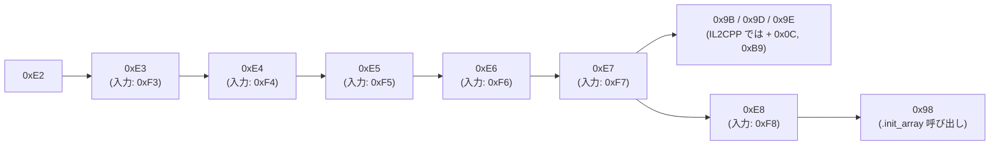

# Stage 2 インタープリター

Stage 2（`0xE2`）は 256 スロットのモジュールテーブルを確保し、自身（`0xE2`）と `SHT_LOUSER` 末尾マッピング（`0xD0`）を登録したうえで、`(X4, X5)` に渡されたルートレコードストリームを走査します。各階層のインタープリターはワーカーモジュールをロードしつつ、次のインタープリターモジュール `0xE(n+1)` をデコードし、直接スライスであるストリーム `0xF(n+1)` を切り出して `0xE(n+1)` へ引き渡します。

## モジュールテーブル（`0x1800` バイト）

Stage 2 は `0x1800` バイトの匿名 RW メモリをマップし、`0x18`（24）バイトのエントリを 256 個保持します。

| オフセット | サイズ | フィールド |
| --- | --- | --- |
| `+0x00` | 4 | `command_id` |
| `+0x04` | 4 | 状態フラグ |
| `+0x08` | 8 | マップ先ベースポインター |
| `+0x10` | 4 | マップサイズ |
| `+0x14` | 4 | 予約領域 |

スロットの登録は `0xE2`（`X2`, `X3`）と `0xD0`（`X6`, `X7`）から始まり、以降はストリームの実行に伴って各レコードの `command_id` 順に追加されます。

## `0x5C` レコード記述子のレイアウト

8 バイトのストリームヘッダー（`dw0` = 記述子数、`G` = 記述子シード。[ワード・ストリーム・レコード暗号](../data-transforms/word-and-record.md)を参照）に続き、最初のペイロードオフセットの手前まで `8 + N * 0x5C` バイトにわたって記述子が並びます。23 dword（`0x5C` バイト）の各記述子は以下のバイナリレイアウトを持ちます。

| オフセット | Dword | フィールド | 役割 |
| --- | --- | --- | --- |
| `+0x00` | `words[0]` | `command_id` | モジュールまたはストリームスライスの識別子（`0x00`..`0xFF`） |
| `+0x04` | `words[1]` | `flags` | `0x2` = 直接スライス、`0x100` = `init` / `entry` コールバックをスキップ |
| `+0x08` | `words[2]` | `image_offset` | 現在のストリーム内におけるペイロードオフセット |
| `+0x0C` | `words[3]` | `image_size` | 展開後のコンテナーサイズ（`flags & 2 == 0`）または生スライス長（`flags & 2 != 0`） |
| `+0x10` | `words[4]` | `metadata_offset` | プロテクターモジュールのロード・再配置・インポート用メタデータのオフセット（なしの場合は `0`） |
| `+0x14` | `words[5]` | `metadata_size` | 展開後または生のモジュールメタデータサイズ |
| `+0x18` | `words[6]` | `id_copy` | `command_id` と一致する必要がある複製値 |
| `+0x1C` | `words[7]` | `entry_offset` | マップ先ベースからのモジュール `entry` コールバック相対オフセット |
| `+0x20` | `words[8]` | `init_offset` | マップ先ベースからのモジュール `init` コールバック相対オフセット |
| `+0x24..+0x5C` | `words[9..22]` | 後続ワード | 予約領域 / モジュール固有パラメーター |

各記述子に対し、インタープリターはまずペイロードを準備します（`flags & 2 == 0` の場合は固有の `Module9bConfig` でコンテナーを展開し、`flags & 2 != 0` の場合はストリームスライスを直接参照します）。続いてレコードの `metadata` ブロブに従ってモジュールの再配置とインポート解決を適用し、テーブルへスロットを登録したあと、`flags & 0x100` が立っていなければ `init_offset`、次いで `entry_offset` を呼び出します。

## ビルド構成による階層の違い

インタープリター `0xE7` は中核となる ELF 復元モジュール（`0x9B`、`0x9D`、`0x9E`）をロードします。Unity IL2CPP ビルドでは、これに加えて `0xE7` がモジュール `0x0C`（`global-metadata.dat` に対する `mmap` フック）とデータ入りの `0xB9` レコードをロードします。一方、非 IL2CPP の一般的なネイティブライブラリでは `0x0C` は含まれず、`0xB9` も省略されるか空レコードになります。その後、インタープリター `0xE8` がモジュール `0x98` をロードし、イメージ復元完了後に対象ライブラリの `.init_array` コンストラクターを実行します。
