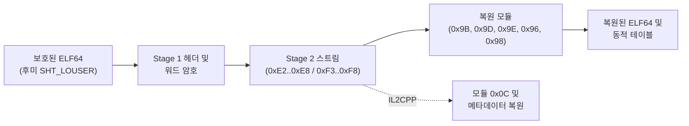

# CrackProof Android SO 내부 구조

이 섹션에서는 리틀 엔디안 ELF64 AArch64 공유 라이브러리에 적용되는 CrackProof의 Android 네이티브 라이브러리 보호 포맷을 다룹니다. CrackProof는 로드 가능한 코드와 데이터 영역을 비우고 파일 끝에 단일 `SHT_LOUSER` 페이로드 섹션을 추가하며, 로드 시점에 2단계 로더와 중첩 모듈 스트림을 거쳐 이미지를 재구성합니다.

## 섹션 구성

<table data-view="cards"><thead><tr><th width="48"></th><th></th><th></th><th data-hidden data-card-target data-type="content-ref"></th></tr></thead><tbody><tr><td><i class="fa-folder-tree"></i></td><td><strong>파일 포맷</strong></td><td>ELF 식별 조건, 커스텀 <code>SHT_LOUSER</code> 섹션, Stage 1 파라미터, Stage 2 레코드 스트림을 다룹니다.</td><td><a href="file-format/file-format.md">파일 포맷</a></td></tr><tr><td><i class="fa-shuffle"></i></td><td><strong>데이터 변환</strong></td><td>GF(2³²) 워드 믹싱, 스트림 및 레코드 암호, 모듈 <code>0x9B</code> 키, <code>0x9D</code> 컨테이너, Huffman/LZ 압축을 다룹니다.</td><td><a href="data-transforms/data-transforms.md">데이터 변환</a></td></tr><tr><td><i class="fa-puzzle-piece"></i></td><td><strong>복원</strong></td><td>정적 모듈 추출, 동적 심볼 테이블과 재배치 테이블 복구, 정상 ELF 재구성을 다룹니다.</td><td><a href="restoration/restoration.md">복원</a></td></tr><tr><td><i class="fa-play"></i></td><td><strong>런타임</strong></td><td>Stage 1 자체 탐색, Stage 2 모듈 테이블과 중첩 인터프리터, 실행 환경 점검, 모듈 카탈로그를 다룹니다.</td><td><a href="runtime/runtime.md">런타임</a></td></tr><tr><td><i class="fa-database"></i></td><td><strong>메타데이터</strong></td><td>IL2CPP 메타데이터 버전 24.1, 29, 31, 39와 5라운드 RID 순열 및 저장 레이아웃을 다룹니다.</td><td><a href="metadata/metadata.md">메타데이터</a></td></tr><tr><td><i class="fa-compass"></i></td><td><strong>분석</strong></td><td>실패 시 즉시 거부하는 검증 체크리스트와 Android 빌드 계열별 포맷 상수를 정리합니다.</td><td><a href="analysis/analysis.md">분석</a></td></tr></tbody></table>

## Windows 포맷과의 관계

Android 공유 라이브러리는 3바이트 Huffman/LZ 토큰 인코딩과 바이트 역순 AES-256 복호화 키 스케줄을 [CrackProof for Windows 내부 구조](https://app.gitbook.com/s/FlY9nVrA6FxLQBrkLIc2/)와 공유합니다. 반면 GF(2³²) 워드 암호, 중첩 `0xE2`..`0xE8` 레코드 스트림, 보조 ELF 컨테이너 기반 재배치 구조, 유저모드 전용 환경 검사는 Android 고유 요소입니다.
