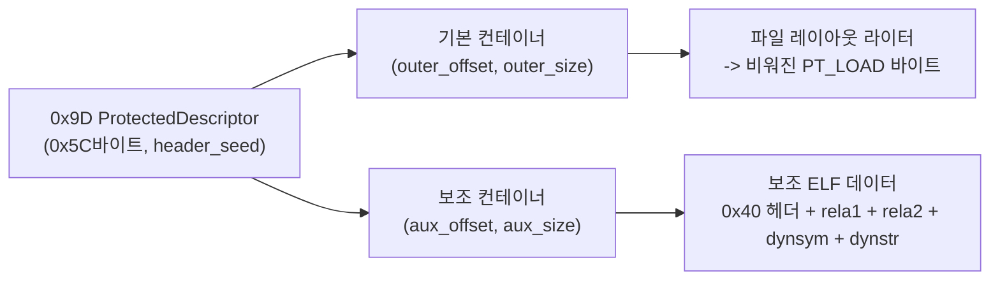

# 컨테이너 변환

모듈 `0x9D`는 [모듈 `0x9B`](module-config.md)의 `header_seed`로 복호화되는 `0x5C`바이트 [보호 디스크립터](word-and-record.md)로 시작합니다. 이 디스크립터는 `0x9D` 내부에 담긴 두 개의 독립 컨테이너 범위를 지정하며, 두 컨테이너 모두 `0x9B`에서 얻은 `container_seed`와 복원된 AES-256 키로 디코딩됩니다.



## 컨테이너 헤더

헤더 시드 `s`는 `seed = container_seed`를 제곱한 뒤 비트 시프트(`17` 및 `11`) 결과를 XOR하여 유도합니다.

```text
s = (seed * seed) & MASK32
s = ((s >> 17) ^ (s << 11)) & MASK32
```

첫 12바이트(`w0`, `w1`, `w2`)는 부호 없는 32비트 래핑 연산과 `gf = gf32_mul_fixed`를 사용해 디코딩합니다.

| 워드 | 수식 (모든 연산은 mod 2³²) | 디코딩된 의미 |
| --- | --- | --- |
| `w0` | `gf(w0) + s * 0xF87B337C + (0xA21DFB3A << (s & 7))` | 디코딩된 컨테이너 전체 출력 크기 (`0`이면 빈 컨테이너) |
| `w1` | `gf(w1) ^ (s + 0xBD19C63C + (0x416E2AF2 >> (s & 0xD)))` | 하위 바이트 `w1 & 0xFF` = `segment_count` (`> 0`), 둘째 바이트 `(w1 >> 8) & 0xFF == 1`이면 `header.skip_aes` 설정 |
| `w2` | `gf(w2) + (0x643A3A3B << (s & 0xB)) - (s ^ 0x3B2BF538)` | 바이트 단위 `tree_size` (`<= 0x1B00`) |

**Huffman 테이블 (`+0x0C`, 길이 `tree_size`):** 테이블 버퍼 안의 4바이트 정렬된 모든 dword를 먼저 `gf(dword)`로 치환한 뒤(끝에 남는 1~3바이트는 바이트 단위 보정 전까지 그대로 유지), `0..tree_size` 범위의 각 인덱스 `i`에 대해 바이트 단위로 보정합니다.

```text
k20  = ((s + 0xF1CB5B81) * s) & MASK32
k21  = (k20 - s * 0x23B32203) & MASK32
adj  = ((gf((k20 << (i & 0x1B)) & MASK32) - (k21 >> (i & 0x17))) & MASK32) >> (i & 0x1F)
b[i] = (b[i] + adj) & 0xFF
```

**세그먼트 테이블 (Huffman 테이블 끝의 4바이트 정렬 위치, `{offset, size}` dword 쌍 `segment_count`개):** 세그먼트 테이블 시작점 기준 `byte_offset = index * 4` 위치의 각 워드는 다음과 같이 복호화됩니다.

```text
t     = ((s + 0xB31F451C) * s) & MASK32
k22   = (t << 3) & MASK32
s2    = (t - s * 0x822FE82D) & MASK32
plain = (gf(cipher ^ k22) + (s2 >> ((byte_offset & 7) + 5))) & MASK32
```


`s2`는 시프트된 `k22`가 아니라 시프트 전 곱셈 결과인 `t`에서 `s * 0x822FE82D`를 뺀 값입니다. `k22`를 사용하면 모든 세그먼트의 오프셋과 크기가 손상됩니다.


모든 `{offset, size}` 세그먼트 범위는 컨테이너 버퍼 내부에 들어와야 합니다.

## 세그먼트 암호 및 AES 계층

각 세그먼트에 대해 `state = container_seed`, `left = 0xE34EAC63`, `right = 0x07B48238`에서 시작하여 4바이트 리틀 엔디안 청크(`i = 0, 1, ...`) 단위로 롤링 워드 복호화를 수행합니다.

```text
left  = ((state + 0x72F6FCBE + ((left + 0x4F8B1BCA) * left)) & MASK32) >> ((i * i) & 0x0F)
right = (((state - 0x71B6A98D + ((right - 0x1605A81C) * right)) & MASK32) << (i & 7)) & MASK32
state = left ^ right

v = (word[i] + (0xB43B9BAF * (i & 0x0D))) & MASK32
v = v ^ ((0xAF57F7FB * (i & 3)) & MASK32)
word[i] = ((v - state) & MASK32) ^ state
```

그다음 `config.skip_aes || header.skip_aes`가 `false`이면, [모듈 설정](module-config.md)에서 복원한 키와 0으로 채워진 IV를 사용해 16바이트 블록 단위로 제자리(in-place) AES-256-CBC 복호화를 수행합니다.

## 라이터 레코드와 대상 영역 매핑

복호화된 각 세그먼트는 16바이트 라이터 헤더 `{u32 base, u32 count, u32 table_offset, u32 src_base}`로 시작합니다. `table_offset` 위치에는 16바이트 레코드 `{u32 dst, u32 out_len, u32 src_len, u32 pad}`가 `count`개 이어지며, 각 레코드에 대응하는 `src_len` 바이트 입력 슬라이스를 `src_base`부터 순서대로 읽어들입니다.

* `out_len == src_len`이면 슬라이스를 그대로 `base + dst`에 복사합니다.
* 두 길이가 다르면 컨테이너에서 디코딩한 Huffman 테이블을 사용해 [Huffman 및 LZ 압축](compression.md) 방식으로 압축을 해제하며, 이때 `src_len` 바이트를 남김없이 읽어들여 정확히 `out_len` 바이트를 출력해야 합니다.

기본 `0x9D` 컨테이너의 라이터 대상 주소는 ELF 내 `PT_LOAD` 세그먼트들의 가상 주소 범위를 가리킵니다. `0..p_filesz` 구간에 대한 쓰기는 대응하는 파일 오프셋에 기록되고, `.bss` 후미 구간(`p_filesz..p_memsz`)에 대한 쓰기는 파일 크기를 늘리지 않고 메모리상 커버리지 구간만 확장합니다.

## 보조 ELF 재배치 컨테이너

`(aux_offset, aux_size)` 위치의 두 번째 컨테이너는 `PT_LOAD` 가상 주소 쓰기 레코드가 아니라 독립된 동적 링킹 데이터 블록으로 디코딩됩니다.

| 영역 | 레이아웃 | 내용 |
| --- | --- | --- |
| 헤더 (`0x00..0x40`) | 16 × `u32` | `words[4..12]` = `dynstr_offset`, `dynstr_size`, `dynsym_offset`, `dynsym_count`, `relocation1_offset` (`0x40`), `relocation1_count`, `relocation2_offset`, `relocation2_count`; `words[14] == 0xB7` (`EM_AARCH64`); `words[1, 3, 12, 13, 15] == 0` |
| `relocation1` | `Elf64_Rela[relocation1_count]` + 16B 0 정렬 | `.rela.dyn` 엔트리 (`0x403` = `R_AARCH64_RELATIVE`, `0x101` = `R_AARCH64_ABS64`, `0x401` = `R_AARCH64_GLOB_DAT`) |
| `relocation2` | `Elf64_Rela[relocation2_count]` + 16B 0 정렬 | `.rela.plt` 엔트리 (`0x402` = `R_AARCH64_JUMP_SLOT`) |
| 보조 `.dynsym` | `Elf64_Sym[dynsym_count]` | 인덱스 `0`의 24바이트 널 심볼과 그 뒤에 이어지는 제거된 외부 심볼들 |
| 보조 `.dynstr` | `u8[dynstr_size]` | 보조 동적 심볼 테이블의 NUL 종료 문자열 이름 |

각 `0x18`바이트 재배치 엔트리는 표준 `Elf64_Rela` `{u64 r_offset, u64 r_info, i64 r_addend}` 구조체이며, 상위 32비트(`r_info >> 32`)에 보조 심볼 인덱스를 저장합니다(모듈 `0x96`이 존재할 경우 행마다 순열이 적용된 상태). 이 테이블들을 원본 `.dynsym`, `.dynstr`, `.rela.dyn`, `.rela.plt`에 다시 병합하는 과정은 [동적 링킹](../restoration/dynamic-linking.md)에서 다룹니다.
