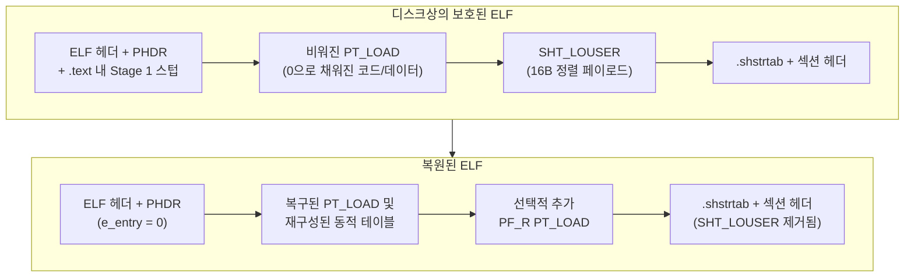

# 보호된 ELF

## 필수 ELF 구조

보호된 바이너리는 AArch64를 대상으로 하는 리틀 엔디안 ELF64 공유 라이브러리입니다(`EM_AARCH64 = 183`, `e_phentsize = 0x38`, `e_shentsize = 0x40`). 섹션 이름은 파일 범위 내에 위치한 유효한 UTF-8 `SHT_STRTAB` 섹션인 `.shstrtab`에서 해석됩니다.

| 섹션 | 필수 여부 | 용도 |
| --- | --- | --- |
| `.dynsym` 및 `.dynstr` | 필수 | 동적 심볼 레코드와 심볼 이름 문자열 |
| `.gnu.hash` 및/또는 `.hash` | 최소 1개 | 심볼 해시 조회 테이블 (GNU 해시, SysV 해시 또는 둘 다) |
| `.gnu.version` | 필수 | 심볼별 버전 인덱스 |
| `.gnu.version_r` | 필수 | 심볼 버전 요구사항 |
| `.dynamic`, `.rela.dyn`, `.rela.plt` | 각 1개 (복원 시) | 동적 태그, 데이터 재배치 테이블, PLT 재배치 테이블 |
| `SHT_LOUSER` (`0x80000000`) | 정확히 1개, 마지막 섹션 | 암호화된 Stage 1 및 Stage 2 보호 페이로드 |

`SHT_LOUSER` 섹션이 없거나 여러 개인 파일, 섹션 범위가 파일 크기를 벗어난 파일, 또는 다른 아키텍처나 엔디안을 사용하는 파일은 복호화 전에 거부됩니다. `SHT_LOUSER` 섹션은 항상 섹션 헤더 테이블의 마지막 엔트리로 배치되며, `PT_LOAD` 세그먼트의 파일 데이터 구간 끝을 16바이트 정렬한 위치에서 시작합니다(정렬 간격은 0으로 패딩됨).

`.init_array` 내부의 `R_AARCH64_RELATIVE` 엔트리 하나는 보존된 `.text` 앞부분에 위치한 `0x84`바이트 크기의 Stage 1 부트스트랩 래퍼를 가리킵니다. 이 래퍼는 15개의 `STP` 명령어로 `X1`..`X30` 레지스터를 저장하고 `X0`에 `SP`를 담아 부트스트랩 본체를 호출한 뒤, 레지스터를 복구하고 반환합니다. 나머지 `.init_array` 엔트리는 링커 순서대로 유지된 일반 생성자, `RET` 명령어(`0xD65F03C0`)만 있는 자리표시자, 또는 이미지 복원과 모듈 `0x98`의 생성자 복구가 끝난 뒤에야 유효해지는 비워진 영역 내 주소입니다.

## 노출된 헤더와 보조 파일

보호된 파일은 파싱 가능한 ELF 헤더, 프로그램 헤더 테이블, 섹션 헤더 테이블, `.dynamic` 엔트리를 유지하지만, 일부 동적 심볼 테이블과 재배치 테이블은 잘려 있거나 숨김 심볼과 재배치 엔트리가 제거된 상태입니다. 따라서 보호된 바이너리를 식별할 때는 `SHT_LOUSER` 섹션의 존재만 확인하는 데 그치지 않고 이 ELF 레이아웃과 [Stage 1 헤더](stage1.md), [Stage 2 스트림](stage2-streams.md)의 검증 조건을 함께 대조해야 합니다.

보호된 APK에는 대상 `.so` 파일과 함께 다음 두 가지 보조 파일이 자주 포함됩니다.

* `lib__XXXX__.so` (`XXXX`는 짧은 빌드 스탬프): 별도 공유 라이브러리로 분리된 Stage 1/2 보호기 스텁 사본입니다.
* `assets/<id>/data1.dat` (약 180 KiB의 고엔트로피 데이터): 보호 대상 라이브러리 이름과 라이브러리별 설정을 담은 소규모 설정 테이블입니다.

두 파일 모두 런타임 래퍼 아티팩트이며, 복원된 공유 라이브러리에서는 사용되지 않습니다.
