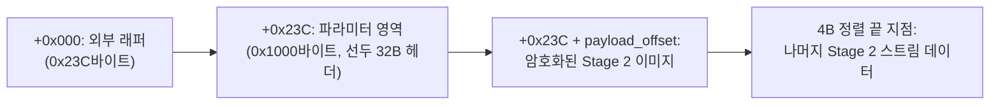

# Stage 1 헤더

`SHT_LOUSER` 섹션은 다음 네 영역이 순서대로 이어진 구조입니다.



확인된 빌드에서는 외부 래퍼 크기(`outer_size`)가 `0x23C`바이트(572바이트)이며, 그 뒤에 `0x1000`바이트 파라미터 블록이 이어지고 이 블록의 첫 32바이트에 암호화된 8개의 dword로 구성된 Stage 1 헤더가 자리합니다. 빌드 계열에 따라 두 가지 Stage 1 워드 암호 상수 `C`(`0xBF20165D`, `0xBF189BDD`)가 사용됩니다.

런타임에서 이 섹션을 탐색하는 과정은 [Stage 1 부트스트랩](../runtime/stage1-bootstrap.md)에서 다루며, 관련 암호 체계는 [워드, 스트림 및 레코드 암호](../data-transforms/word-and-record.md)에 정리되어 있습니다.

## 헤더 필드

`section_offset + outer_size` 위치의 첫 32바이트를 복호화하면 8개의 리틀 엔디안 `u32` 필드를 얻습니다.

| 오프셋 | 필드 | 의미 | 검증 규칙 |
| --- | --- | --- | --- |
| `+0x00` | `key` | 파일별 Stage 1 헤더 키 | 워드 `1..7` 복호화 후 워드 0에 기록됨 |
| `+0x04` | `reserved` | 미사용 예약 필드 | `== 0` |
| `+0x08` | `payload_offset` | 파라미터 헤더(`section_offset + outer_size`) 기준 Stage 2 시작 오프셋 | `>= 0x20` 및 `payload_offset + payload_size <= section_size - outer_size` |
| `+0x0C` | `payload_size` | 암호화된 Stage 2의 바이트 길이 | `> 0` 및 4바이트 정렬 (`payload_size % 4 == 0`) |
| `+0x10` | `payload_key` | Stage 1이 Stage 2 이미지를 복호화할 때 쓰는 워드 암호 키 | `payload_size` 바이트 범위에 대해 Stage 1 워드 암호에 전달됨 |
| `+0x14` | `entry_offset` | 복호화된 Stage 2 이미지 내부 진입 오프셋 | `< payload_size` |
| `+0x18` | `protect_size` | 복호화된 Stage 2 이미지 내부 `mprotect` 적용 길이 | `<= payload_size` |
| `+0x1C` | `size_copy` | `payload_size`의 사본 | `== payload_size` |


`payload_offset`은 ELF 파일 시작점이 아니라 32바이트 파라미터 헤더의 시작 위치(`section_offset + outer_size`)를 기준으로 계산됩니다. 따라서 암호화된 Stage 2 이미지의 실제 파일 오프셋은 `section_offset + outer_size + payload_offset`입니다.


워드 인덱스 `i`(`0..7`)는 부호 없는 32비트 래핑 연산(하위 32비트 마스킹)으로 복호화합니다.

```text
plain[i] = ((cipher[i] + (i + 3) * key) ^ (C * (i + 1))) & 0xFFFFFFFF
```

먼저 워드 `0`에서 `key = cipher[0] ^ C`를 구해 워드 `1..7`을 복호화하고 `plain[0] = key`를 기록합니다. 이어서 Stage 1은 동일한 워드 암호에 `payload_key`와 상수 `C`를 적용해 `section_offset + outer_size + payload_offset` 위치의 Stage 2 이미지를 복호화합니다. Stage 2 루트 레코드 스트림(`0xE2`)은 `SHT_LOUSER` 내부에서 Stage 2 이미지의 4바이트 정렬된 끝 지점 바로 뒤에서 시작합니다.

## 헤더 검증

`(outer_size, C)` 후보 조합은 8개 헤더 불변식이 모두 성립하고 Stage 2 이미지와 후속 스트림 전체가 `SHT_LOUSER` 범위 안에 들어올 때만 채택됩니다. 섹션이 잘려 있거나 `reserved` 워드가 0이 아니거나, `size_copy` 불일치, `payload_size` 정렬 오류, `entry_offset` 또는 `protect_size` 범위 초과가 하나라도 있으면 Stage 2 파싱 전에 해당 후보를 거부합니다.
