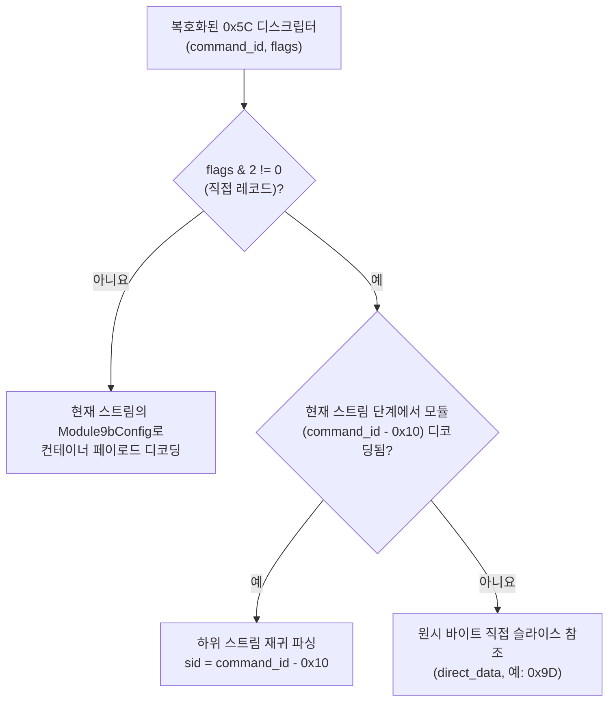

# Stage 2 스트림

Stage 2는 루트 스트림 식별자 `0xE2`에서 시작합니다. 각 스트림은 암호화된 8바이트 헤더(`cipher0`, `cipher1`)로 시작하며, 바로 뒤인 `+0x08` 위치부터 `0x5C`바이트 크기의 레코드 디스크립터 `N`개가 연속 배열로 이어집니다(복호화된 스트림 헤더의 `dw0` 값이 개수를 나타내며 최대 256개). 레코드 페이로드는 디스크립터 테이블 전체(`8 + N * 0x5C`) 뒤에서 시작하므로, 0이 아닌 `image_offset` 또는 `metadata_offset` 중 가장 작은 오프셋에 디스크립터 끝 위치(`8 + (index + 1) * 0x5C`)가 도달하면 파싱을 멈춥니다.

## 레코드 디스패치

각 레코드 디스크립터는 `command_id`, `flags`, `image_offset` / `image_size`, `metadata_offset` / `metadata_size`, `id_copy`(`== command_id`), `entry_offset`(`+0x1C`), `init_offset`(`+0x20`) 필드를 담고 있습니다. `image_size`와 `metadata_size`의 해석 방식은 `DIRECT_FLAG`(`0x2`) 설정 여부에 따라 달라집니다.

* **컨테이너 레코드 (`flags & 2 == 0`):** `image_offset`과 `metadata_offset`은 현재 스트림 내부의 압축 및 암호화된 컨테이너를 가리키며, `image_size`와 `metadata_size`는 디코딩 후 생성될 **예상 출력 크기**를 나타냅니다(스트림 내 압축 페이로드는 출력 크기보다 작으므로 디코딩 전에는 `offset < stream.len()`을 확인하고, 압축 해제 후에는 디코딩된 크기가 정확히 일치하는지 검증함). 스트림 단계 `S`에 속한 모든 컨테이너는 해당 스트림 `S`의 인터프리터 [모듈 설정](../data-transforms/module-config.md)으로 디코딩됩니다. 루트 스트림 `0xE2`에서는 Stage 2에 내장된 디코더 설정을 사용하고, 중첩 단계 `0xE3`..`0xE8`에서는 인터프리터 모듈 `S`에서 파싱한 `Module9bConfig`를 사용합니다.
* **직접 레코드 (`flags & 2 != 0`):** `image_offset`과 `image_size`로 현재 스트림에서 원시 바이트 슬라이스를 직접 참조합니다(`image_offset + image_size <= stream.len()`). 동일한 스트림 단계에서 식별자 `command_id - 0x10`인 모듈이 이미 디코딩된 상태라면(확인된 쌍: `0xF3` -> `0xE3`부터 `0xF8` -> `0xE8`까지), 해당 직접 슬라이스를 하위 스트림 `command_id - 0x10`으로 간주하여 재귀 파싱합니다. 그렇지 않은 경우(예: 모듈 `0x9D`)에는 원시 모듈 데이터로 유지합니다.

플래그 `0x100`이 설정된 레코드는 런타임에서 `init` 및 `entry` 콜백 호출을 건너뜁니다. 정적 추출 시 하위 스트림은 `(stream_id, sha256)` 조합으로 중복을 제거하여 동일한 참조를 두 번 디코딩하지 않으며, 같은 모듈 ID를 가진 중복 레코드는 SHA-256 다이제스트가 일치할 때만 허용됩니다.

런타임 모듈 테이블과 콜백 실행 순서는 [Stage 2 인터프리터](../runtime/stage2-interpreter.md)에서 다룹니다.

## 구조적 경계 검증

추출 전 과정에서 이미지 페이로드와 보호기 모듈 메타데이터(`metadata_offset` / `metadata_size`, IL2CPP 에셋이 아니라 모듈 로드, 재배치, 임포트 메타데이터를 담음)는 분리해 처리합니다. 잘린 디스크립터 테이블, `id_copy` 불일치, 범위를 벗어난 슬라이스, 컨테이너 디코딩 실패, 모듈 다이제스트 충돌이 발생하면 스트림 추출을 즉시 중단합니다.
