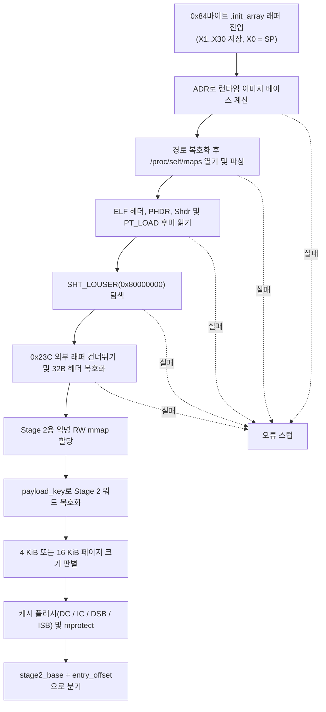

# Stage 1 부트스트랩

`.init_array` 엔트리 중 하나는 온전하게 유지된 `.text` 앞부분의 `0x84`바이트 레지스터 보존 래퍼를 가리킵니다(`X1`..`X30` 레지스터를 저장하는 15개의 `STP` 명령어, `MOV X0, SP`, 부트스트랩 본문으로의 `BL` 호출, 15개의 `LDP` 복원 명령어 및 `RET` 명령어로 구성). 부트스트랩은 `/proc/self/maps`를 통해 디스크 상의 원본 ELF 파일을 찾고 전용 섹션 `SHT_LOUSER`를 읽은 뒤, 익명 메모리에 Stage 2를 복호화하여 해당 엔트리 포인트로 분기합니다.

## `SHT_LOUSER` 탐색

Stage 1은 `ADR` 명령어로 현재 PC를 구하고 링크 타임 오프셋을 빼서 로드된 공유 라이브러리의 베이스 주소를 계산한 뒤, 스택 버퍼에 `"/proc/self/maps"` 문자열을 복호화하여 파일을 열고 경로 버퍼를 즉시 지웁니다. 로드 베이스에 대응하는 원본 파일 경로를 확인하면 ELF 헤더, 프로그램 헤더 테이블, 섹션 헤더 테이블(`Elf64_Shdr` 보폭 `0x40`)을 읽어 마지막 `PT_LOAD` 세그먼트 뒤에 위치한 `sh_type == 0x80000000`(`SHT_LOUSER`) 섹션을 찾습니다.

`0x23C`바이트 외부 래퍼 뒤에는 `0x1000`바이트 파라미터 영역이 이어지며, 그중 첫 32바이트를 빌드 계열별 워드 상수 `C`(`0xBF20165D` 또는 `0xBF189BDD`, [Stage 1 헤더](../file-format/stage1.md) 참고)로 복호화합니다.

## Stage 2 매핑 및 레지스터 제어 전달

Stage 1은 `payload_size` 바이트 크기의 쓰기 가능한 익명 메모리 영역을 할당하고 `payload_key`로 Stage 2 이미지를 복사·복호화한 뒤, 시스템 페이지 크기(4 KiB 또는 16 KiB)를 판별하여 데이터 및 명령어 캐시를 플러시하고(`DC` / `IC` / `DSB` / `ISB`), `protect_size` 범위에 `mprotect`를 적용한 다음 8개 인자와 함께 `stage2_base + entry_offset`으로 분기합니다.

| 레지스터 | 값 |
| --- | --- |
| `X0` | 로더 컨텍스트 포인터 |
| `X1` | 보호된 공유 라이브러리의 런타임 이미지 베이스 |
| `X2` | 복호화된 Stage 2 베이스 주소 |
| `X3` | 복호화된 Stage 2 바이트 크기(`payload_size`) |
| `X4` | 남은 `SHT_LOUSER` 스트림 베이스(Stage 2 끝의 4바이트 정렬 지점) |
| `X5` | 남은 `SHT_LOUSER` 스트림 크기 |
| `X6` | 파일 후미 매핑 베이스 |
| `X7` | 파일 후미 매핑 크기 |

Stage 2는 진입 직후 `(X2, X3)` 쌍을 모듈 `0xE2` 슬롯에, `(X6, X7)` 쌍을 모듈 `0xD0` 슬롯에 기록합니다.
