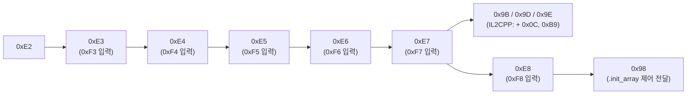

# Stage 2 인터프리터

Stage 2(`0xE2`)는 256슬롯 모듈 테이블을 할당하여 자기 자신(`0xE2`)과 `SHT_LOUSER` 후미 매핑(`0xD0`)을 등록한 뒤, `(X4, X5)`로 전달된 루트 레코드 스트림을 순회합니다. 각 인터프리터 단계는 작업 모듈을 로드하고 다음 단계 인터프리터 모듈 `0xE(n+1)`을 디코딩하며, 직접 스트림 슬라이스 `0xF(n+1)`을 잘라내어 `0xE(n+1)`에 전달합니다.

## 모듈 테이블 (`0x1800`바이트)

Stage 2는 `0x18`(24)바이트 엔트리 256개를 저장할 `0x1800`바이트 크기의 익명 RW 메모리를 매핑합니다.

| 오프셋 | 크기 | 필드 |
| --- | --- | --- |
| `+0x00` | 4 | `command_id` |
| `+0x04` | 4 | 상태 플래그 |
| `+0x08` | 8 | 매핑된 베이스 포인터 |
| `+0x10` | 4 | 매핑된 크기 |
| `+0x14` | 4 | 예약됨 |

테이블에는 가장 먼저 `0xE2`(`X2`, `X3`)와 `0xD0`(`X6`, `X7`) 슬롯이 등록되며, 이후 스트림을 실행하면서 각 레코드의 `command_id`를 차례로 추가합니다.

## `0x5C` 레코드 디스크립터 구조

8바이트 스트림 헤더(`dw0` = 디스크립터 개수, `G` = 디스크립터 시드, [워드, 스트림 및 레코드 암호](../data-transforms/word-and-record.md) 참고) 뒤에는 첫 번째 페이로드 오프셋 전까지 `8 + N * 0x5C`바이트에 걸쳐 디스크립터가 배치됩니다. 23개 dword(`0x5C`바이트)로 구성된 각 디스크립터의 바이너리 레이아웃은 다음과 같습니다.

| 오프셋 | Dword | 필드 | 역할 |
| --- | --- | --- | --- |
| `+0x00` | `words[0]` | `command_id` | 모듈 또는 스트림 슬라이스 식별자(`0x00`..`0xFF`) |
| `+0x04` | `words[1]` | `flags` | `0x2` = 직접 슬라이스, `0x100` = `init` 및 `entry` 콜백 생략 |
| `+0x08` | `words[2]` | `image_offset` | 현재 스트림 내 페이로드 오프셋 |
| `+0x0C` | `words[3]` | `image_size` | 디코딩된 컨테이너 크기(`flags & 2 == 0`) 또는 원시 슬라이스 길이(`flags & 2 != 0`) |
| `+0x10` | `words[4]` | `metadata_offset` | 프로텍터 모듈의 로드·재배치·임포트 메타데이터 오프셋(없으면 `0`) |
| `+0x14` | `words[5]` | `metadata_size` | 디코딩된 모듈 메타데이터 크기 또는 원시 크기 |
| `+0x18` | `words[6]` | `id_copy` | `command_id`와 동일해야 함 |
| `+0x1C` | `words[7]` | `entry_offset` | 매핑된 베이스 기준 모듈 `entry` 콜백 오프셋 |
| `+0x20` | `words[8]` | `init_offset` | 매핑된 베이스 기준 모듈 `init` 콜백 오프셋 |
| `+0x24..+0x5C` | `words[9..22]` | 후미 워드 | 예약 영역 / 모듈별 파라미터 |

인터프리터는 각 디스크립터에 대해 페이로드를 준비하고(`flags & 2 == 0`이면 자체 `Module9bConfig`로 컨테이너를 언패킹하고, `flags & 2 != 0`이면 스트림 슬라이스를 직접 가리킴), 레코드의 `metadata` 블롭에 정의된 모듈 재배치와 임포트를 적용한 뒤 슬롯을 등록합니다. 이어서 `flags & 0x100`이 설정되어 있지 않으면 `init_offset`과 `entry_offset`을 순서대로 호출합니다.

## 단계별 구성 차이

인터프리터 `0xE7`은 핵심 ELF 복원 모듈(`0x9B`, `0x9D`, `0x9E`)을 로드합니다. Unity IL2CPP 빌드에서는 `0xE7`이 데이터가 채워진 `0xB9` 레코드와 함께 모듈 `0x0C`(`global-metadata.dat`용 `mmap` 후킹)도 추가로 로드하며, IL2CPP가 아닌 일반 네이티브 공유 라이브러리에서는 `0x0C`가 생략되고 `0xB9` 역시 생략되거나 빈 레코드로 들어갑니다. 이어서 인터프리터 `0xE8`이 모듈 `0x98`을 로드하며, 이미지 복원이 완료되면 `0x98`이 대상 공유 라이브러리의 `.init_array` 생성자를 호출합니다.
