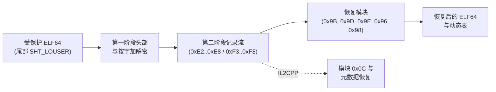

# CrackProof for Android SO 内部机制

本节记录 CrackProof 用于 Android 小端序 ELF64 AArch64 共享库的保护格式。CrackProof 将可加载的代码与数据段原位清零，在文件末尾追加单个 `SHT_LOUSER` 私有载荷节，加载时再由两阶段加载器与嵌套模块流还原内存映像。

## 章节导航

<table data-view="cards"><thead><tr><th width="48"></th><th></th><th></th><th data-hidden data-card-target data-type="content-ref"></th></tr></thead><tbody><tr><td><i class="fa-folder-tree"></i></td><td><strong>文件格式</strong></td><td>ELF 识别条件、私有 <code>SHT_LOUSER</code> 节、第一阶段参数与第二阶段记录流。</td><td><a href="file-format/file-format.md">文件格式</a></td></tr><tr><td><i class="fa-shuffle"></i></td><td><strong>数据变换</strong></td><td>GF(2³²) 字混淆、流头与记录描述符加解密、模块 <code>0x9B</code> 密钥配置、<code>0x9D</code> 容器变换与 Huffman/LZ 压缩。</td><td><a href="data-transforms/data-transforms.md">数据变换</a></td></tr><tr><td><i class="fa-puzzle-piece"></i></td><td><strong>恢复</strong></td><td>静态模块提取、动态符号表与重定位表还原，以及干净 ELF 重建。</td><td><a href="restoration/restoration.md">恢复</a></td></tr><tr><td><i class="fa-play"></i></td><td><strong>运行时</strong></td><td>第一阶段自定位、第二阶段模块表与嵌套解释器、环境探测及模块目录。</td><td><a href="runtime/runtime.md">运行时</a></td></tr><tr><td><i class="fa-database"></i></td><td><strong>元数据</strong></td><td>IL2CPP 元数据 v24.1、v29、v31、v39 规则、五轮 RID 置换与存储布局。</td><td><a href="metadata/metadata.md">元数据</a></td></tr><tr><td><i class="fa-compass"></i></td><td><strong>分析</strong></td><td>默认拒绝策略下的格式校验清单与各 Android 构建家族常量。</td><td><a href="analysis/analysis.md">分析</a></td></tr></tbody></table>

## 与 Windows 格式的关系

Android 版与 [CrackProof for Windows 内部机制](https://app.gitbook.com/s/fEb9nKPvKsjkPAHMUbOt/)共用 3 字节结点的 Huffman/LZ 符号编码以及字节逆序的 AES-256 解密轮密钥表；基于 GF(2³²) 的 32 位字加解密、层层嵌套的 `0xE2`..`0xE8` 记录流、辅助 ELF 重定位容器以及纯用户态环境检查则是 Android 独有的设计。
