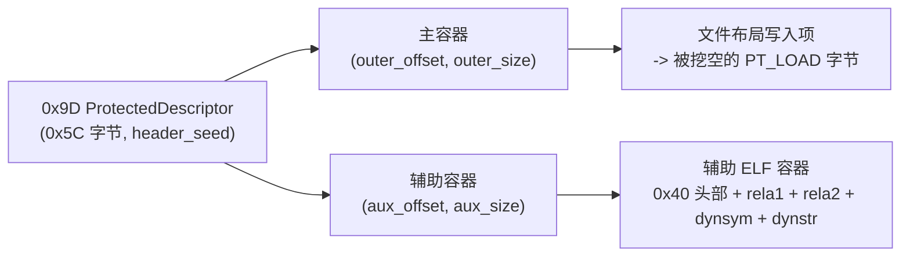

# 容器变换

模块 `0x9D` 开头是 `0x5C` 字节的[加密描述符（`ProtectedDescriptor`）](word-and-record.md)，由[模块 `0x9B`](module-config.md) 的 `header_seed` 解密。该描述符给出 `0x9D` 内部主、辅两个容器的偏移与大小，二者均使用来自 `0x9B` 的 `container_seed` 及恢复出的 AES-256 密钥解码：



## 容器头

工作种子 `s` 由 `seed = container_seed` 经平方与移位异或（右移 `17` 与左移 `11`）导出：

```text
s = (seed * seed) & MASK32
s = ((s >> 17) ^ (s << 11)) & MASK32
```

前 12 字节（`w0`、`w1`、`w2`）通过无符号 32 位算术与 `gf = gf32_mul_fixed` 解码：

| 字 | 公式（所有运算均模 2³²） | 解码含义 |
| --- | --- | --- |
| `w0` | `gf(w0) + s * 0xF87B337C + (0xA21DFB3A << (s & 7))` | 容器解码后的总输出长度（`0` 表示空容器） |
| `w1` | `gf(w1) ^ (s + 0xBD19C63C + (0x416E2AF2 >> (s & 0xD)))` | 低字节 `w1 & 0xFF` 为 `segment_count`（`> 0`）；次低字节 `(w1 >> 8) & 0xFF == 1` 时置位 `header.skip_aes` |
| `w2` | `gf(w2) + (0x643A3A3B << (s & 0xB)) - (s ^ 0x3B2BF538)` | `tree_size`（字节数，`<= 0x1B00`） |

**Huffman 表**（`+0x0C`，长度 `tree_size`）：表缓冲区内每个按 4 字节对齐的双字先替换为 `gf(dword)`（末尾不足 4 字节的 1 至 3 个余字节在逐字节阶段前保持原样），随后对 `i in 0..tree_size` 逐字节调整：

```text
k20  = ((s + 0xF1CB5B81) * s) & MASK32
k21  = (k20 - s * 0x23B32203) & MASK32
adj  = ((gf((k20 << (i & 0x1B)) & MASK32) - (k21 >> (i & 0x17))) & MASK32) >> (i & 0x1F)
b[i] = (b[i] + adj) & 0xFF
```

**段表**（从 Huffman 表按 4 字节对齐后的末尾开始，共 `segment_count` 对 `{offset, size}` 双字）：对距段表起点偏移 `byte_offset = index * 4` 的双字：

```text
t     = ((s + 0xB31F451C) * s) & MASK32
k22   = (t << 3) & MASK32
s2    = (t - s * 0x822FE82D) & MASK32
plain = (gf(cipher ^ k22) + (s2 >> ((byte_offset & 7) + 5))) & MASK32
```


`s2` 是从未移位的乘积 `t` 中减去 `s * 0x822FE82D`，而不是从移位后的 `k22` 中减去。若误用 `k22`，解出的所有段偏移与段长度都会损坏。


每一组 `{offset, size}` 段区间都必须完整落在容器缓冲区边界之内。

## 按段滚动解密与 AES 层

对每个段，先以 `state = container_seed`、`left = 0xE34EAC63`、`right = 0x07B48238` 为初始状态，按 4 字节小端序字（`i = 0, 1, ...`）执行滚动解密：

```text
left  = ((state + 0x72F6FCBE + ((left + 0x4F8B1BCA) * left)) & MASK32) >> ((i * i) & 0x0F)
right = (((state - 0x71B6A98D + ((right - 0x1605A81C) * right)) & MASK32) << (i & 7)) & MASK32
state = left ^ right

v = (word[i] + (0xB43B9BAF * (i & 0x0D))) & MASK32
v = v ^ ((0xAF57F7FB * (i & 3)) & MASK32)
word[i] = ((v - state) & MASK32) ^ state
```

随后，若 `config.skip_aes` 与 `header.skip_aes` 均为假，则使用从[模块配置](module-config.md)恢复的主密钥和全零 IV，按 16 字节分组原地执行 AES-256-CBC 解密。

## 写入记录与目标范围覆盖

每个解密后的段都以 16 字节写入头 `{u32 base, u32 count, u32 table_offset, u32 src_base}` 开头，并在 `table_offset` 处存放 `count` 条 16 字节记录 `{u32 dst, u32 out_len, u32 src_len, u32 pad}`，按顺序从 `src_base` 连续读取源数据切片：

* 当 `out_len == src_len` 时，将切片原样拷贝到 `base + dst`。
* 否则，使用当前容器已解码的 Huffman 表，按 [Huffman 与 LZ 压缩](compression.md)解压该切片；解压必须恰好消耗全部 `src_len` 字节并产出 `out_len` 字节。

对于 `0x9D` 主容器，写入目标指向 ELF 各 `PT_LOAD` 段的虚拟地址区间：落在 `0..p_filesz` 内的写入映射到对应的文件偏移；落在 `.bss` 尾部（`p_filesz..p_memsz`）的写入仅计入内存覆盖范围，不扩展文件大小。

## 辅助 ELF 容器

位于 `(aux_offset, aux_size)` 的第二个容器解码后是一份独立的动态链接数据块，而非面向 `PT_LOAD` 虚拟地址的写入序列：

| 区域 | 布局 | 内容 |
| --- | --- | --- |
| 头部（`0x00..0x40`） | 16 × `u32` | `words[4..12]` 依次为 `dynstr_offset`、`dynstr_size`、`dynsym_offset`、`dynsym_count`、`relocation1_offset`（`0x40`）、`relocation1_count`、`relocation2_offset`、`relocation2_count`；`words[14] == 0xB7`（`EM_AARCH64`）；`words[1, 3, 12, 13, 15] == 0` |
| `relocation1` | `Elf64_Rela[relocation1_count]` + 16B 零填充对齐 | `.rela.dyn` 重定位项（`0x403` = `R_AARCH64_RELATIVE`，`0x101` = `R_AARCH64_ABS64`，`0x401` = `R_AARCH64_GLOB_DAT`） |
| `relocation2` | `Elf64_Rela[relocation2_count]` + 16B 零填充对齐 | `.rela.plt` 重定位项（`0x402` = `R_AARCH64_JUMP_SLOT`） |
| 辅助 `.dynsym` | `Elf64_Sym[dynsym_count]` | 下标 `0` 为 24 字节空符号，其后是被剥离的外部符号表项 |
| 辅助 `.dynstr` | `u8[dynstr_size]` | 供辅助符号表引用的 NUL 结尾符号名字符串 |

每条 `0x18` 字节的重定位项都是标准 `Elf64_Rela` `{u64 r_offset, u64 r_info, i64 r_addend}`，其高 32 位（`r_info >> 32`）保存辅助符号表下标（当存在模块 `0x96` 时按行置换）。这些表如何重新合并回 `.dynsym`、`.dynstr`、`.rela.dyn` 与 `.rela.plt` 见[动态链接](../restoration/dynamic-linking.md)。
