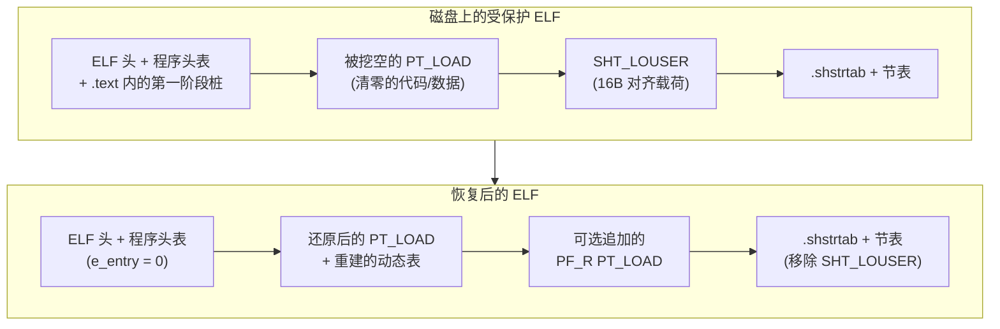

# 受保护 ELF

## 必需的 ELF 结构

受保护文件是面向 AArch64 的小端序 ELF64 共享库（`EM_AARCH64 = 183`，`e_phentsize = 0x38`，`e_shentsize = 0x40`）。节名统一从 `.shstrtab`（`SHT_STRTAB`）解析，该节不得越出文件边界，且内容必须为合法 UTF-8。

| 节 | 要求 | 作用 |
| --- | --- | --- |
| `.dynsym` 与 `.dynstr` | 必需 | 动态符号表项与符号名称字符串 |
| `.gnu.hash` 和/或 `.hash` | 至少其一 | 符号哈希查找表（GNU hash、SysV hash 或二者并存） |
| `.gnu.version` | 必需 | 各符号对应的版本索引 |
| `.gnu.version_r` | 必需 | 依赖库的符号版本信息 |
| `.dynamic`、`.rela.dyn`、`.rela.plt` | 各出现一次（恢复时要求） | 动态标签、数据重定位表与 PLT 重定位表 |
| `SHT_LOUSER`（`0x80000000`） | 恰好一个，且为最后一节 | 加密的第一阶段与第二阶段保护载荷 |

若文件不含 `SHT_LOUSER` 节或包含多个该类私有节、任一节范围越界，或架构与字节序不符，都会在进入解密流程前直接拒绝。`SHT_LOUSER` 私有节固定排在节表最后一项，起始偏移紧接含文件数据的 `PT_LOAD` 区间末尾，并向上按 16 字节对齐（对齐空隙填零）。

在 `.init_array` 中，有一项 `R_AARCH64_RELATIVE` 重定位指向保留在 `.text` 开头的 `0x84` 字节第一阶段引导包装函数（先用 15 条 `STP` 指令保存 `X1`..`X30`，通过 `X0` 传入 `SP` 调用引导主体，最后恢复寄存器并返回）。其余 `.init_array` 表项可能有三种形态：按链接器顺序保留的未隐藏构造函数、仅含单条 `RET`（`0xD65F03C0`）的占位桩，或是落在被清零的加载段内、需经映像还原与模块 `0x98` 构造函数恢复后才有效的地址。

## 可见头部与 APK 附带文件

受保护文件仍保留可正常解析的 ELF 头、程序头表、节表与 `.dynamic` 表项，但多张动态表已被截断，部分符号与重定位项已从原表剥离。识别受保护文件时，不能仅凭存在 `SHT_LOUSER` 节下结论，必须结合上述 ELF 布局以及[第一阶段头部](stage1.md)、[第二阶段记录流](stage2-streams.md)中的校验条件综合判定。

受保护 APK 内除了目标 `.so` 外，通常还会附带两个辅助文件：

* `lib__XXXX__.so`（其中 `XXXX` 为短构建标识）：独立打包的第一、二阶段加载器副本。
* `assets/<id>/data1.dat`（约 180 KiB 的高熵数据）：保存受保护库文件名及各库对应参数的小型配置表。

这两类文件均属于外层运行时包装产物，恢复后的共享库不再依赖它们。
