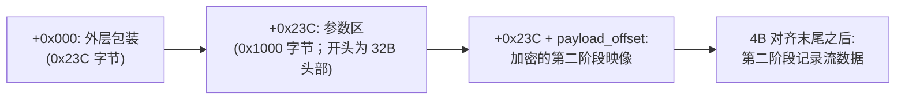

# 第一阶段头部

`SHT_LOUSER` 私有节依次包含四个区域：



在已知构建中，外层包装长度（`outer_size`）均为 `0x23C`（572 字节），其后紧跟 `0x1000` 字节的参数区，参数区前 32 字节为加密的第一阶段头部（8 个 `u32`）。第一阶段按字解密常量 `C` 随构建家族取值，目前有两种：`0xBF20165D` 与 `0xBF189BDD`。

运行时如何在内存中定位该私有节见[第一阶段引导](../runtime/stage1-bootstrap.md)，相关加解密算法见[字、流与记录加解密](../data-transforms/word-and-record.md)。

## 头部字段

解密 `section_offset + outer_size` 处的前 32 字节，可得到 8 个小端序 `u32` 字段：

| 偏移 | 字段 | 含义 | 校验规则 |
| --- | --- | --- | --- |
| `+0x00` | `key` | 每个文件独立生成的第一阶段头部密钥 | 解密第 `1..7` 个字后写回第 0 个字 |
| `+0x04` | `reserved` | 保留未用字段 | `== 0` |
| `+0x08` | `payload_offset` | 第二阶段相对于参数头（`section_offset + outer_size`）的起始偏移 | `>= 0x20` 且 `payload_offset + payload_size <= section_size - outer_size` |
| `+0x0C` | `payload_size` | 加密的第二阶段映像字节长度 | `> 0` 且按 4 字节对齐（`payload_size % 4 == 0`） |
| `+0x10` | `payload_key` | 解密第二阶段映像所用的密钥 | 代入第一阶段按字解密公式，处理 `payload_size` 字节 |
| `+0x14` | `entry_offset` | 解密后第二阶段映像内的入口偏移 | `< payload_size` |
| `+0x18` | `protect_size` | 解密后第二阶段映像内的 `mprotect` 长度 | `<= payload_size` |
| `+0x1C` | `size_copy` | `payload_size` 的副本 | `== payload_size` |


`payload_offset` 是从 32 字节参数头起点（即 `section_offset + outer_size`）起算的偏移，而非相对于 ELF 文件开头的偏移。加密第二阶段映像的实际文件偏移为 `section_offset + outer_size + payload_offset`。


对于字索引 `i`（`0..7`），解密采用无符号 32 位回绕算术：

```text
plain[i] = ((cipher[i] + (i + 3) * key) ^ (C * (i + 1))) & 0xFFFFFFFF
```

第 `0` 个字提供 `key`（回写前由 `key = cipher[0] ^ C` 得出，解码完第 `1..7` 个字后再将 `plain[0] = key` 存入槽位 0）。随后，第一阶段沿用同一按字解密公式，以 `payload_key` 与常量 `C` 解密位于 `section_offset + outer_size + payload_offset` 的第二阶段映像。第二阶段根记录流（`0xE2`）就保存在 `SHT_LOUSER` 内，紧接在第二阶段映像按 4 字节对齐后的末尾之后。

## 头部校验

只有在全部 8 项头部校验条件同时满足，且计算出的第二阶段映像与尾部记录流均完全落在 `SHT_LOUSER` 节范围内时，候选参数组合 `(outer_size, C)` 才会被采纳。只要出现节被截断、`reserved` 非零、`size_copy` 不一致、`payload_size` 未对齐，或 `entry_offset` / `protect_size` 越界，就会在进入第二阶段解析前拒绝该候选组合。
