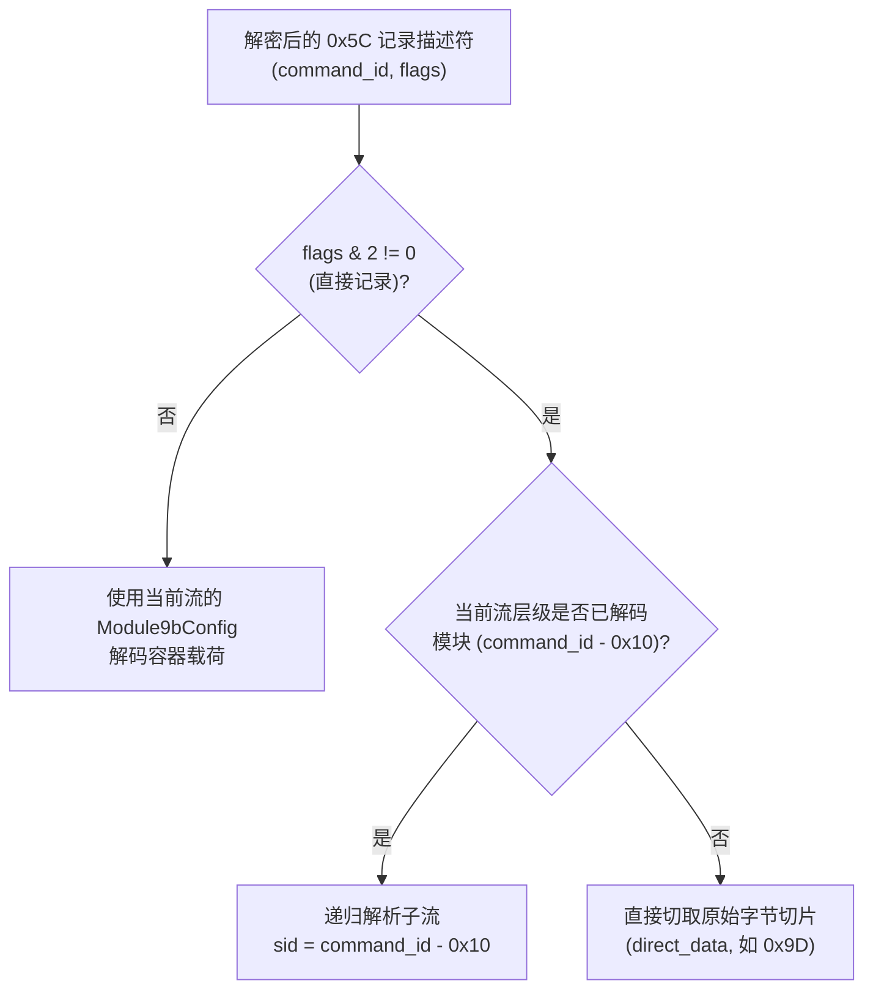

# 第二阶段记录流

第二阶段从根流标识 `0xE2` 开始。每条流开头都是加密的 8 字节流头（`cipher0`、`cipher1`），紧接着从 `+0x08` 起连续存放 `N` 个 `0x5C` 字节的记录描述符（解密后流头的 `dw0` 给出描述符数量，上限为 256）。记录载荷排在整个描述符表（`8 + N * 0x5C`）之后，因此当 `8 + (index + 1) * 0x5C` 到达最小的非零 `image_offset` 或 `metadata_offset` 时，描述符解析即告结束。

## 记录分发

每个记录描述符包含 `command_id`、`flags`、`image_offset` / `image_size`、`metadata_offset` / `metadata_size`、`id_copy`（`== command_id`）、`entry_offset`（`+0x1C`）以及 `init_offset`（`+0x20`）。`image_size` 与 `metadata_size` 的含义取决于 `DIRECT_FLAG`（`0x2`）：

* **容器记录**（`flags & 2 == 0`）：`image_offset` 与 `metadata_offset` 指向当前流内经压缩和加密的容器，而 `image_size` 与 `metadata_size` 表示预期的**解码后输出长度**（流中的压缩载荷体积更小，因此解码前校验 `offset < stream.len()`，解压还原后再校验解码输出长度是否严格相等）。层级 `S` 上的所有容器统一使用流 `S` 自身解释器的[模块配置](../data-transforms/module-config.md)进行解码：根流 `0xE2` 使用第二阶段内置解码配置，嵌套层级 `0xE3`..`0xE8` 则使用从解释器模块 `S` 中提取的 `Module9bConfig`。
* **直接记录**（`flags & 2 != 0`）：`image_offset` 与 `image_size` 直接从所属流中切取一段原始字节（直接切片，满足 `image_offset + image_size <= stream.len()`）。若同一流层级上已经解码出标识为 `command_id - 0x10` 的模块（已观察到的配对为 `0xF3` -> `0xE3` 直至 `0xF8` -> `0xE8`），则将该切片作为子流 `command_id - 0x10` 递归解析；否则（例如模块 `0x9D`）将该切片保留为模块的原始数据。

标志位 `0x100` 表示在运行时跳过该记录的 `init` 与 `entry` 回调。静态提取期间，子流按 `(stream_id, sha256)` 去重，避免重复解码同一引用；同一模块 ID 若出现重复记录，仅当它们的 SHA-256 摘要完全一致时才予以接受。

运行时模块表与回调执行顺序见[第二阶段解释器](../runtime/stage2-interpreter.md)。

## 结构边界检查

在整个提取过程中，映像载荷与模块自身的元数据（`metadata_offset` / `metadata_size`，记录模块的加载、重定位与导入信息，而非 IL2CPP 的 `global-metadata.dat`）始终分开保存。一旦遇到描述符表截断、`id_copy` 不匹配、切片越界、容器解码失败或同模块摘要冲突，流提取会立即中止。
