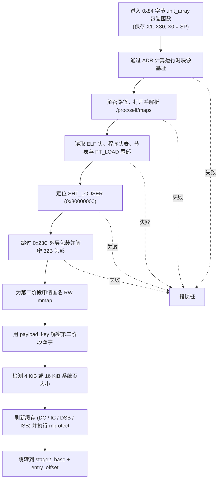

# 第一阶段引导

`.init_array` 中有一项指向保留在 `.text` 开头的 `0x84` 字节寄存器保存包装函数（用 15 条 `STP` 指令保存 `X1`..`X30`，执行 `MOV X0, SP` 后 `BL` 调用引导主体，再用 15 条 `LDP` 恢复寄存器并 `RET`）。引导代码通过 `/proc/self/maps` 定位自身磁盘文件，读取 `SHT_LOUSER` 私有节，将第二阶段解密到匿名内存，最后跳转到第二阶段入口。

## 定位 `SHT_LOUSER`

第一阶段通过 `ADR` 获取当前 PC，减去链接期偏移得出当前共享库的加载基址；随后将 `"/proc/self/maps"` 解密到栈缓冲区，调用 `open` 打开后立即擦除路径字符串。从映射表中查到加载基址对应的磁盘文件路径后，引导代码读取 ELF 头、程序头表与节表（`Elf64_Shdr` 步长为 `0x40`），在最后一个 `PT_LOAD` 段之后找到 `sh_type == 0x80000000`（`SHT_LOUSER`）的私有节。

跨过开头的 `0x23C` 字节外层包装后即为 `0x1000` 字节参数区，其前 32 字节按所属家族的字密码常量 `C`（`0xBF20165D` 或 `0xBF189BDD`）解码，详见[第一阶段头部](../file-format/stage1.md)。

## 第二阶段映射与寄存器移交

第一阶段通过 `mmap` 分配 `payload_size` 字节的匿名可写内存，拷入并用 `payload_key` 解密第二阶段映像，随后检测当前系统页大小是 4 KiB 还是 16 KiB，刷新数据缓存与指令缓存（`DC` / `IC` / `DSB` / `ISB`），对 `protect_size` 范围调用 `mprotect`，最后携带 8 个寄存器参数跳转到 `stage2_base + entry_offset`：

| 寄存器 | 传入值 |
| --- | --- |
| `X0` | 加载器上下文指针 |
| `X1` | 受保护共享库的运行时映像基址 |
| `X2` | 解密后第二阶段的基址 |
| `X3` | 解密后第二阶段的字节长度（`payload_size`） |
| `X4` | 剩余 `SHT_LOUSER` 流基址（第二阶段按 4 字节对齐后的末尾） |
| `X5` | 剩余 `SHT_LOUSER` 流字节长度 |
| `X6` | 文件尾部映射基址 |
| `X7` | 文件尾部映射字节长度 |

第二阶段启动后，立即在模块表中将 `(X2, X3)` 登记为模块 `0xE2`，并将 `(X6, X7)` 登记为模块 `0xD0`。
