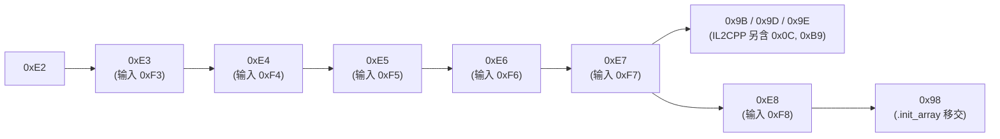

# 第二阶段解释器

第二阶段（`0xE2`）分配一张 256 槽模块表，先登记自身（`0xE2`）与 `SHT_LOUSER` 文件尾映射（`0xD0`），再遍历 `(X4, X5)` 传入的根记录流。每一层解释器都会加载当前层级的功能模块，解码下一层解释器模块 `0xE(n+1)`，切出下一层输入流切片 `0xF(n+1)`，并将其交给 `0xE(n+1)` 继续解析：

## 模块表（`0x1800` 字节）

第二阶段通过 `mmap` 映射 `0x1800` 字节的匿名可读写内存，共容纳 256 个槽位，每槽 `0x18`（24）字节：

| 偏移 | 大小 | 字段 |
| --- | --- | --- |
| `+0x00` | 4 | `command_id` |
| `+0x04` | 4 | 状态标志 |
| `+0x08` | 8 | 映射基址指针 |
| `+0x10` | 4 | 映射字节长度 |
| `+0x14` | 4 | 保留字段 |

槽位登记从 `0xE2`（`X2`、`X3`）与 `0xD0`（`X6`、`X7`）开始，随后在各层记录流执行过程中按每条记录的 `command_id` 依次写入。

## `0x5C` 记录描述符布局

8 字节流头（`dw0` 为描述符数量，`G` 为描述符种子，详见[字、流与记录密码](../data-transforms/word-and-record.md)）之后紧跟 `N` 个连续的记录描述符，总头部长度为 `8 + N * 0x5C` 字节，末尾即第一段载荷的起始偏移。每个记录描述符长 `0x5C` 字节（23 个双字），布局如下：

| 偏移 | 双字 | 字段 | 作用 |
| --- | --- | --- | --- |
| `+0x00` | `words[0]` | `command_id` | 模块或流切片标识（`0x00`..`0xFF`） |
| `+0x04` | `words[1]` | `flags` | `0x2` 为直接切片；`0x100` 为跳过 `init` 与 `entry` 回调 |
| `+0x08` | `words[2]` | `image_offset` | 当前流内的载荷起始偏移 |
| `+0x0C` | `words[3]` | `image_size` | 解码后容器大小（`flags & 2 == 0`）或原始直接切片长度（`flags & 2 != 0`） |
| `+0x10` | `words[4]` | `metadata_offset` | 保护壳模块的加载、重定位与导入元数据偏移（无则为 `0`） |
| `+0x14` | `words[5]` | `metadata_size` | 解码后或原始模块元数据的字节长度 |
| `+0x18` | `words[6]` | `id_copy` | 必须等于 `command_id` |
| `+0x1C` | `words[7]` | `entry_offset` | 相对模块映射基址的 `entry` 回调偏移 |
| `+0x20` | `words[8]` | `init_offset` | 相对模块映射基址的 `init` 回调偏移 |
| `+0x24..+0x5C` | `words[9..22]` | 尾部双字 | 保留字段或模块私有参数 |

对每个记录描述符，解释器先准备载荷（`flags & 2 == 0` 时使用当前解释器自身的 `Module9bConfig` 解包容器，`flags & 2 != 0` 时直接引用当前流内的原始切片），再根据记录附带的 `metadata` 数据块完成模块重定位与符号导入，随后登记模块表槽位，并在未置位 `flags & 0x100` 的前提下依次调用 `init_offset` 与 `entry_offset`。

## 层级差异

解释器 `0xE7` 负责加载核心 ELF 恢复模块（`0x9B`、`0x9D`、`0x9E`）。在 Unity IL2CPP 构建中，`0xE7` 还会额外加载模块 `0x0C`（针对 `global-metadata.dat` 的 `mmap` hook 模块）以及带有效数据的 `0xB9` 记录；非 IL2CPP 的普通原生共享库不包含 `0x0C`，且省略 `0xB9` 或仅保留空的 `0xB9` 记录。解释器 `0xE8` 随后加载模块 `0x98`，待内存映像还原完毕后负责调用目标共享库的 `.init_array` 构造函数。
