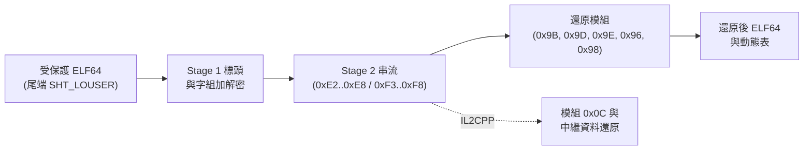

# CrackProof for Android SO 內部機制

本篇說明 CrackProof 針對 Android 小端序 ELF64 AArch64 共用程式庫（`.so`）的保護格式。CrackProof 會將可載入的程式碼與資料區間清零，在檔案尾端附加單一 `SHT_LOUSER` 私有區段，並於載入期間透過兩階段載入器與巢狀模組串流重建記憶體映像。

## 章節導覽

<table data-view="cards"><thead><tr><th width="48"></th><th></th><th></th><th data-hidden data-card-target data-type="content-ref"></th></tr></thead><tbody><tr><td><i class="fa-folder-tree"></i></td><td><strong>檔案格式</strong></td><td>ELF 辨識條件、私有 <code>SHT_LOUSER</code> 區段、Stage 1 參數與 Stage 2 記錄串流。</td><td><a href="file-format/file-format.md">檔案格式</a></td></tr><tr><td><i class="fa-shuffle"></i></td><td><strong>資料轉換</strong></td><td>GF(2³²) 字組混洗、串流與記錄加解密、模組 <code>0x9B</code> 金鑰、<code>0x9D</code> 容器與 Huffman/LZ 壓縮。</td><td><a href="data-transforms/data-transforms.md">資料轉換</a></td></tr><tr><td><i class="fa-puzzle-piece"></i></td><td><strong>靜態還原</strong></td><td>靜態模組擷取、動態符號表與重定位表還原，以及乾淨 ELF64 重建。</td><td><a href="restoration/restoration.md">靜態還原</a></td></tr><tr><td><i class="fa-play"></i></td><td><strong>執行期機制</strong></td><td>Stage 1 自我定位、Stage 2 模組表與巢狀直譯器、環境偵測及模組目錄。</td><td><a href="runtime/runtime.md">執行期機制</a></td></tr><tr><td><i class="fa-database"></i></td><td><strong>中繼資料</strong></td><td>IL2CPP 中繼資料 24.1、29、31 與 39 版、五輪 RID 置換及儲存版面。</td><td><a href="metadata/metadata.md">中繼資料</a></td></tr><tr><td><i class="fa-compass"></i></td><td><strong>分析與驗證</strong></td><td>嚴格拒絕（fail-closed）驗證清單與各 Android 建置家族觀測到的格式常數。</td><td><a href="analysis/analysis.md">分析與驗證</a></td></tr></tbody></table>

## 與 Windows 格式的關聯

Android 原生程式庫與 [CrackProof for Windows 內部機制](https://app.gitbook.com/s/sFi4W2Zr1UBoxZd5YI3A/)共用 3 位元組 Huffman/LZ 編碼格式與位元組反序的 AES-256 解密金鑰展開表；至於 GF(2³²) 字組加解密、巢狀 `0xE2`..`0xE8` 記錄串流、輔助 ELF 容器與純使用者空間的環境檢查，則是 Android 平台特有的設計。
