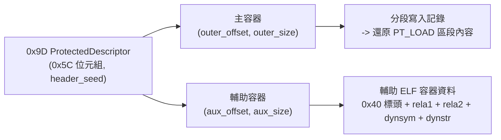

# 容器轉換

模組 `0x9D` 開頭是一筆 `0x5C` 位元組的[受保護描述元](word-and-record.md)，由[模組 `0x9B`](module-config.md) 的 `header_seed` 解密。該描述元界定了 `0x9D` 內部的兩個完整容器，兩者皆使用 `0x9B` 提供的 `container_seed` 與還原出的 AES-256 金鑰進行解碼：



## 容器標頭

標頭種子 `s` 由 `seed = container_seed` 先平方，再以位移量 `17` 與 `11` 做 XOR 混洗推導而成：

```text
s = (seed * seed) & MASK32
s = ((s >> 17) ^ (s << 11)) & MASK32
```

前 12 位元組（`w0`、`w1`、`w2`）採用無號 32 位元算術搭配 `gf = gf32_mul_fixed` 解碼：

| 字組 | 公式（所有運算皆為 mod 2³²） | 解碼後意義 |
| --- | --- | --- |
| `w0` | `gf(w0) + s * 0xF87B337C + (0xA21DFB3A << (s & 7))` | 容器解碼後的總輸出大小（`0` 代表空容器） |
| `w1` | `gf(w1) ^ (s + 0xBD19C63C + (0x416E2AF2 >> (s & 0xD)))` | 最低位元組 `w1 & 0xFF` 為 `segment_count`（`> 0`）；次低位元組 `(w1 >> 8) & 0xFF == 1` 時會設定 `header.skip_aes` |
| `w2` | `gf(w2) + (0x643A3A3B << (s & 0xB)) - (s ^ 0x3B2BF538)` | 以位元組計的 `tree_size`（`<= 0x1B00`） |

**Huffman 表（`+0x0C`，長度 `tree_size`）：** 表緩衝區內每個 4 位元組對齊的 dword 會先替換為 `gf(dword)`（尾端若剩 1 至 3 個未對齊位元組，在進入逐位元組階段前保持原樣），接著對 `i in 0..tree_size` 逐位元組調整：

```text
k20  = ((s + 0xF1CB5B81) * s) & MASK32
k21  = (k20 - s * 0x23B32203) & MASK32
adj  = ((gf((k20 << (i & 0x1B)) & MASK32) - (k21 >> (i & 0x17))) & MASK32) >> (i & 0x1F)
b[i] = (b[i] + adj) & 0xFF
```

**分段表（緊接於 Huffman 表的 4 位元組對齊尾端，共 `segment_count` 組 `{offset, size}` dword 配對）：** 以分段表起點起算的 `byte_offset = index * 4` 計算：

```text
t     = ((s + 0xB31F451C) * s) & MASK32
k22   = (t << 3) & MASK32
s2    = (t - s * 0x822FE82D) & MASK32
plain = (gf(cipher ^ k22) + (s2 >> ((byte_offset & 7) + 5))) & MASK32
```


`s2` 是從未左移的乘積 `t` 減去 `s * 0x822FE82D`，而非從 `k22` 減去。若誤用 `k22`，解出的所有分段位移與大小都會損毀。


每一組 `{offset, size}` 分段區間都必須落在容器緩衝區範圍內。

## 分段加解密與 AES 層

針對每個分段，滾動字組解密演算法會從初始狀態 `state = container_seed`、`left = 0xE34EAC63` 與 `right = 0x07B48238` 出發，依序處理 4 位元組小端序字組（`i = 0, 1, ...`）：

```text
left  = ((state + 0x72F6FCBE + ((left + 0x4F8B1BCA) * left)) & MASK32) >> ((i * i) & 0x0F)
right = (((state - 0x71B6A98D + ((right - 0x1605A81C) * right)) & MASK32) << (i & 7)) & MASK32
state = left ^ right

v = (word[i] + (0xB43B9BAF * (i & 0x0D))) & MASK32
v = v ^ ((0xAF57F7FB * (i & 3)) & MASK32)
word[i] = ((v - state) & MASK32) ^ state
```

接著，除非 `config.skip_aes || header.skip_aes` 為真，否則會使用從[模組設定](module-config.md)還原出的金鑰與全零 IV，對 16 位元組區塊原地執行 AES-256-CBC 解密。

## 寫入記錄與目標範圍

每個解密後的分段開頭皆為 16 位元組寫入標頭 `{u32 base, u32 count, u32 table_offset, u32 src_base}`，並於 `table_offset` 處存放 `count` 筆 16 位元組記錄 `{u32 dst, u32 out_len, u32 src_len, u32 pad}`，依序從 `src_base` 讀取來源切片：

* 當 `out_len == src_len` 時，來源切片直接原樣複製到 `base + dst`。
* 否則，來源切片會搭配該容器解碼出的 Huffman 表，透過 [Huffman 與 LZ 壓縮](compression.md)展開，且必須精確消耗全部 `src_len` 位元組並產出 `out_len` 位元組。

在 `0x9D` 主容器中，寫入目標對應各個 `PT_LOAD` 區段的虛擬位址範圍：落在 `0..p_filesz` 內的區間會寫回對應的檔案位移；落在 `.bss` 尾端（`p_filesz..p_memsz`）的區間僅計入區段記憶體涵蓋範圍，不會寫入檔案或增加輸出檔案大小。

## 輔助 ELF 容器

位於 `(aux_offset, aux_size)` 的第二個容器不會直接寫入 `PT_LOAD` 虛擬位址，而是解碼出一段獨立的動態連結資料區塊：

| 區塊 | 版面 | 內容 |
| --- | --- | --- |
| 標頭（`0x00..0x40`） | 16 × `u32` | `words[4..12]` 依序為 `dynstr_offset`、`dynstr_size`、`dynsym_offset`、`dynsym_count`、`relocation1_offset`（`0x40`）、`relocation1_count`、`relocation2_offset`、`relocation2_count`；`words[14] == 0xB7`（`EM_AARCH64`）；`words[1, 3, 12, 13, 15] == 0` |
| `relocation1` | `Elf64_Rela[relocation1_count]` + 16B 補零對齊 | `.rela.dyn` 重定位項目（`0x403` = `R_AARCH64_RELATIVE`、`0x101` = `R_AARCH64_ABS64`、`0x401` = `R_AARCH64_GLOB_DAT`） |
| `relocation2` | `Elf64_Rela[relocation2_count]` + 16B 補零對齊 | `.rela.plt` 重定位項目（`0x402` = `R_AARCH64_JUMP_SLOT`） |
| 輔助 `.dynsym` | `Elf64_Sym[dynsym_count]` | 索引 `0` 為 24 位元組空符號，其後為從原檔案抽離的外部符號 |
| 輔助 `.dynstr` | `u8[dynstr_size]` | 輔助符號表對應的 NUL 結尾名稱字串 |

每筆 `0x18` 位元組重定位項目皆為標準 `Elf64_Rela` `{u64 r_offset, u64 r_info, i64 r_addend}`，其高 32 位元（`r_info >> 32`）存放輔助符號索引（若存在模組 `0x96`，每列索引會經過旋轉置換）。這些表格如何合併回 `.dynsym`、`.dynstr`、`.rela.dyn` 與 `.rela.plt`，請參閱[動態連結](../restoration/dynamic-linking.md)。
