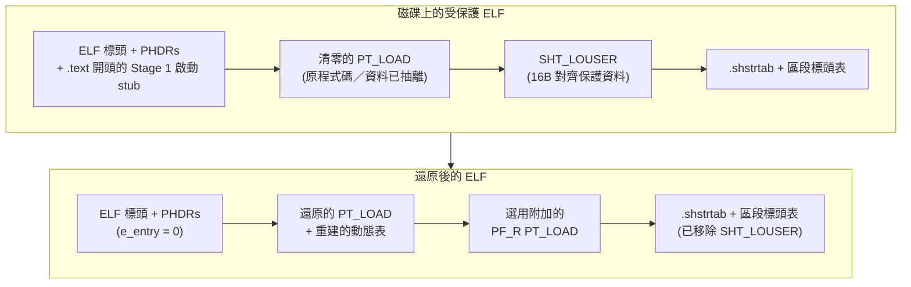

# 受保護 ELF

## 必備的 ELF 結構

受保護檔案是 AArch64 架構的小端序 ELF64 共用程式庫（`EM_AARCH64 = 183`、`e_phentsize = 0x38`、`e_shentsize = 0x40`）。區段名稱由 `.shstrtab` 解析，且該表必須是位於檔案範圍內、符合 UTF-8 編碼的合法 `SHT_STRTAB`。

| 區段 | 條件 | 用途 |
| --- | --- | --- |
| `.dynsym` 與 `.dynstr` | 必備 | 動態符號記錄與符號名稱字串 |
| `.gnu.hash` 及／或 `.hash` | 至少其一 | 符號雜湊查詢表（GNU hash、SysV hash 或兩者皆有） |
| `.gnu.version` | 必備 | 各符號對應的版本索引 |
| `.gnu.version_r` | 必備 | 外部相依符號所需的版本定義 |
| `.dynamic`、`.rela.dyn`、`.rela.plt` | 各出現一次（還原時必備） | 動態標籤、資料重定位表與 PLT 重定位表 |
| `SHT_LOUSER` (`0x80000000`) | 恰好一個，且為最後一項 | 加密的 Stage 1 與 Stage 2 保護資料區 |

凡是缺少或含有多個 `SHT_LOUSER` 私有區段、區段範圍超出檔案大小，或是架構與位元組順序不符的檔案，都會在進入解密流程前直接拒絕。`SHT_LOUSER` 私有區段必定是區段標頭表的最後一項，緊接在所有含檔案內容（`p_filesz > 0`）的 `PT_LOAD` 區間尾端之後，起點按 16 位元組對齊，中間空隙補零。

在 `.init_array` 中，會有一筆 `R_AARCH64_RELATIVE` 項目指向 `.text` 開頭保留區內的 `0x84` 位元組 Stage 1 啟動封裝函式（以 15 條 `STP` 指令保存 `X1`..`X30`，將 `SP` 放入 `X0`，呼叫啟動主體後還原暫存器並返回）。其餘 `.init_array` 項目可能是為維持連結器執行順序而保留不動的建構函式、僅含單條 `RET`（`0xD65F03C0`）的佔位函式，或是指向清零區間內、須等映像與模組 `0x98` 還原建構函式後才有效的位址。

## 可見標頭與 APK 附屬檔案

受保護檔案仍保有可解析的 ELF 標頭、程式標頭表、區段標頭表與 `.dynamic` 項目，但多張動態表已被截斷，或移除了隱藏符號與重定位項目。辨識受保護檔案時，不能只憑 `SHT_LOUSER` 是否存在，還必須同時符合上述 ELF 結構，並通過 [Stage 1 標頭](stage1.md)與 [Stage 2 串流](stage2-streams.md)的結構驗證。

受保護的 APK 常在目標 `.so` 旁附帶兩個輔助檔案：

* `lib__XXXX__.so`（其中 `XXXX` 為簡短建置標記）：獨立編譯的 Stage 1/2 載入器 stub 副本。
* `assets/<id>/data1.dat`（約 180 KiB 的高熵資料）：小型設定表，列出受保護程式庫名稱及個別程式庫的保護設定。

兩者皆供執行期外層載入流程使用，還原後的原生程式庫不會用到。
