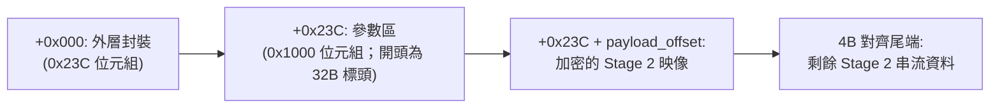

# Stage 1 標頭

`SHT_LOUSER` 私有區段依序由四個區塊組成：



目前已觀測到的建置版本皆使用 `0x23C` 位元組（572 位元組）的外層封裝大小（`outer_size`），後方緊接 `0x1000` 位元組的參數區，其中前 32 位元組存放加密的 8 個 dword Stage 1 標頭。在已知建置家族中，Stage 1 字組加解密常數 `C` 出現過兩種數值：`0xBF20165D` 與 `0xBF189BDD`。

執行期如何定位此區段請見 [Stage 1 啟動引導](../runtime/stage1-bootstrap.md)，相關加解密演算法則記錄於[字組、串流與記錄加解密](../data-transforms/word-and-record.md)。

## 標頭欄位

解密 `section_offset + outer_size` 起算的前 32 位元組，可得到 8 個小端序 `u32` 欄位：

| 位移 | 欄位 | 意義 | 驗證條件 |
| --- | --- | --- | --- |
| `+0x00` | `key` | 各檔案獨立的 Stage 1 標頭金鑰 | 解完第 `1..7` 個字組後寫回第 `0` 個字組 |
| `+0x04` | `reserved` | 未使用保留欄位 | `== 0` |
| `+0x08` | `payload_offset` | Stage 2 相對於參數標頭起點（`section_offset + outer_size`）的位移 | `>= 0x20` 且 `payload_offset + payload_size <= section_size - outer_size` |
| `+0x0C` | `payload_size` | 加密 Stage 2 映像的位元組長度 | `> 0` 且符合 4 位元組對齊（`payload_size % 4 == 0`） |
| `+0x10` | `payload_key` | Stage 1 解密 Stage 2 映像所用的字組金鑰 | 帶入 Stage 1 字組解密演算法，解密 `payload_size` 位元組 |
| `+0x14` | `entry_offset` | 解密後 Stage 2 映像內的進入點位移 | `< payload_size` |
| `+0x18` | `protect_size` | 解密後 Stage 2 映像內套用 `mprotect` 的長度 | `<= payload_size` |
| `+0x1C` | `size_copy` | `payload_size` 的副本 | `== payload_size` |


`payload_offset` 是從 32 位元組參數標頭的起點（`section_offset + outer_size`）開始計算，而非從 ELF 檔案開頭起算。加密 Stage 2 映像的實際檔案位移為 `section_offset + outer_size + payload_offset`。


對字組索引 `i`（`0..7`），解密採用無號 32 位元溢位迴繞運算：

```text
plain[i] = ((cipher[i] + (i + 3) * key) ^ (C * (i + 1))) & 0xFFFFFFFF
```

`key` 取自第 `0` 個字組（`key = cipher[0] ^ C`，待第 `1..7` 個字組解碼完成後再寫回 `plain[0] = key`）。接著 Stage 1 以同一套字組解密演算法，搭配 `payload_key` 與常數 `C` 解密位於 `section_offset + outer_size + payload_offset` 的 Stage 2 映像。Stage 2 根記錄串流（`0xE2`）則在 `SHT_LOUSER` 內緊接於 Stage 2 映像尾端（按 4 位元組對齊）之後。

## 標頭驗證

一組候選參數 `(outer_size, C)` 必須同時滿足上述 8 個欄位的驗證條件，且推算出的 Stage 2 映像與後續串流皆落在 `SHT_LOUSER` 範圍內，才會被接受。只要區段遭到截斷、`reserved` 非零、`size_copy` 不一致、`payload_size` 未對齊，或是 `entry_offset` / `protect_size` 超出範圍，都會在進入 Stage 2 解析前淘汰該組候選值。
