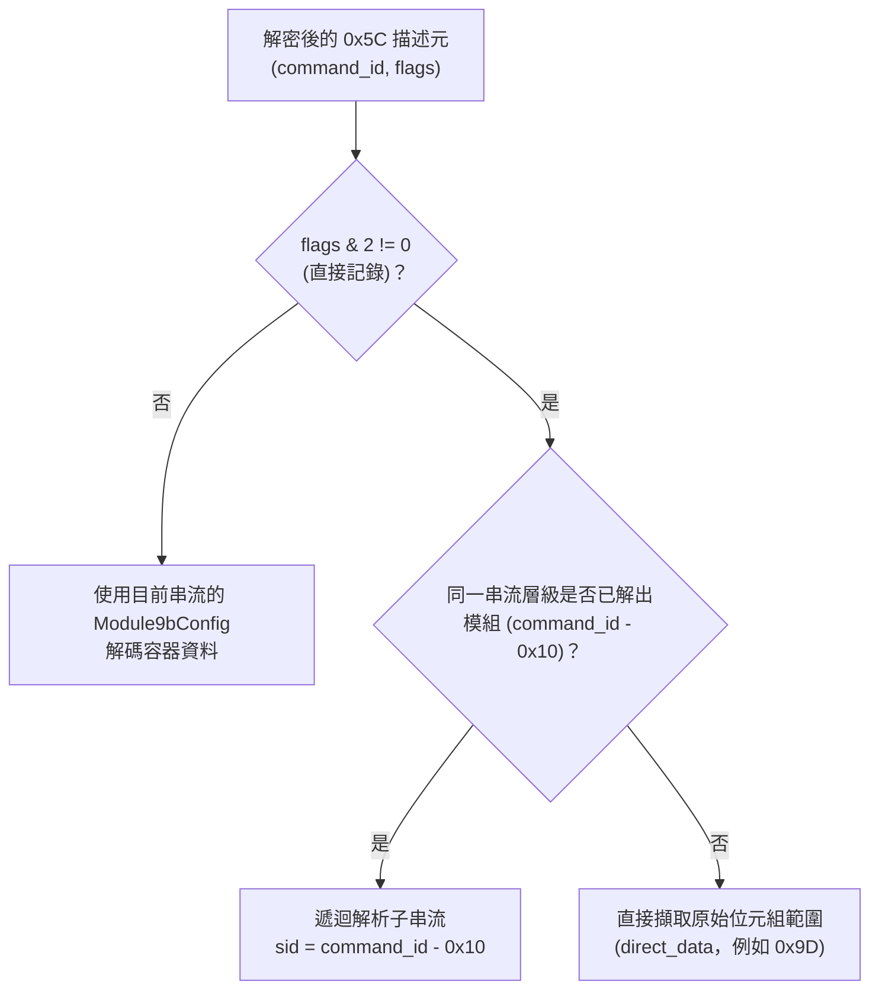

# Stage 2 串流

Stage 2 由根串流識別碼 `0xE2` 開始。每條串流開頭皆為加密的 8 位元組標頭（`cipher0`、`cipher1`），並於 `+0x08` 緊接連續 `N` 筆 `0x5C` 位元組的記錄描述元（筆數由解密後串流標頭的 `dw0` 指定，上限 256）。實際記錄資料位於整張描述元表（`8 + N * 0x5C`）之後，因此當 `8 + (index + 1) * 0x5C` 觸及最早出現的非零 `image_offset` 或 `metadata_offset` 時，描述元解析即告結束。

## 記錄分派流程

每筆記錄描述元帶有 `command_id`、`flags`、`image_offset` / `image_size`、`metadata_offset` / `metadata_size`、`id_copy`（`== command_id`）、`entry_offset`（`+0x1C`）與 `init_offset`（`+0x20`）。`image_size` 與 `metadata_size` 的解讀方式取決於 `DIRECT_FLAG`（`0x2`）：

* **容器記錄（`flags & 2 == 0`）：** `image_offset` 與 `metadata_offset` 指向目前串流內經過壓縮與加密的容器，而 `image_size` 與 `metadata_size` 則代表預期的**解碼後輸出大小**（串流內的壓縮內容較短，因此解碼前會檢查 `offset < stream.len()`，展開後再核對實際輸出長度是否完全吻合）。位於串流層級 `S` 的每個容器，都會使用串流 `S` 自身的直譯器[模組設定](../data-transforms/module-config.md)進行解碼：根層級 `0xE2` 使用內嵌於 Stage 2 映像的解碼設定，巢狀層級 `0xE3`..`0xE8` 則使用從直譯器模組 `S` 解析出的 `Module9bConfig`。
* **直接記錄（`flags & 2 != 0`）：** `image_offset` 與 `image_size` 直接指定所屬串流內的原始位元組範圍（`image_offset + image_size <= stream.len()`）。若同一串流層級已解出識別碼為 `command_id - 0x10` 的模組（已觀測到的配對為 `0xF3` -> `0xE3` 至 `0xF8` -> `0xE8`），該段切片就會作為子串流 `command_id - 0x10` 遞迴解析；否則（例如模組 `0x9D`）則保留為原始模組資料。

旗標 `0x100` 表示在執行期跳過該筆記錄的 `init` 與 `entry` 回呼。靜態擷取期間，子串流會以 `(stream_id, sha256)` 過濾重複項目，避免同一子串流重複解碼；若同一模組 ID 出現多筆記錄，唯有在 SHA-256 雜湊值完全相同時才會接受。

執行期模組表與回呼順序請參閱 [Stage 2 直譯器](../runtime/stage2-interpreter.md)。

## 結構邊界檢查

整個擷取過程中，模組映像資料與保護層模組中繼資料（`metadata_offset` / `metadata_size`，內容為模組載入、重定位與匯入資訊，並非 IL2CPP 資產）始終分開保存。一旦發生描述元表截斷、`id_copy` 不符、切片越界、容器解碼失敗，或同一模組出現相衝突的雜湊值，串流擷取便會立即中止。
