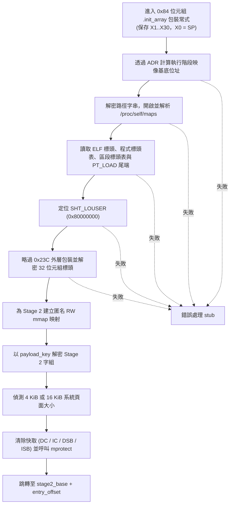

# Stage 1 啟動流程

`.init_array` 中有一筆項目指向保留在 `.text` 開頭的 `0x84` 位元組暫存器保存包裝常式（以 15 條 `STP` 指令保存 `X1`..`X30`、執行 `MOV X0, SP`、`BL` 進入啟動主體，返回後以 15 條 `LDP` 還原暫存器並 `RET`）。啟動主體會透過 `/proc/self/maps` 找出自身對應的磁碟檔案，讀取 `SHT_LOUSER` 私有區段，將 Stage 2 解密至匿名記憶體，再跳轉至其進入點。

## 定位 `SHT_LOUSER`

Stage 1 先以 `ADR` 取得目前 PC，減去連結期位移以算出已載入程式庫的基底位址；接著將 `"/proc/self/maps"` 解密至堆疊緩衝區，開啟檔案後立即清除該路徑緩衝區。找到載入基底位址對應的底層檔案路徑後，Stage 1 會讀取 ELF 標頭、程式標頭表與區段標頭表（`Elf64_Shdr` 單筆大小為 `0x40`），在最後一個 `PT_LOAD` 程式區段之後尋找 `sh_type == 0x80000000`（`SHT_LOUSER`）的區段。

略過開頭 `0x23C` 位元組的外層包裝後，即可抵達 `0x1000` 位元組的參數區，其前 32 位元組會以該組建系列的字組常數 `C`（`0xBF20165D` 或 `0xBF189BDD`；詳見 [Stage 1 標頭](../file-format/stage1.md)）解碼。

## Stage 2 映射與暫存器參數移交

Stage 1 會配置一段長 `payload_size` 位元組的匿名可寫入記憶體區域，複製並以 `payload_key` 解密 Stage 2 映像，偵測系統採用 4 KiB 或 16 KiB 頁面，清除資料與指令快取（`DC` / `IC` / `DSB` / `ISB`），對 `protect_size` 範圍套用 `mprotect`，最後帶著八個暫存器參數跳轉至 `stage2_base + entry_offset`：

| 暫存器 | 內容 |
| --- | --- |
| `X0` | 載入器 context 指標 |
| `X1` | 受保護程式庫的執行階段映像基底位址 |
| `X2` | 解密後的 Stage 2 基底位址 |
| `X3` | 解密後的 Stage 2 位元組大小（`payload_size`） |
| `X4` | 剩餘 `SHT_LOUSER` 串流基底位址（Stage 2 結尾對齊 4 位元組處） |
| `X5` | 剩餘 `SHT_LOUSER` 串流大小 |
| `X6` | 檔案尾端映射基底位址 |
| `X7` | 檔案尾端映射大小 |

Stage 2 進入後會立即將 `(X2, X3)` 登錄為模組 `0xE2`，並將 `(X6, X7)` 登錄為模組 `0xD0`。
