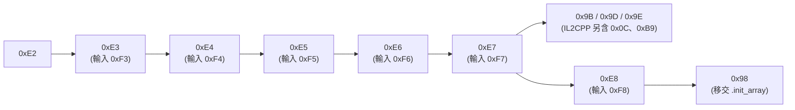

# Stage 2 直譯器

Stage 2（`0xE2`）會配置一張 256 格的模組表，先登錄自身（`0xE2`）與 `SHT_LOUSER` 尾端映射（`0xD0`），再走訪 `(X4, X5)` 所指的根記錄串流。每一層直譯器都會載入工作模組、解碼下一層直譯器模組 `0xE(n+1)`、切出直接切片串流 `0xF(n+1)`，並將 `0xF(n+1)` 交由 `0xE(n+1)` 執行：

## 模組表（`0x1800` 位元組）

Stage 2 會映射 `0x1800` 位元組的匿名可讀寫記憶體，容納 256 筆各占 `0x18`（24）位元組的紀錄：

| 位移 | 大小 | 欄位 |
| --- | --- | --- |
| `+0x00` | 4 | `command_id` |
| `+0x04` | 4 | 狀態旗標 |
| `+0x08` | 8 | 映射基底指標 |
| `+0x10` | 4 | 映射大小 |
| `+0x14` | 4 | 保留欄位 |

模組表會先登錄 `0xE2`（`X2`、`X3`）與 `0xD0`（`X6`、`X7`），隨後在各層串流執行期間依各筆記錄的 `command_id` 陸續填入對應槽位。

## `0x5C` 記錄描述元結構

8 位元組串流標頭（`dw0` 為描述元數量、`G` 為描述元種子；詳見 [字組、串流與記錄加密](../data-transforms/word-and-record.md)）後方緊接著描述元表，連同標頭共占 `8 + N * 0x5C` 位元組，直到第一筆 payload 位移為止。每筆 23 個 dword（`0x5C` 位元組）的描述元二進位結構如下：

| 位移 | Dword | 欄位 | 用途 |
| --- | --- | --- | --- |
| `+0x00` | `words[0]` | `command_id` | 模組或串流切片識別碼（`0x00`..`0xFF`） |
| `+0x04` | `words[1]` | `flags` | `0x2` 代表直接切片；`0x100` 代表略過 `init` 與 `entry` 回呼函式 |
| `+0x08` | `words[2]` | `image_offset` | 目前串流內的 payload 位移 |
| `+0x0C` | `words[3]` | `image_size` | 解碼後的容器大小（`flags & 2 == 0`）或原始切片長度（`flags & 2 != 0`） |
| `+0x10` | `words[4]` | `metadata_offset` | 保護器模組的載入、重定位與匯入中繼資料位移（無則為 `0`） |
| `+0x14` | `words[5]` | `metadata_size` | 解碼後或原始模組中繼資料大小 |
| `+0x18` | `words[6]` | `id_copy` | 必須等於 `command_id` |
| `+0x1C` | `words[7]` | `entry_offset` | 模組 `entry` 回呼函式相對於映射基底的位移 |
| `+0x20` | `words[8]` | `init_offset` | 模組 `init` 回呼函式相對於映射基底的位移 |
| `+0x24..+0x5C` | `words[9..22]` | 後續字組 | 保留欄位或模組專屬參數 |

處理每筆描述元時，直譯器會先準備 payload（當 `flags & 2 == 0` 時以直譯器自身的 `Module9bConfig` 解開容器；當 `flags & 2 != 0` 時直接指向串流切片），接著依該筆記錄的 `metadata` 區塊套用模組重定位與匯入符號、將模組登錄至槽位，並在未設定 `flags & 0x100` 的情況下依序呼叫 `init_offset` 與 `entry_offset`。

## 分層差異

直譯器 `0xE7` 負責載入核心 ELF 還原模組（`0x9B`、`0x9D`、`0x9E`）。在 Unity IL2CPP 組建中，`0xE7` 還會一併載入模組 `0x0C`（針對 `global-metadata.dat` 的 `mmap` hook）以及帶有實際內容的 `0xB9` 資料記錄；非 IL2CPP 的一般原生程式庫則不含 `0x0C`，且不含 `0xB9` 或僅帶有空的 `0xB9` 記錄。隨後直譯器 `0xE8` 會載入模組 `0x98`，待映像還原完成後呼叫目標程式庫原有的 `.init_array` 建構函式。
