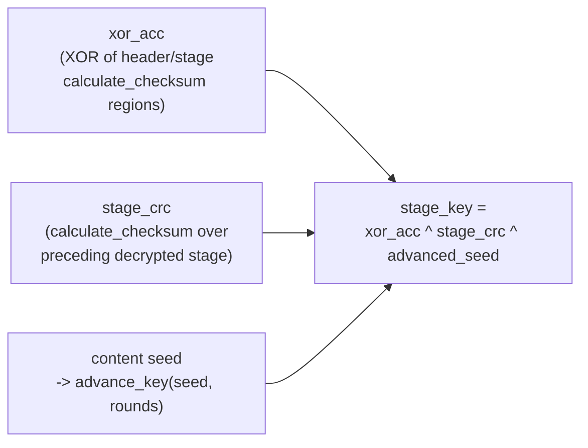

# Checksums and key progression

## Reflected CRC-32 checksums

Stage verification and key derivation use standard reflected CRC-32 (polynomial `0xEDB88320`, matching zlib/IEEE 802.3; `crc32(b"123456789") == 0xCBF43926`). Descriptors supply `(offset, length)` pairs, and `calculate_checksum` XORs the region's CRC-32 with `length`:

```python
def _build_crc_table():
    table = []
    for i in range(256):
        c = i
        for _ in range(8):
            c = 0xEDB88320 ^ (c >> 1) if c & 1 else c >> 1
        table.append(c)
    return table

CRC_TABLE = _build_crc_table()

def crc32_append(initial, data):
    crc = ~initial & MASK32
    for b in data:
        crc = CRC_TABLE[(crc ^ b) & 0xFF] ^ (crc >> 8)
    return ~crc & MASK32

def crc32(data):
    return crc32_append(0, data)

def calculate_checksum(d, pos):
    """crc32(region) ^ length, where (offset, length) is read from d[pos]."""
    offset = get_u32(d, pos)
    length = get_u32(d, pos + 4)
    return crc32(d[offset:offset + length]) ^ length
```

A chained variant feeds the previous output into `crc32_append(initial, data)` across original file slices during the validation-only `walk3` check in [Stage chain and marker layout](../loading-and-pe-repair/loading/stage-chain.md).

## Triangular key progression

Before mixing into a stage key, seed dwords extracted from the preceding stage are stepped through `iterations` triangular sums (`1 + 2 + ... + (m + 1) * 100` per round `m`):

```python
def advance_key(key, iterations):
    for m in range(iterations):
        bound = ((m + 1) * 25) << 2
        for n in range(1, bound + 1):
            key = (key + n) & MASK32
    return key
```

## Stage-key composition



Each downstream stage key XORs three inputs:

* **`xor_acc`:** accumulated XOR of `calculate_checksum` over a descriptor list in the anchor or header table.
* **Upstream CRC-32 (`stage_crc`):** `calculate_checksum` over plaintext bytes produced by earlier stages.
* **Content-derived seed:** a dword read from the just-decrypted stage and stepped with `advance_key`.

Because every stage key depends on both upstream plaintext bytes and header checksums, stages must be decoded strictly in order, and any wrong offset, shift, or corrupted byte causes downstream stage decryption and Huffman decompression to fail immediately.
