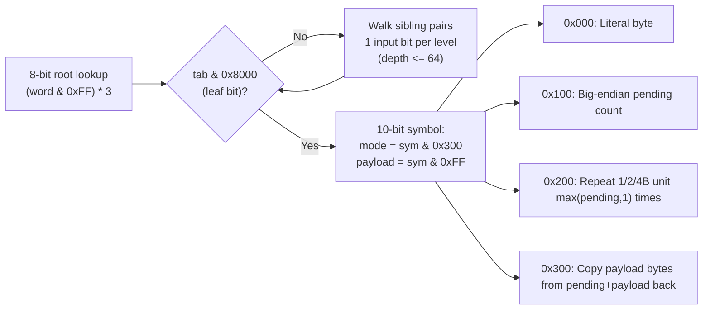

# Huffman and LZ compression

## Hybrid Huffman/LZ stream format

Stages 3 through 5 and compressed section blocks decode through a 3-byte-per-node Huffman table stored inside the working buffer at `key_offset`, producing a stream of 10-bit tokens:



* **3-byte table entries:** each entry is `(u16 tab, u8 bits)`. Reading the low 8 input bits indexes the root table; `tab & 0x8000` marks a leaf, while internal nodes store the index of a sibling pair selected by one additional input bit per tree level (`8 + depth` total bits).
* **10-bit leaf symbols:** bits `8..9` select the mode and bits `0..7` carry `payload`:

| Mode (`tab & 0x300`) | Payload (`tab & 0xFF`) | Operation |
| --- | --- | --- |
| `0x000` | Literal byte | Write `payload` (`1` byte) |
| `0x100` | Count byte | Reject if `pending >= 256`; shift into `pending = (pending << 8) \| payload` (`0` bytes written) |
| `0x200` | Unit width (`1`, `2`, or `4`) | Set `reps = max(pending, 1)`, repeat the preceding `payload`-byte unit `reps` times (`reps * payload` bytes written), and reset `pending = 0` |
| `0x300` | Copy length (`payload`) | Copy `payload` bytes from `pending + payload` bytes behind `dest`, then reset `pending = 0` |

```python
def decompress(d, src, dest, key_offset, s_size, d_size):
    """Decompress s_size bytes at `src` into d_size bytes at `dest`,
    in place within buffer `d`. Returns True when exactly d_size bytes
    were produced."""
    bit_pos = 0
    buf = bytearray(d[src:src + s_size]) + bytearray(3)  # 3 bytes of slack
    buf_off = 0
    src_consumed = 0
    pending = 0
    written = 0

    while src_consumed < s_size and written < d_size:
        word = get_u32(buf, buf_off) >> bit_pos
        tab_addr = key_offset + (word & 0xFF) * 3
        tab = get_u16(d, tab_addr)
        if tab & 0x8000:  # leaf
            tab &= 0x7FFF
            bits = d[tab_addr + 2]
        else:             # internal node: walk down one bit per level
            bits = d[tab_addr + 2]
            if bits >= 32:
                return False
            mask = 1 << bits
            bits += 1
            idx = (tab & 0x7FFF) + (1 if word & mask else 0)
            t2 = get_u16(d, key_offset + idx * 3)
            depth = 0
            while not (t2 & 0x8000):
                depth += 1
                if depth > 64:
                    return False
                mask <<= 1
                bits += 1
                idx = (t2 & 0x7FFF) + (1 if word & mask else 0)
                t2 = get_u16(d, key_offset + idx * 3)
            tab = t2 & 0x7FFF

        bit_pos += bits
        advance = bit_pos // 8
        buf_off += advance
        src_consumed += advance
        bit_pos %= 8

        mode = tab & 0x300
        payload = tab & 0xFF
        if mode == 0x000:  # literal
            step = 1
            d[dest] = payload
        elif mode == 0x100:  # count accumulator
            step = 0
            if pending >= 256:
                return False
            pending = payload if pending == 0 else (pending << 8) | payload
        elif mode == 0x200:  # run fill
            if pending == 0:
                pending = 1
            step = pending * payload
            if step + written > d_size:
                return False
            if payload == 1:
                if dest < 1:
                    return False
                v = d[dest - 1]
                for k in range(pending):
                    d[dest + k] = v
            elif payload == 2:
                if dest < 2:
                    return False
                v = get_u16(d, dest - 2)
                for k in range(pending):
                    put_u16(d, dest + k * 2, v)
            elif payload == 4:
                if dest < 4:
                    return False
                v = get_u32(d, dest - 4)
                for k in range(pending):
                    put_u32(d, dest + k * 4, v)
            else:
                return False
            pending = 0
        else:  # 0x300: LZ back-reference
            step = payload
            if written + payload > d_size or pending + payload > written:
                return False
            back = pending + payload
            for k in range(payload):
                d[dest + k] = d[dest + k - back]
            pending = 0

        dest += step
        written += step
        if bits == 0 and step == 0:
            return False

    return written == d_size
```

Because `decompress` enforces tree depth, back-reference bounds, `pending` width, and exact `written == d_size` output length, trial decompression rejects wrong stage keys, shift guesses, and false-positive bytecode stubs across [Loading and section recovery](../loading-and-pe-repair/loading/README.md). The same 3-byte table entries and four token modes are used in [CrackProof for Android SO internals](https://app.gitbook.com/s/fcBZibCo72OSh5jVcKoo/data-transforms/compression).
