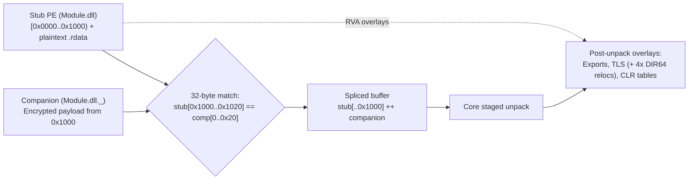

# Section data and companion files

## Section payload file base (`0x1080`)

Across all Windows build families, section-block descriptors store source offsets relative to a base address encoded via bitwise NOT at file offset `0x1080`:

```text
section_data_file_base = (~u32@0x1080 + 0x1000) & 0xFFFFFFFF
```

Each descriptor's `src` field resolves to file offset `src + section_data_file_base` inside the container (or inside the virtual `stub[..4096] ++ companion` buffer on companion builds).

## External-companion layout (`._` files)

Some PE32+ EXE-style builds split a protected EXE or DLL across two files in the same directory:

* **`Module.dll` / `App.exe` (stub):** retains the outer PE headers (`0x0000..0x0FFF`), the 32-byte `info` header at `0x1000..0x101F`, a minimal loader entry section, and selected plaintext directories in `.rdata`.
* **`Module.dll._` / `App.exe._` (companion):** high-entropy payload holding the bytes from container offset `0x1000` onward, with no standalone PE headers.



Pairing requires an exact 32-byte match between `stub[4096..4128]` and `companion[0..32]` (the encrypted `info` header).


**Entry-thunk companion declaration.** On PE32+ shells, the 63-byte loader entry record also declares whether an external companion is expected: offset `+53` holds `~0x1000` (vs `~0` on single-file builds) and offset `+58` holds `~u32("._\0\0")`. That signature lets static tools distinguish a missing `._` file from a damaged single-file binary.


## Plaintext regions retained only in the stub

Because the encrypted `._` companion omits or zeroes several tables that Windows or the CLR inspects, reconstruction overlays them from the stub PE by RVA after core section recovery:

* **Export directory (`DD[0]`):** copied from the stub because the companion payload leaves the export range encrypted or unpopulated.
* **TLS directory (`DD[9]`):** the companion payload zeroes `DD[9]`, the `IMAGE_TLS_DIRECTORY64` struct, and the TLS raw-data template; reconstruction restores them from the stub and appends four `IMAGE_REL_BASED_DIR64` base relocations for the four VA fields in `IMAGE_TLS_DIRECTORY64`.
* **ASLR and base relocations (`DD[5]`):** companion modules preserve `DllCharacteristics` (`DYNAMIC_BASE` / `HIGH_ENTROPY_VA`) and active base relocations rather than forcing `/FIXED`.
* **CLR metadata on managed companions (`DD[14]`):** the `._` payload carries the encrypted IL method bodies, while the stub retains the `COR20` header and its referenced metadata (`BSJB`), resource, strong-name, and vtable-fixup ranges (see [Relocations, page transforms, and CLR data](../loading-and-pe-repair/pe-reconstruction/relocations-managed.md)).
