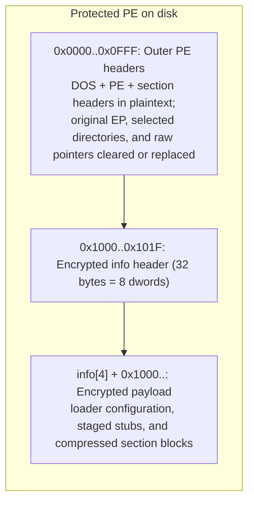

# Container and encrypted header

A protected PE replaces the original section layout with an encrypted container. The first 4,096 bytes (`0x0000..0x0FFF`) keep readable outer PE headers, offset `0x1000` holds an encrypted 32-byte parameter block, and the remainder of the file stores encrypted loader tables, stage stubs, and compressed application sections.

## Container layout



| Region | File offset | Contents |
| --- | --- | --- |
| Outer PE headers | `0x0000..0x0FFF` | DOS/PE signatures, COFF header, optional header, and section table. Original entry point, selected data directories, and section raw pointers are blanked or redirected to the loader. |
| `info` header | `0x1000..0x101F` | Eight little-endian dwords decrypted by `header_kdf`. Supplies the magic, RVA placement, and payload bounds for the entire container. |
| Payload | From `info[4] + 0x1000` | Encrypted loader tables, stage code, and compressed section data. |

Every observed Windows build splits headers from container state at `0x1000`, including the [external-companion layout](companion-layout.md), which moves container bytes from `0x1000` onward into a separate `._` file.

## The `info` header and key derivation

`info[0]` is stored in plaintext at `0x1000`; words `info[1..7]` are decrypted with a rolling key that mixes the raw ciphertext word and `i * i`:

```python
def header_kdf(file_data, offset=4096):
    info = [0] * 8
    info[0] = get_u32(file_data, offset)
    k = info[0]
    for i in range(7):
        cell = get_u32(file_data, offset + 4 + 4 * i)
        info[i + 1] = k ^ cell
        k = (i * i) ^ ((k + cell - i) & 0xFFFFFFFF)
    return info
```

The same 32-byte KDF applies across PE32 and PE32+, EXEs and DLLs, and single-file and companion builds:

| Field | Meaning |
| --- | --- |
| `info[0]` | Plaintext seed key; also seeds `payload_xor_chain` |
| `info[1]` | Format magic (`0x4E4E4F4B` = ASCII `KONN` in little-endian) |
| `info[2]` | Reserved / build-variant field |
| `info[3]` | Target base RVA in the working image buffer where the payload is mapped |
| `info[4]` | File offset bias: payload bytes start at file offset `info[4] + 4096` |
| `info[5]` | Total payload byte length copied to image range `[info[3], info[3] + info[5])` |
| `info[6]` | End RVA marker for the encrypted loader prefix and anchor search |
| `info[7]` | Reserved / build-variant field |

## Payload transfer and `decrypt_size`

File bytes `[info[4] + 4096, info[4] + 4096 + info[5])` map into working-image RVAs `[info[3], info[3] + info[5])`:

* **Standard prefix decryption:** on 64-bit builds and standard PE32 builds, the first `decrypt_size = info[6] - info[3] + 8192` bytes are decrypted with `payload_xor_chain` (see [Rolling-key and rotation ciphers](../data-transforms/rolling-and-rotation.md)), and the remaining tail of `info[5]` is copied verbatim.
* **Full-payload PE32 variant:** older compact PE32 builds encrypt the entire payload (`decrypt_size = info[5]`, which also changes the initial XOR seed `info[0] + ~decrypt_size`). Static recovery falls back to `decrypt_size = info[5]` on PE32 when prefix decryption yields no `tbl` candidate whose `SecondStage` validates.

After payload transfer, `4096` (`0x1000`) is written as a dword at image RVA `info[3]`, and the first `4096` bytes of the file are copied to `[0, 0x1000)` as the working PE header.
