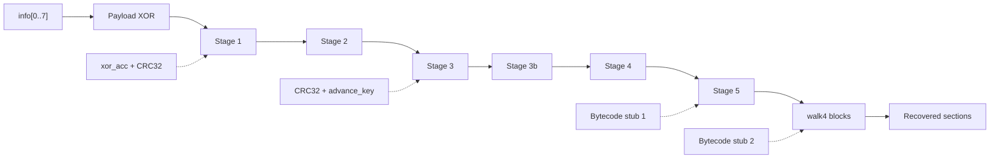
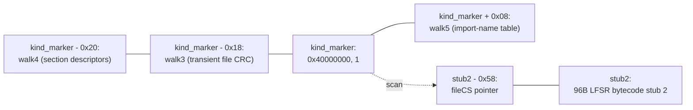

# Stage chain and marker layout

`payload_xor_chain` decrypts the outer loader workspace rather than the application itself. Inside that workspace, stages 1 through 5 unwrap sequentially: each stage's key combines header checksums, CRC-32 over the preceding decrypted stage, and a content seed passed through `advance_key`.

## Composite stage decryptor (Stages 3..5)

Every stage after Stage 2 is described by a 16-byte `{src, src_len, dest, dest_len}` quad and decoded in four steps:

1. **AES-CBC decrypt** `d[src .. src + src_len]` in place using stage schedule `key_offsets[3]`.
2. **XOR + rotate-right** (`xor_ror_dwords`, shift `19`) over `{src, src_len}` with the derived stage key.
3. **Bytecode translate** (Stage 5 only): map every byte in `src .. src + src_len` through bytecode stub 1.
4. **Huffman/LZ decompress:** when `src_len != dest_len`, expand `src -> dest` using stage Huffman table `key_offsets[1]`.

## Nine-phase 64-bit marker pipeline



### Phases 1 and 2: `info` header and payload prefix

Decode `info[0..7]` at `0x1000` with `header_kdf`, verify `info[1] == 0x4E4E4F4B` (`KONN`), allocate a zeroed `SizeOfImage` working buffer, run `payload_xor_chain` over `decrypt_size = info[6] - info[3] + 8192` bytes from `info[4] + 4096` into `info[3]`, copy the remaining `info[5] - decrypt_size` tail verbatim, write `0x1000` at `info[3]`, and copy file bytes `[0, 0x1000)` to the front of the image.



### Phase 3: Configuration anchor and Stage 1

Scan `[info[6] + 1000, info[6] + 8000)` for `anchor` where `u32@anchor == info[3]` and `u32@(anchor + 8)` lies below `info[6]` within `0x1000` on a `0x200` boundary. Test `extra in (0, 8)` against the Stage 1 `{base, length}` descriptor at `anchor + 120 + extra` (`base >= info[3]`, `length >= 16`, in-image).

Restore `DD[1]` (Import Directory) `(RVA, size)` from `anchor + 8` and `anchor + 4`, accumulate `xor_acc` across the `(offset, length)` chain at `anchor + 184 + extra`, compute `chk1 = calculate_checksum(d, anchor + 56 + extra)` and `v = u32@(anchor + 20)`, and unwrap Stage 1 with `xor_ror_dwords(d, anchor + 120 + extra, xor_acc ^ chk1 ^ v, 21)`.



### Phase 4: Stage 2 and the four `key_offsets`

Scan Stage 1 for the unique 16-byte Stage 2 quad (`stage2_off`) where `d0 == d2` in payload range, `d1 > 0x10000`, and `0 < d3 < d1`. Walk backward to `chk_src_start` (four valid consecutive `(src, len)` pairs), read the Stage 2 key at `chk_src_start - 20`, and unwrap Stage 2 with shift `19`.

Locate `(1, 0, info[3], 0)` inside Stage 2 (`table_start`), process the two `head` entries at `table_start + 32` (kind `1`/`0x11` -> `byte_rotate3`; kind `2` -> `(src, len, dst, chk)` copy list), and `byte_rotate3`-decrypt the four `walk2` slots at `head - 88`:

| Slot | Table role |
| --- | --- |
| `key_offsets[0]` | Huffman table for **section** decompression |
| `key_offsets[1]` | Huffman table for **stage** decompression |
| `key_offsets[2]` | AES schedule for **section** decryption |
| `key_offsets[3]` | AES schedule for **stage** decryption |



### Phase 5: Stages 3, 3b, 4, and 5

Decode the four stage quads relative to `stage2_off`:

| Stage | Quad offset | Key formula |
| --- | --- | --- |
| Stage 3 | `stage2_off + 88` | `xor_acc ^ chk2 ^ advance_key(u32@(chk_src_start - 16), rounds)` (`rounds = 4` default; retries `0..=8` if decompression or `v4` lookup fails) |
| Stage 3b | `stage2_off + 104` | `xor_acc ^ chk3 ^ v4`, where `v4` is the last nonzero dword after `C3 CC CC CC` in Stage 3 |
| Stage 4 | `stage2_off + 136` | `xor_acc ^ chk4 ^ ~v5`, where `v5 = u32@(first "Virtual..." string in Stage 3b - 8)` |
| Stage 5 | `stage2_off + 216` | `xor_acc ^ chk4 ^ chk5 ^ advance_key(accum2, rounds)` (`rounds = 3` default; retries `0..=8` on decompression failure), translated through **bytecode stub 1** |

In Stage 4, LFSR-scan for bytecode stub 1 near the anti-debug API strings (`IsDebuggerPresent`, `CheckRemoteDebuggerPresent`), and read `accum2` immediately past the last `48 EB 01 B9` sequence (skipping any `0xCC` padding).



### Phase 6: Stage 5 marker geometry and bytecode stub 2

Locate `"pm\0\0cm\0\0"` (`70 6D 00 00 63 6D 00 00`) and the kind marker `0x40000000, 1` (`00 00 00 40 01 00 00 00`) inside Stage 5:

* **`walk3`** is decrypted transiently to verify the chained CRC-32 over original file regions, then restored to its encrypted bytes.
* **`fileCS`** (`stub2 - 0x58`) is decrypted permanently in place (`byte_rotate2` over 16-byte entries until `len == 0`).
* **Stub 2** is LFSR-decrypted and compiled into its 256-byte lookup table.



### Phase 7: Parallelizable section recovery (`walk4`)

`walk4` chains 16-byte `{src, len, dst, plain_len}` descriptors (`byte_rotate2`-decrypted at their own RVAs) terminated by `len == 0`. Each block copies `file[src + section_data_file_base .. +len]` to `image[dst]`, runs `aes_decrypt` (`key_offsets[2]`), translates through stub 2, and runs `decompress` (`key_offsets[0]`) when `len != plain_len`. A second `walk4` chain zero-fills `.bss` ranges afterward. Because destination spans are disjoint, block recovery is deterministic whether run sequentially or in parallel.



### Phase 8: `walk5` import-name decryption

When `walk5` is non-null (native modules), each 20-byte entry references an encrypted DLL name (`+12`, decrypted with `string_cipher` at `name_rva & 0xFF` and lowercased) and thunk array (`+0` or `+16`). Each by-name thunk (bit 63 clear) decrypts its symbol name at `hint_name_rva + 2` using initial key `hint_name_rva & 0xFF` (preserving symbol case) and zeroes its 2-byte `Hint`. Managed modules have a null `walk5` pointer.



### Phase 9: PE header, scramble, and directory finalization

Convert section raw pointers to RVA layout, apply the `.text` page scramble (`dd8`), transiently decrypt and restore the entry point and data directories, and apply TLS, relocation, and CLR metadata overlays (see [PE reconstruction](../pe-reconstruction/README.md)).


