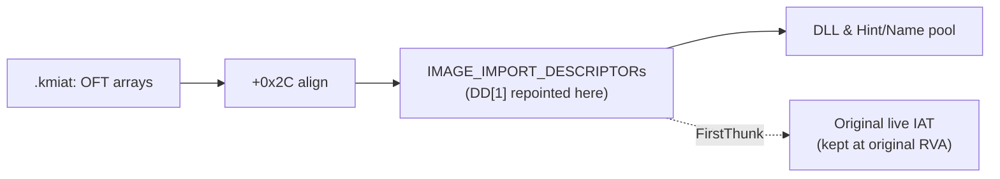

# Imports, TLS, and exports

## Import-table and string recovery

Encrypted import strings use `string_cipher` (`dd7`): DLL names at `name_rva` start at `pos = name_rva` with `key = name_rva & 0xFF`, whereas by-name `IMAGE_IMPORT_BY_NAME` entries at `hint_name_rva` start at `pos = hint_name_rva + 2` (past the 2-byte `Hint`, which is zeroed) with initial key `hint_name_rva & 0xFF`. Ordinal thunks (bit 63 on PE32+, bit 31 on PE32; always read full 64-bit thunks on PE32+) are left untouched.



* Walks 20-byte entries in Stage 5's `walk5` table (`+12` = DLL name RVA, `+0` / `+16` = thunk chains). Managed assemblies have `walk5 == 0`.
* Decrypts each DLL name in place and lowercases it; decrypts each by-name function string at `hint_name_rva + 2` **without** lowercasing (symbol names remain case-sensitive) and zeroes `Hint`.
* `DataDirectory[12]` (IAT) comes from the saved 128-byte metadata directory array.



* Walks `IMAGE_IMPORT_DESCRIPTOR`s from restored `DataDirectory[1]` (falling back to the anchor's import RVA when metadata `DD[1]` is zero) **after** `.text` `dd8` runs, because import strings reside inside `.text`.
* Skips `string_cipher` on any module or function name that is already printable ASCII; lowercases decrypted DLL names while preserving function-name case.
* Computes `DataDirectory[12]` (IAT) bounds by scanning the `FirstThunk` chains across descriptors.



* Decrypts DLL names and by-name function strings in place from the import table without lowercasing DLL names.
* Restores `DataDirectory[12]` from the 656-byte metadata block at `info[3] + 16`.



* Selects between the `EighthStage` (`+0x18`) import table and the metadata directory's import table.
* **In-place `.idata` PE32:** decrypts names in place (computing `DD[12]` from thunk bounds on `.idata` EXEs, and clearing `DD[12]` to `(0, 0)` on PE32 DLLs).
* **`.kmiat` rebuild (PE32 EXEs only):** when the loader-written IAT layout diverges from standard `.idata`, import descriptors, OriginalFirstThunk arrays (`+0x2C` padding gap), and lowercased DLL / case-preserved symbol strings (`api-ms-win-crt-*` normalized to `ucrtbase.dll`) are rebuilt into the final section renamed `.kmiat` (size `0x7000`, characteristics `0xE0000060`), keeping the live IAT in place and clearing `DD[12]` to `(0, 0)`:




## TLS restoration and relocation re-arming

CrackProof strips TLS state from the encrypted payload and handles TLS manually inside its runtime loader, leaving static images broken (`0xC0000005` on `_tls_index` / `LdrpAllocateTlsEntry`) unless TLS is restored from the plaintext outer stub:

* **Single-file 64-bit marker:** saved metadata retains a nonzero `DD[9]` pointing at a zeroed `IMAGE_TLS_DIRECTORY64`; reconstruction copies the plaintext struct and raw-data template from the protected file at their RVAs (single-file marker builds are `/FIXED` and do not synthesize relocations; marker-less single-file builds clear `DD[9]` if the recovered struct is all zero).
* **External-companion (`._`) 64-bit:** the companion zeroes `DD[9]`, the TLS struct, and the template, and drops their base relocations. Reconstruction restores `DD[9]`, the `IMAGE_TLS_DIRECTORY64` struct, and its raw-data template from the stub PE, then **appends four `IMAGE_REL_BASED_DIR64` entries** to `.reloc` covering `StartAddressOfRawData`, `EndAddressOfRawData`, `AddressOfIndex`, and `AddressOfCallBacks`.
* **PE32 EXEs and DLLs:** copies the plaintext `IMAGE_TLS_DIRECTORY32` and template from the loader stub (falling back to a minimal `.tls`/`.data` placeholder if absent). On **PE32 DLLs**, CrackProof leaves the four TLS-pointer relocations in `.reloc` demoted to `IMAGE_REL_BASED_ABSOLUTE` (`type = 0`) with nonzero page offsets; reconstruction **re-arms those four slots to `IMAGE_REL_BASED_HIGHLOW` (`type = 3`)** so rebasing updates all four `IMAGE_TLS_DIRECTORY32` pointer fields.

## Export directories (`DD[0]`)

Single-file builds retain the plaintext export directory at its RVA in the protected file. External-companion (`._`) payloads decrypt to garbage across the export range, so reconstruction overlays the entire `DataDirectory[0]` span from the stub PE's `.rdata`.
