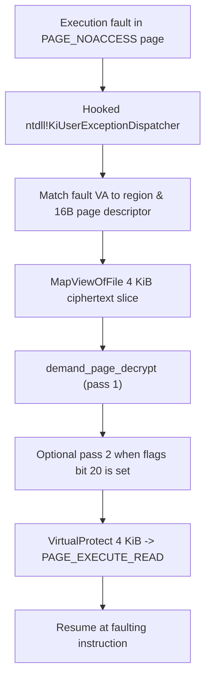

# Page protection and loader code

## Demand-fault page encryption (`640` -> `840`)

Page protection is an optional per-module runtime layer (commonly enabled on host EXEs and disabled on plugin DLLs):

1. Executable sections are bulk-decrypted during stage `640`.
2. At stage `840`, executable pages are re-encrypted per 4 KiB page and marked `PAGE_NOACCESS`, while `ntdll!KiUserExceptionDispatcher` is inline-hooked to jump into `HtdpStub2.dll` (see [Manually mapped helper modules](mapped-modules.md)).
3. When execution faults on a `PAGE_NOACCESS` page, the dispatcher hook intercepts the exception ahead of all SEH chains, decrypts that 4 KiB page on demand, sets `PAGE_EXECUTE_READ`, and resumes execution.

Because untouched pages stay `PAGE_NOACCESS` (and some builds enable **scribble**, XOR-masking selected bytes of resident decrypted pages between faults), a single post-OEP memory snapshot captures only the faulted working set unless every protected page is forced to fault in and de-scribbled.

## On-demand page cipher



Inside `HtdpStub2.dll`, each protected module registers a region descriptor pointing to an array of 16-byte page descriptors at `region_base + page_table_offset` (indexed by `(fault_va - region_base) >> 12`):

| Structure | Offset | Size | Observed meaning |
| --- | --- | --- | --- |
| Region descriptor | `+0x08` | 8 | `region_base` virtual address |
| Region descriptor | `+0x10` | 4 | Region byte size |
| Region descriptor | `+0x20` | 4 | `page_table_offset` relative to `region_base` |
| Region descriptor | `+0x24` | 4 | Total 4 KiB page count |
| Region descriptor | `+0x28` | 8 | Section handle passed to `MapViewOfFile` |
| Region descriptor | `+0x34` | 4 | Decrypted-page counter |
| Page descriptor (`16B`) | `+0x00` | 4 | `flags` (`bit 20`, bit index `0x14` / mask `0x00100000`, enables pass 2) |
| Page descriptor (`16B`) | `+0x04` | 4 | Per-page `key_part` |
| Page descriptor (`16B`) | `+0x08` | 4 | Last `GetTickCount` timestamp |
| Page descriptor (`16B`) | `+0x0C` | 2 | Fault counter |
| Page descriptor (`16B`) | `+0x0E` | 2 | Unconfirmed 16-bit field |

Pass 1 derives a 32-bit key from the low 32 bits of `page_va + region_base` XORed with `key_part` and runs a rolling dword cipher over the 4 KiB page:

```python
def demand_page_key(page_va, region_base, key_part):
    return ((page_va + region_base) ^ key_part) & MASK32


def demand_page_decrypt(buf, key):
    count = len(buf) >> 2
    state = ((key << 16) ^ key) & MASK32
    prev = state
    for i in range(count):
        enc = get_u32(buf, i * 4)
        state = rol32((state + i) & MASK32, 3)
        put_u32(buf, i * 4, enc ^ prev ^ state)
        prev = enc
```

`get_u32`, `put_u32`, `rol32`, and `MASK32` are defined on [Rolling-key and rotation ciphers](../data-transforms/rolling-and-rotation.md); runnable vectors live in [primitives.py](https://app.gitbook.com/s/8S0xnfw9UP9A2yylicaA/primitives.py). When `flags & 0x00100000` is nonzero, a second build-specific pass runs before `VirtualProtect` switches the page to `PAGE_EXECUTE_READ`.

## Loader polymorphism, decoys, and disk self-mapping

* **Duplicated polymorphic prologues:** Stage 5 emits up to 16 cosmetically permuted copies of identical cipher routines with varied junk-jump layout.
* **Desynchronizing jumps and return-address arithmetic:** unconditional jumps followed by junk bytes, mid-instruction branch targets, and `call $+5` constant-offset adjustments break linear and naive recursive-descent disassembly.
* **Timing and `#DB` SEH decoys:** one decoy saves all 16 GPRs, runs the `0x5658` `in eax, dx` probe, executes `jne $+2` (`disp = 0`, reaching the next instruction either way), and returns, existing solely to feed external timing checks; another sets `TF` (`pushfq; or [rsp], 0x100; popfq`) so normal execution diverts via SEH while debuggers or emulators that swallow `#DB` fall into dead code.
* **Post-boot table scrubbing & disk self-mapping:** Stage 5 resolves its own path via `GetModuleFileNameW`, opens and maps the on-disk file (`CreateFileW` / `CreateFileMappingA` / `MapViewOfFile`) using OS-resolved imports, applies `.reloc` entries itself at `655`, and zeroes spent stage tables and markers before `280`.
