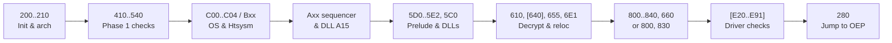

# Startup sequence and status reporting

Before original program code runs, CrackProof executes a configurable startup pipeline across the host stub and its manually mapped support modules, ending at status `280` (jump to OEP):

## The boot sequence and status codes

Each enabled stage logs a 12-bit hex status code:

| Code | Stage |
| --- | --- |
| `200` / `210` | Loader startup / host architecture check |
| `410` | Usermode anti-debug check (`IsDebuggerPresent`; live captures show no SEH substages in `410`) |
| `510` | CRC-32 integrity check over a loader memory range |
| `520` / `52F` | `NtQueryInformationProcess` debug check / kernel-debugger check |
| `540` | VMware I/O-port backdoor probe and/or CPU feature check |
| `560` / `561` | Section-decrypt setup / support-module selection |
| `C00` | Minimum Windows build check: logs two `(0x01A00000 + build)` dwords (host build, minimum build) |
| `C01` | Boot-configuration check (`testsigning`, `disableintegritychecks`) |
| `C02` / `C03` / `C04` | Install `Htsysm` service (`Htsysm7679`, `Htsysm767901`, or `Htsysm1B4001`) / initialize driver / register callbacks or `EPROCESS` protection and hooks |
| `A03` | Parent-process check (`explorer.exe` / `cmd.exe`) |
| `A09` | VM hardware/BIOS registry prefix check |
| `A0F` | Injected-DLL scan |
| `A08` / `A04` | Copy clean `ntdll` / `kernel32` `.text` from disk (`A04` also aborts if the on-disk system DLL is modified) |
| `A07` / `A01` | Terminate unexpected threads / abort if foreign threads remain |
| `A11` | DLL host-process check (`peC` section or exact-case `KeRnEl32.dLl` import in the host EXE) |
| `A15` | DLL sequencer marker logged after `5D0` once host checks pass (no check body; never logged on EXEs) |
| `B00` / `BD0` / `BE0` | Compatible OS check / `C:\Windows\msc.log.log` absence check / legacy SoftICE-Syser device check |
| `B21` / `BB0` | Legacy driver helper loads (`HtsyskNT.dll` / `HtpecmNT.dll`) |
| `5D0` `552` `570` `590` `5B0` `5B1` `598` `5A0` `5E1` `5E2` | Staged decrypt prelude steps |
| `A06` / `5C0` | Late API hooks / load imported runtime DLLs |
| `610` | Bulk section and header decryption |
| `640` | Bulk executable-page decryption prior to page sealing |
| `655` / `6E1` | Base relocation fixups / tail section setup |
| `800` `810` `820` `840` | Page-protection setup (`800`..`820`), `KiUserExceptionDispatcher` hook + `PAGE_NOACCESS` sealing (`840`) |
| `830` | Page-setup completion on non-page-encrypted native builds (`800` -> `830`) |
| `660` | Post-page-seal handoff stage before `280` |
| `E20` `E40` `E52`..`E59` `E55` `E91` | Late integrity and analysis-driver device checks on `1B40`-family builds |
| `280` | Final handoff to the original entry point (OEP) |

Per-module configuration is visible in multi-module captures (see [Sample debug logs](https://app.gitbook.com/s/8S0xnfw9UP9A2yylicaA/sample-debug-logs)): a page-encrypted host EXE runs `610 -> 640 -> 655 -> 6E1 -> 800..840 -> 660 -> 280`, whereas a bulk-decrypted native plugin DLL in the same process runs `610 -> 655 -> 6E1 -> 800 -> 830 -> 280`. A single mode-driven sequencer dispatches the `A`-series checks across passes.

## Debug logging

* **`%temp%\<12 hex>` folder gate:** each protected module derives a 12-hex-character folder name; if `%temp%\<12 hex>` exists and its creation timestamp is within roughly 48 hours, the loader writes a plaintext trace file (`HHMMSSmmmE-...` for EXEs, `HHMMSSmmmD-...` for DLLs). Hooking or breaking on `CreateFileW` reveals the probed path immediately.
* **`\\.\mailslot\ErrLog-Pec<4 hex>` channel:** an independent diagnostic channel derives `<4 hex>` as `((key + 1) * 0x3039) mod 0x8003` (from the first 16-bit word of the 12-hex logging key) and writes an XOR-rolled report (`state = (derive(key) + 1)^2 ^ ~length; word ^= state; state = ror32(state + i, 7)` from `-- Version` onward) when a mailslot listener is present.
* **`AAA-BBB-CCC` closing code:** both channels close with a 9-character status code:
  * **`AAA` (3 decimal digits):** `000` on clean startup, or the failing stage's 1-based decimal index in a 104-entry stage table (for example `C03` -> `046`, `A09` -> `048`, `E91` -> `601`).
  * **`BBB` (3 uppercase hex digits):** the first sub-stage code recorded during the failing stage.
  * **`CCC` (3 uppercase hex digits):** the first cause/error code recorded while `BBB` was still unset (observed examples: `046-019-01F`, `048-012-002`, `601-000-008`).


**Finding stage emitters in memory.** The logging helper packs a 12-bit code into `ECX` with low-nibble tag `1` for stage status (`(code << 4) | 1`, e.g. `0xC01` -> `0xC011`), `3` for `CCC` cause codes (`(code << 4) | 3`), and `5` for `BBB` sub-stage codes (`(code << 4) | 5`). Only core bootstrap codes (`200`, `560`, `590`, `5A0`, `5E1`, `5E2`, `800`) reside in the host module's own loader section (with Phase 1 immediates scrubbed after execution); `410`/`510`/`520`/`540`, `Cxx`, and `Axx` immediates live inside the manually mapped helper DLLs (`HtpecIt`, `dm`, etc.).

