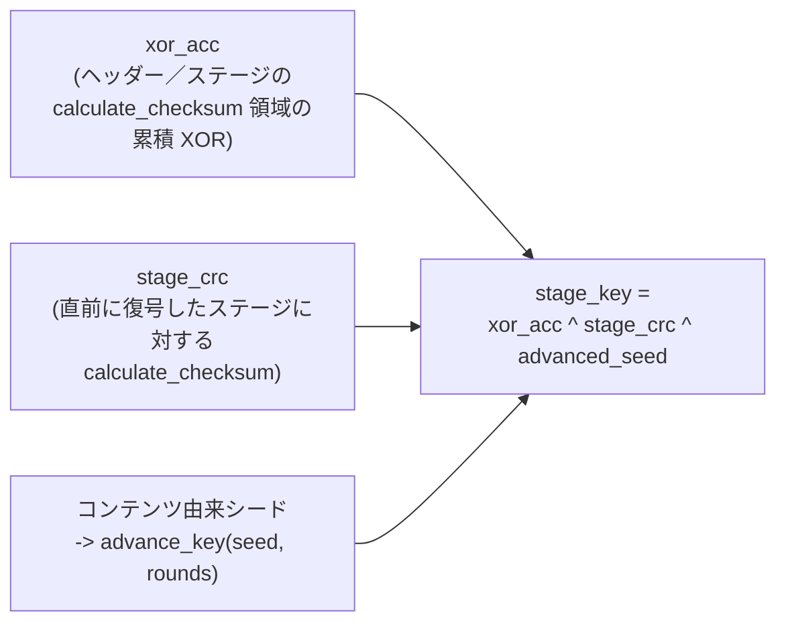

# チェックサムと鍵更新

## ビット反転型 CRC-32 チェックサム

ステージ検証および鍵導出には、標準的なビット反転型（Reflected）CRC-32（多項式 `0xEDB88320`、zlib および IEEE 802.3 と同一仕様で `crc32(b"123456789") == 0xCBF43926`）が使用されます。ディスクリプターは `(offset, length)` のペアを保持し、`calculate_checksum` は対象領域の CRC-32 と `length` を XOR した値を返します。

```python
def _build_crc_table():
    table = []
    for i in range(256):
        c = i
        for _ in range(8):
            c = 0xEDB88320 ^ (c >> 1) if c & 1 else c >> 1
        table.append(c)
    return table

CRC_TABLE = _build_crc_table()

def crc32_append(initial, data):
    crc = ~initial & MASK32
    for b in data:
        crc = CRC_TABLE[(crc ^ b) & 0xFF] ^ (crc >> 8)
    return ~crc & MASK32

def crc32(data):
    return crc32_append(0, data)

def calculate_checksum(d, pos):
    """crc32(region) ^ length, where (offset, length) is read from d[pos]."""
    offset = get_u32(d, pos)
    length = get_u32(d, pos + 4)
    return crc32(d[offset:offset + length]) ^ length
```

[ステージチェーンとマーカーありレイアウト](../loading-and-pe-repair/loading/stage-chain.md)の検証専用チェック `walk3` では、元ファイルの複数スライスにわたって直前の出力を `crc32_append(initial, data)` へ引き継ぐ連鎖型 CRC-32 も使用されます。

## 三角数による鍵更新

直前のステージから抽出したシード dword は、ステージ鍵へ混合される前に `iterations` ラウンド分の三角数加算（各ラウンド `m` につき `1 + 2 + ... + (m + 1) * 100`）で更新されます。

```python
def advance_key(key, iterations):
    for m in range(iterations):
        bound = ((m + 1) * 25) << 2
        for n in range(1, bound + 1):
            key = (key + n) & MASK32
    return key
```

## ステージ鍵の合成



後続の各ステージ鍵は、次の 3 要素を XOR して合成されます。

* **`xor_acc`:** アンカーまたはヘッダーテーブル内のディスクリプターリストに対する `calculate_checksum` の累積 XOR 値。
* **前段ステージの CRC-32（`stage_crc`）:** 先行ステージで復号された平文バイト列に対する `calculate_checksum` の結果。
* **コンテンツ由来シード:** 直前に復号したステージから読み取った dword を `advance_key` で更新した値。

各ステージ鍵は前段までの平文バイト列とヘッダーチェックサムの双方に依存するため、ステージの復号は厳密に順序どおり行う必要があり、オフセットや右ローテート幅（`shift`）の誤り、あるいは 1 バイトの破損があっても後続ステージの復号および Huffman 展開が即座に失敗します。
