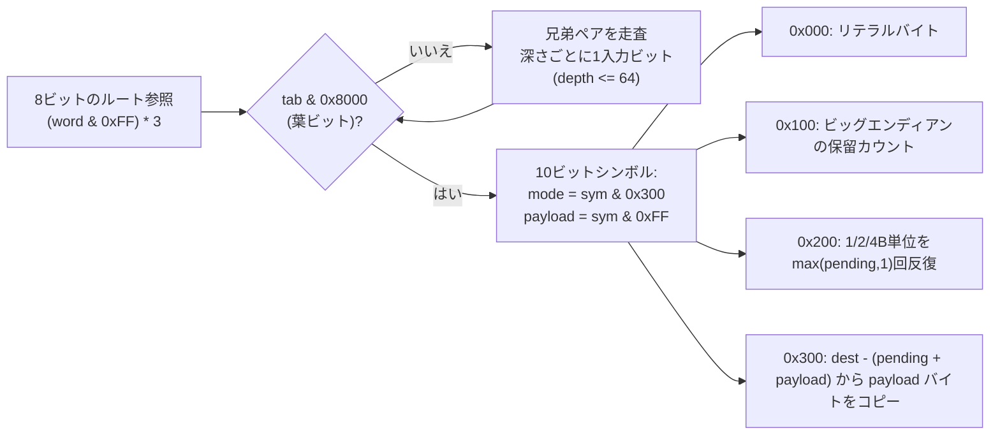

# ハフマン / LZ 圧縮

## ハイブリッド型のハフマン / LZ ストリーム形式

Stage 3 から Stage 5 および圧縮されたセクションブロックの展開では、作業バッファー内の `key_offset` に配置された 1 ノード 3 バイトのハフマンテーブルでビットストリームを 10 ビットのトークン列にデコードし、出力バイト列を復元します。



* **3 バイトのテーブルエントリ：** 各エントリは `(u16 tab, u8 bits)` で構成されます。入力の下位 8 ビットでルートテーブルを参照し、`tab & 0x8000` が立っていれば葉ノードを表します。内部ノードの場合は兄弟ペアのインデックスを保持し、木の階層を 1 段下るごとに追加入力 1 ビット（合計 `8 + depth` ビット）で分岐先を選択します。
* **10 ビットの葉シンボル：** ビット `8..9` がモードを選択し、ビット `0..7` が `payload` を保持します。

| モード (`tab & 0x300`) | ペイロード (`tab & 0xFF`) | 動作 |
| --- | --- | --- |
| `0x000` | リテラルバイト | `payload` をそのまま書き込む（`1` バイト出力） |
| `0x100` | カウントバイト | `pending >= 256` なら不正として棄却し、`pending = (pending << 8) \| payload` にシフト連結する（`0` バイト出力） |
| `0x200` | 単位幅（`1`、`2`、`4` のいずれか） | `reps = max(pending, 1)` とし、直前の `payload` バイト単位を `reps` 回繰り返す（`reps * payload` バイト出力）。完了後に `pending = 0` にリセットする |
| `0x300` | コピー長（`payload`） | `dest` の `pending + payload` バイト手前（`dest - (pending + payload)`）から `payload` バイトをコピーし、`pending = 0` にリセットする |

```python
def decompress(d, src, dest, key_offset, s_size, d_size):
    """Decompress s_size bytes at `src` into d_size bytes at `dest`,
    in place within buffer `d`. Returns True when exactly d_size bytes
    were produced."""
    bit_pos = 0
    buf = bytearray(d[src:src + s_size]) + bytearray(3)  # 3 bytes of slack
    buf_off = 0
    src_consumed = 0
    pending = 0
    written = 0

    while src_consumed < s_size and written < d_size:
        word = get_u32(buf, buf_off) >> bit_pos
        tab_addr = key_offset + (word & 0xFF) * 3
        tab = get_u16(d, tab_addr)
        if tab & 0x8000:  # leaf
            tab &= 0x7FFF
            bits = d[tab_addr + 2]
        else:             # internal node: walk down one bit per level
            bits = d[tab_addr + 2]
            if bits >= 32:
                return False
            mask = 1 << bits
            bits += 1
            idx = (tab & 0x7FFF) + (1 if word & mask else 0)
            t2 = get_u16(d, key_offset + idx * 3)
            depth = 0
            while not (t2 & 0x8000):
                depth += 1
                if depth > 64:
                    return False
                mask <<= 1
                bits += 1
                idx = (t2 & 0x7FFF) + (1 if word & mask else 0)
                t2 = get_u16(d, key_offset + idx * 3)
            tab = t2 & 0x7FFF

        bit_pos += bits
        advance = bit_pos // 8
        buf_off += advance
        src_consumed += advance
        bit_pos %= 8

        mode = tab & 0x300
        payload = tab & 0xFF
        if mode == 0x000:  # literal
            step = 1
            d[dest] = payload
        elif mode == 0x100:  # count accumulator
            step = 0
            if pending >= 256:
                return False
            pending = payload if pending == 0 else (pending << 8) | payload
        elif mode == 0x200:  # run fill
            if pending == 0:
                pending = 1
            step = pending * payload
            if step + written > d_size:
                return False
            if payload == 1:
                if dest < 1:
                    return False
                v = d[dest - 1]
                for k in range(pending):
                    d[dest + k] = v
            elif payload == 2:
                if dest < 2:
                    return False
                v = get_u16(d, dest - 2)
                for k in range(pending):
                    put_u16(d, dest + k * 2, v)
            elif payload == 4:
                if dest < 4:
                    return False
                v = get_u32(d, dest - 4)
                for k in range(pending):
                    put_u32(d, dest + k * 4, v)
            else:
                return False
            pending = 0
        else:  # 0x300: LZ back-reference
            step = payload
            if written + payload > d_size or pending + payload > written:
                return False
            back = pending + payload
            for k in range(payload):
                d[dest + k] = d[dest + k - back]
            pending = 0

        dest += step
        written += step
        if bits == 0 and step == 0:
            return False

    return written == d_size
```

`decompress` は木の最大深さ、後方参照の境界、`pending` のバイト幅、および出力長 `written == d_size` の完全一致を検査するため、[ローディングとセクション復元](../loading-and-pe-repair/loading/README.md)における試行展開で誤ったステージ鍵、右ローテート幅（`shift`）の候補、偽陽性のバイトコードスタブを確実に除外できます。また、[CrackProof for Android SO の内部構造](https://app.gitbook.com/s/XSPACE_ANDROID_JA/data-transforms/compression)でも、これと同一の 3 バイトテーブルエントリと 4 種類のトークンモードが使用されています。
